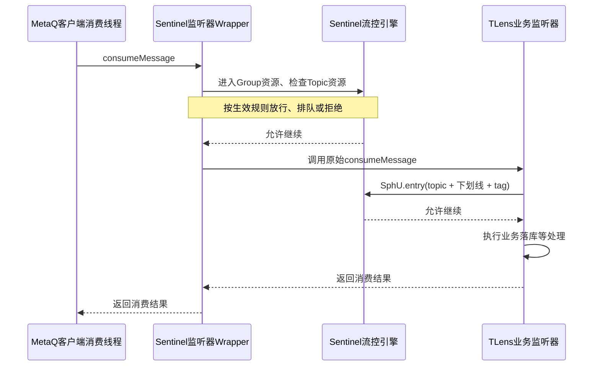
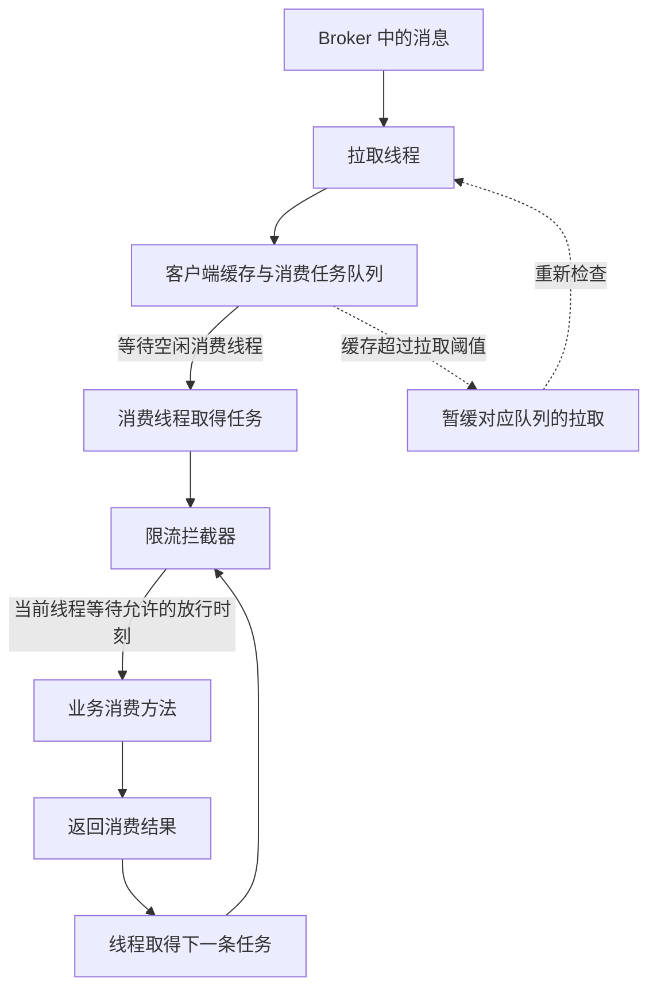

# MetaQ 消费 RT 升高排查：限流排队、线程池与消息堆积

## 1. 问题：消费 RT 贴近 400ms，是业务变慢了吗？

2026 年 11 月 4 日，TLens 的拉菲权益发放记录消费者出现以下现象：

- 消费 QPS 长时间维持在约 15600。
- 消费 RT 多次稳定在约 400ms。
- 流量下降后，消费 RT 随之回落。

对应资源为：

```text
Consumer Group：CID_tlens_lafite_benefit_issue_record
Topic：BP_ISSUE_RECORD_STRATEGY_88MEMBER
Tag：SUCCESS
```

截图中 09:12 的消费 QPS 为 **15599.97 次/秒**，RT 为 **399.41ms**。直觉上容易归因于“消息堆积，所以消费变慢”，但需要先拆开两个问题：

1. 消息在 Broker 或客户端任务队列中等了多久？
2. 消息已经交给消费线程后，线程被占用了多久？

消费 RT、业务执行时间、消息从发送到完成的端到端延迟，是不同口径。限流等待落在消费计时范围内时，即使业务方法很快，消费 RT 仍会显著升高。

> [!abstract] 本次结论
> 管控端明确配置了单机 50 QPS、匀速排队、最大排队时长 3000ms；消费速率贴近单机上限，RT 与 20 个线程持续饱和时的周转时间高度吻合。现有证据强烈支持“消费端排队限流抬高 RT”，但没有直接抓到故障时刻的线程等待栈，不能把 399.41ms 全部当作已测得的纯等待时间。

## 2. 查到的证据

### 2.1 流控规则明确启用了匀速排队

目标资源：

```text
metaq:consumer:CID_tlens_lafite_benefit_issue_record:BP_ISSUE_RECORD_STRATEGY_88MEMBER
```

普通规则详情接口只返回阈值等部分字段。进一步读取规则 **263223** 最近一次修改的审计记录 **1260996**，获得了完整配置；该记录日期为 2026 年 10 月 29 日。

```json
{
  "controlBehavior": 2,
  "maxQueueingTimeMs": 3000,
  "count": 50.0,
  "enable": true,
  "isCluster": false,
  "grade": 1
}
```

| 字段 | 含义 |
|---|---|
| `controlBehavior=2` | 匀速排队 |
| `maxQueueingTimeMs=3000` | 最大排队等待时长为 3 秒 |
| `count=50`、`grade=1` | QPS 阈值为 50 |
| `isCluster=false` | 单机限流 |
| `enable=true` | 规则启用 |

这是管控端最近修改记录中的明确配置，并非根据曲线猜测出的默认值；线上 JVM 实际加载的规则副本未直接读取。

### 2.2 实际消费速率贴近每机 50 QPS

09:10—09:12 抽查多台机器，消费速率均稳定在约 **49.98—50.02 QPS**。09:12 全组消费 QPS 为 **15599.97**，与截图一致。

跨机器都稳定在同一个整数附近，比单看总 QPS 的平台更能支持“存在单机限速”的判断。但不能仅用 `15600÷50` 就认定准确消费实例数，还要排除空闲实例、指标聚合和实例分配差异。

### 2.3 堆积与 RT 同期上升、回落

以下是同一消费组、同一 Topic 的历史堆积采样点：

| 时间（北京时间） | 堆积量 |
|---|---:|
| 09:08 | 62151 条 |
| 09:13 | 168568 条 |
| 09:18 | 164288 条 |
| 09:28 | 4279 条 |

同期消费 RT 从约 399ms 回落至约 157ms。它说明流量高峰下发生了积压，但相关性本身不能证明“Broker 中等待的时间被计入了这 400ms”。

更合理的解释是：到达流量超过限速后的完成能力，消费线程持续等待放行，RT 上升；未完成消息同时在 Broker 或客户端积累。

### 2.4 具体消费 Trace 也接近 400ms

09:10—09:12 抽样的三条目标消费 Trace 分别为 **399ms、400ms、400ms**，均成功。例如：

```text
TraceId：213cbc0817937546023572430dae9b
RPC 类型：METAQ_RCV
Consumer Group：CID_tlens_lafite_benefit_issue_record
消费耗时：399ms
结果：OK
```

这些样本证明 400ms 出现在具体消费调用上，而不仅是大盘聚合现象；它们不能证明整个时段没有失败或重试。

### 2.5 这个资源是谁创建的：MetaQ 客户端、Sentinel 适配器与业务埋点

**本次 `metaq:consumer:<group>:<topic>` 资源来自 Sentinel 的 MetaQ 适配器，在消费应用 JVM 的客户端回调链路上执行。** 它不是 Broker 端的限速配置，也不是 TLens 的 `SphU.entry(topic + "_" + tag)` 创建的资源。

这里可以进一步区分三个角色：

| 角色 | 职责 |
|---|---|
| MetaQ 客户端 | 拉取消息、管理消费线程、调用消息监听器、处理消费结果与重试 |
| Sentinel MetaQ 适配器 | 包装消息监听器，在调用业务回调前进入 Group/Topic 流控资源 |
| TLens 业务监听器 | 解析消息、执行落库业务，也可以通过自己的 `SphU.entry` 再定义业务资源 |

因此，说“MetaQ 消费链路接入了 Sentinel”是准确的；但不应据此说“这个限流资源写在 MetaQ 核心源码里”或“所有 MetaQ 客户端天然都有这条 50 QPS 规则”。本次找到的实现位于 `middleware-container/pandora-sar` 仓库的 **`sentinel/sentinel-adapter/sentinel-metaq-adapter` 模块**，Java 包为 `com.alibaba.csp.sentinel.adapter.metaq`。

#### 源码一：注册方法包装原始消息监听器

[`SentinelMetaRegistry.registerConsumerInterceptor`](https://code.alibaba-inc.com/middleware-container/pandora-sar/blob/f066b3ca541aeda869625549a353fcc672a1d157/sentinel/sentinel-adapter/sentinel-metaq-adapter/src/main/java/com/alibaba/csp/sentinel/adapter/metaq/SentinelMetaRegistry.java) 先获取 Consumer 的 Group 和原有 `MessageListener`，然后按并发/顺序消费类型替换成对应 Wrapper；已包装的监听器会跳过，避免重复注册。

并发消费分支的关键代码为：

```java
pushConsumer.registerMessageListener(
    new MessageListenerConcurrentlyWrapper(
        consumerGroup, (MessageListenerConcurrently) messageListener));
```

所以这里的“拦截器”具体是**对消息监听器进行包装**，不是在 Broker 上增加一段执行逻辑。

#### 源码二：真正的 Sentinel entry 在 Wrapper 中

[`MessageListenerConcurrentlyWrapper.consumeMessage`](https://code.alibaba-inc.com/middleware-container/pandora-sar/blob/f066b3ca541aeda869625549a353fcc672a1d157/sentinel/sentinel-adapter/sentinel-metaq-adapter/src/main/java/com/alibaba/csp/sentinel/adapter/metaq/listener/wrap/MessageListenerConcurrentlyWrapper.java) 的关键调用顺序如下，省略异常与清理分支：

```java
String groupResourceName = MetaAdapterGlobalConfig.getConsumerResource(consumerGroup);
groupEntry = SphU.entry(groupResourceName, ResourceTypeConstants.COMMON_MQ, EntryType.OUT);
entryTopics(consumerGroup, list);
return messageListener.consumeMessage(list, context);
```

其中 [`AbstractMessageListener.entryTopic`](https://code.alibaba-inc.com/middleware-container/pandora-sar/blob/f066b3ca541aeda869625549a353fcc672a1d157/sentinel/sentinel-adapter/sentinel-metaq-adapter/src/main/java/com/alibaba/csp/sentinel/adapter/metaq/listener/wrap/AbstractMessageListener.java) 会为消息进入 Topic 资源，并把 keys、tags、body 作为参数传入。该版本在 Topic 检查方法内退出 Topic entry，随后才执行原始业务回调；Group entry 则覆盖外层回调。**不能把这两个资源的统计耗时都直接解释成业务处理耗时。** Topic 层还有对本机发送消息是否参与流控的配置分支，不能忽略版本与配置差异。

[`MetaAdapterGlobalConfig.getConsumerResource`](https://code.alibaba-inc.com/middleware-container/pandora-sar/blob/f066b3ca541aeda869625549a353fcc672a1d157/sentinel/sentinel-adapter/sentinel-metaq-adapter/src/main/java/com/alibaba/csp/sentinel/adapter/metaq/config/MetaAdapterGlobalConfig.java) 默认以 `metaq:consumer:` 为前缀，用冒号拼接参数，形成两种资源：

```text
metaq:consumer:<consumerGroup>
metaq:consumer:<consumerGroup>:<topic>
```

这就解释了本文目标资源名的来源。Tag 不在这个普通 Topic 资源名中；需要按 Tag 区分时，适配器支持通过热点参数规则处理。资源前缀也有可覆盖的配置项，上面是默认命名。

#### 源码三：为什么业务没有手动注册，也可能接入了适配器

官方[MetaQ Sentinel 接入文档](https://mw.alibaba-inc.com/sentinel/quick-start/MetaQ) 明确区分两种方式：

- 手动创建 Consumer：先注册业务监听器，再调用 `SentinelMetaRegistry.registerConsumerInterceptor(consumer)`，最后启动 Consumer。
- Pandora autoconfiguration：无需业务手动调用注册方法；FAQ 进一步要求加载 `sentinel-tracer-metaq.xml`，并满足相应版本条件。TLens 的具体导入位置见下文 2.6 节。

源码中的 [`SentinelMetaInterceptor.invoke`](https://code.alibaba-inc.com/middleware-container/pandora-sar/blob/f066b3ca541aeda869625549a353fcc672a1d157/sentinel/sentinel-adapter/sentinel-metaq-adapter/src/main/java/com/alibaba/csp/sentinel/adapter/metaq/SentinelMetaInterceptor.java) 展示了自动集成的关键拦截逻辑：命中 `MetaPushConsumer.registerMessageListener` 后，先执行原方法，再调用 `SentinelMetaRegistry.registerConsumerInterceptor`。这个类说明了注册如何衔接；完整装配是否生效仍要结合运行版本、Bean/AOP 装配和实际注册结果验证。

TLens 拉菲记录消费者使用 `spring.metaq.consumers[3]` 配置，指定 Group、Topic、Tag 及 `latourBenefitIssueConsumer`。配置见 [application.properties](/Users/qiuhb/Project/tlens/tlens-start/src/main/resources/META-INF/autoconf/application.properties:58)，属于官方文档描述的自动配置接入方式。

仓库的另一套增强监听器还有明确的手动接入示例：[AbstractEnhancedMessageListener.afterPropertiesSet](/Users/qiuhb/Project/tlens/tlens-facility/src/main/java/com/taobao/tlens/metaq/listener/base/AbstractEnhancedMessageListener.java:328)，顺序为注册业务监听器、注册 Sentinel 包装、启动 Consumer。**这个示例属于另一套监听器，不能当成 `LatourBenefitIssueConsumer` 的直接调用路径。**

#### 与 TLens 自己的 `SphU.entry` 有什么区别

[AbstractConsumer.consumeMessage](/Users/qiuhb/Project/tlens/tlens-integrations/src/main/java/com/taobao/tlens/metaq/consumer/base/AbstractConsumer.java:62) 中还有业务自行定义的资源：

```java
String sentinalKey = topic + "_" + tag;
entry = SphU.entry(sentinalKey);
```

对本文消息，两者分别是：

```text
适配器 Topic 资源：
metaq:consumer:CID_tlens_lafite_benefit_issue_record:BP_ISSUE_RECORD_STRATEGY_88MEMBER

TLens 业务资源：
BP_ISSUE_RECORD_STRATEGY_88MEMBER_SUCCESS
```

它们是两个独立资源，命名和维度不同，可以分别配置规则。正常调用关系可以表示为：



图中展示放行路径。适配器遇到 `BlockException` 时进入 fallback；官方默认消费 fallback 抛出异常，让 MetaQ 进入重试处理，并不是继续执行业务回调。

最后还要区分：**自动注册资源，不等于自动创建本文的 50 QPS、3 秒匀速排队规则。** 适配器提供资源和流控执行入口；本文阈值来自前面查到的管控规则及审计记录。现有证据没有确认这条规则最初由谁、经哪个自动化流程创建，不能归因给某个业务开发者或中间件默认值。

> 源码核对边界：上述适配器源码固定到 `pandora-sar` 提交 `f066b3ca541aeda869625549a353fcc672a1d157`，用于说明实现机制；没有据此证明 11 月 4 日线上部署的二进制与该提交完全一致，也没有补齐该线上版本消费 RT 埋点与 Wrapper 的精确相对位置。原文关于 RT 归因的证据边界仍然成立。

### 2.6 结合 Sentinel FAQ 补充核对：接入条件、版本与拒绝开销

进一步读取[《消息 Notify, MetaQ 限流接入文档》](https://yuque.alibaba-inc.com/sentinel2c/sentinelfaq/kfoai7gu4ffmc827)，页面显示更新时间为 2025-11-04。它补充了简版接入说明没有展开的条件，也给出了规则选择建议。

#### 自动配置 Consumer，不等于 Sentinel 适配器无条件生效

该 FAQ 要求 Spring Boot 应用通过 `@ImportResource({"sentinel-tracer-metaq.xml"})` 加载 MetaQ 集成配置；普通 Spring 应用则在 XML 中导入同一文件。这个要求与“无需手动调用注册 API”可以同时成立：**Consumer 由自动配置创建，Sentinel 的包装逻辑仍需要相应集成配置完成装配。**

TLens 的 [Application.java:16](/Users/qiuhb/Project/tlens/tlens-start/src/main/java/com/taobao/tlens/Application.java:16) 已明确导入 `sentinel-tracer-metaq.xml`，不只是存在 `spring.metaq.consumers` 配置。因此当前本地源码能串起如下接入关系：

```text
Application 导入 sentinel-tracer-metaq.xml
  + spring.metaq.consumers 配置 Consumer 与业务监听器
  → Sentinel 集成拦截监听器注册
  → SentinelMetaRegistry 包装原始监听器
  → 消费时进入 metaq:consumer:<group> / <group>:<topic> 资源
  → 放行后调用 TLens 业务监听器
```

这补强了适配器接入的源码依据；仍不能只凭本地注解证明每台部署机器加载了完全相同的版本。可通过触发消费后查看 `localhost:8718/tree` 或管控端簇点链路核实注册结果。本文已有目标资源和规则证据，但没有新增读取线上 JVM 的加载配置。

#### 版本不能只看 API 是否存在

FAQ 给出的 Sentinel 安全接入基线是 **3.9.34 及以上**，指出更早版本可能在处理非 JSON 消息体时出现解析异常。它还给出 SAR 基线及当时推荐的升级版本；这些属于该页面的历史说明，不能当成今天统一适用的升级目标。

这与注册 API 标注从 3.9.33 开始提供并不矛盾：**API 已存在，不等于相关已知问题已修复。** 适配器读取 body 是为了支持热点参数限流，因此排查接入异常时也要检查消息格式和解析器，不能只检查业务监听器。

页面评论进一步提到插件未 deploy 时可能使用项目依赖版本，以及 `mq-spring-starter >= 2.0.11` 的配套条件。这些是评论层面的排查线索，不能直接套用为 TLens 当前依赖已经满足或不满足的结论；尤其不能把它与 `pandora-metaq-spring-boot-starter` 的 artifact、版本号直接等同。应核实实际加载的类、插件和依赖版本。

#### 为什么文档推荐排队等待，而不是快速失败

FAQ 明确推荐 MetaQ 资源优先使用排队等待：快速拒绝通过异常阻止本次消费，MetaQ 随后进入重投、重试处理，会额外增加消息传输、调度和应用开销。

两种模式的取舍是：

| 模式 | 主要代价 | 对当前案例的含义 |
|---|---|---|
| 排队等待 | 消费线程被等待占用，消费调用 RT 可能升高 | 约 400ms 且成功，不与限流生效矛盾 |
| 快速失败 | 业务回调暂不执行，触发默认 fallback 与消息重试 | 可能降低单次等待，却增加重试和端到端延迟 |

排队超过允许等待范围后仍可能被拒绝，因此“排队模式”不等于“永远不重试”。这个建议解释了当前策略选择的合理性，却不能证明单机 50 QPS 的容量设置合理；阈值仍需结合业务和下游承载能力评估。

## 3. 两处等待：先等线程，再等限流放行



**任务队列等待**：消息尚未分配到消费线程，在队列中等线程空闲。

**限流等待**：线程已经拿到消息，执行到限流拦截器，但还没获得放行资格。线程此时被占用，却不一定执行着业务代码，也不表示 CPU 在持续计算。

核对的开源 RocketMQ 实现是在消费任务进入线程执行后，围绕消费回调统计 `consumeRT`，不包含此前在任务队列里等待线程的时间。具体 MetaQ 版本中，限流拦截器与监控埋点的相对位置仍应以实际实现为准，不能把开源版本直接当成线上二进制的证明。

## 4. 线程数由谁控制？为什么是 20，而不是 64？

该消费者 QoS 返回：

```text
consumeThreadMin:20
consumeThreadMax:64
consumeMessageBatchMaxSize:1
```

消费线程池由 MetaQ 客户端管理。限流器控制放行速率，不根据 50 QPS 去创建“恰好 20 个线程”。

官方客户端参数说明明确：`consumeThreadMin` 对应线程池的 `coreSize`；由于内部任务队列接近无界队列，`consumeThreadMax` 通常没有实际扩容效果。达到核心线程数后，新任务优先入队；队列不满，就不会因为任务增加而自动向 64 扩容。自动调整线程池的 `AdjustThreadPoolNumsThreshold` 参数已弃用。

后续实时查询返回了 842 个客户端，它们上报的 `consumeThreatCnt` 都为 20。抽查机器在约 26.72 QPS、44.85ms RT 时，也仍上报 20。

这里必须保留两点边界：

- 上报线程数不能当成同时正在执行业务或等待限流的活跃线程数。
- 后续快照不能直接替代早上 09:12 的运行状态。

因此，不能单凭 `consumeThreadMin=20` 就断言故障时恰好有 20 个线程在等待；它是解释模型的配置依据。

## 5. 50 QPS 为什么对应约 400ms？

### 5.1 先算放行间隔

单条消息、匀速放行的情况下：

$$
\Delta=\frac{1000}{Q}\text{ ms}
$$

当 `Q=50`，相邻放行时刻间隔为 **20ms**。

假设消息充足，20 个线程持续参与消费，业务执行很快。可以把限流器理解为维护一张共享的放行时间表：

```text
线程1：预约   0ms 放行
线程2：预约  20ms 放行
线程3：预约  40ms 放行
……
线程20：预约380ms 放行
```

线程 1 完成后立即取得下一条消息，再次申请放行。此时后面 19 个位置已被其他线程预约，只能排到约 400ms。进入稳定状态后，同一个线程约每 400ms 完成一条，但整个线程池每 20ms 完成一条。

```text
每个线程：1 ÷ 0.4 = 2.5 条/秒
20个线程：20 × 2.5 = 50 条/秒
```

第一轮的等待并不全是 400ms；约 400ms 是持续饱和后的线程周转量级。具体消息还会受业务耗时、调度和放行实现影响。

### 5.2 用 Little 定律表达

$$
L=\lambda W
$$

其中，`L` 是平均被消息占用的消费线程数，`λ` 是实际完成吞吐量，`W` 是平均线程占用时间。三个量必须对应同一个统计范围；线程占用包括限流等待和业务执行。

当 `N` 个线程持续跑满、吞吐量达到限流值 `Q`，且消费 RT 基本覆盖线程占用阶段时：

$$
RT\approx\frac{N}{Q}\times1000\text{ ms}
$$

代入得到：

$$
RT\approx\frac{20}{50}\times1000=400\text{ ms}
$$

> [!note] 公式的条件
> `RT=N/Q` 不是普遍恒等式。消息不足、线程未跑满、业务本身已经成为瓶颈、批量消费或 RT 计时边界不同时，不能直接用配置线程数和限流阈值反推 RT。Little 定律里的 `L` 是平均在途数，不天然等于配置线程数。

设不含限流等待的平均业务耗时为 `S` 秒，在稳定、单条消费等简化条件下，可以估计能力边界：

$$
\lambda\lesssim\min\left(消息到达速率,\ Q,\ \frac{N}{S}\right)
$$

当限流是瓶颈时，平均限流等待量级可近似写成 `N/Q−S`。不能直接把 400ms 全算成纯等待。

## 6. 线程在等待时，会一直从 Broker 拉消息吗？

拉取与消费由不同线程负责。消费线程在限流器里等待时，拉取仍可继续，直到触发客户端缓存背压。

本次配置：

| 参数 | 值 | 含义 |
|---|---:|---|
| `pullInterval` | 0 | 正常拉取完成后，不额外增加固定拉取间隔 |
| `pullBatchSize` | 32 | 每个 Broker 队列单次最多拉取的条数 |
| `pullThresholdForQueue` | 1000 | 每个 Broker 队列在客户端的消息缓存阈值 |
| `consumeMessageBatchMaxSize` | 1 | 每个消费任务的消息批量大小 |

单队列缓存超过阈值时，客户端会暂缓拉取约 50ms，再检查是否可以继续。这是按队列生效的背压，不是整个线程池任务队列的统一容量；阈值检查和批量拉取也意味着 1000 并非严格不可超过的硬上限。

因此，十几万条堆积不表示都被拉进本地线程池。缓存触发背压后，后续消息会继续留在 Broker。具体队列长度不能仅凭线程数和 QPS 算出，`cachedMsgCount` 也不能直接等同于线程池待执行任务数。

## 7. 排队会触发什么超时？

| 类型 | 本次配置 | 超限语义 |
|---|---|---|
| Sentinel 最大排队等待 | `maxQueueingTimeMs=3000`，3 秒 | 预计等待超过允许时长时拒绝放行；默认 MetaQ 适配逻辑会让消息重试 |
| MetaQ 消费超时 | `consumeTimeout=15`，15 分钟 | 超时消息可能被重投；原消息处理不会因此被强制中断 |
| 下游调用超时 | 由具体下游客户端配置决定 | 与上述两种阈值独立 |

本次约 400ms 的消费 RT，远低于 15 分钟的消费超时；在排队时间约为这个量级的情况下，也落在 3 秒的排队允许范围内。但平均值不能排除个别消息等待更久。

消息留在 Broker 中等待，不等于已经执行中的消费方法超时。它首先体现为消息延迟和堆积增长。

### 最大排队时长必须大于 1/QPS 吗？

不是硬性要求。若 QPS 为 50，一个放行间隔为 20ms，而最大排队时长只设 10ms：

- 可以立即放行的请求仍会通过。
- 若距离可预约的放行时刻还有 5ms，可以等待后通过。
- 若预计需要等 15ms，则会被拒绝。

因此，小于一个放行间隔不会导致全部失败，但突发流量更容易被拒绝、重试。即使大于一个间隔，也不代表足以容纳多个消费线程同时预约。20 个线程、50 QPS 时，持续饱和的周转量级约为 400ms，需要按并发和业务波动留余量。3 秒表示最多允许等多久，不表示每条消息都要等 3 秒。

### 7.1 FAQ 的排队等待公式，应如何理解

上述 FAQ 的“超时时间的最佳设定”给出了下面的参考公式：

$$
T_{ref}(ms)=\max\left(20\times\frac{1000}{QPS},\ 3000\right)
$$

其中 20 来自文档采用的默认消费线程数，并不是所有 Consumer 的固定实际并发。结合本文已经查到的 20 个核心消费线程和 50 QPS，得到：

```text
20 × 1000 / 50 = 400ms
max(400ms, 3000ms) = 3000ms
```

当前 `maxQueueingTimeMs=3000` 与该参考值吻合。这能解释为何允许线程等待约 400ms 后成功放行；它不表示每条消息都等待 3 秒，也不能证明这条规则就是按照该公式创建的。

需要保留文档本身的表述边界：正文同时出现“不得超过”和“最小超时时间”，文字方向不一致；评论中的作者回复又表示没有统一上限，应看调用方可接受的延迟。因此，**不能把这个公式当成严格上限或必须满足的数学约束**。该段也没有给出具体配置属性名，本文按其排队等待上下文用作 Sentinel 等待预算参考，不将它等同于 MetaQ 的 `consumeTimeout`，更不能把 15 分钟消费超时改成公式中的 3 秒。

从前文的线程周转模型看，若实际参与限流的并发为 N，`N×1000/QPS` 可作为持续饱和时的周转时间量级；这是本文的模型推导，不是 FAQ 对任意配置给出的保证。等待预算还要考虑业务耗时、批量、多个资源规则、调度抖动和可接受延迟。线程数增加而阈值不变时，放行能力不会提高，等待压力反而可能增大。

对于本文案例，新文档进一步支持“排队控速可以带来成功消费下的 RT 升高”，并没有消除对故障时刻线程栈和实际 RT 计时边界的验证需求。

## 8. 如何建立可信的归因链？

本次证据可以分成两类：

| 已查到的事实 | 还需要进一步验证的细节 |
|---|---|
| 管控规则为单机 50 QPS、匀速排队、最大等待 3 秒 | 线上 JVM 当时实际加载的规则副本 |
| 多机消费速率贴近 50 QPS | 09:12 实际活跃、等待线程数 |
| 消费 RT 约 399—400ms | 该版本埋点与限流拦截器的精确相对位置 |
| 同期存在明显消息堆积 | 单条消息中限流等待与业务执行各占多少 |

稳妥的排查顺序是：先确认 RT 口径，再检查单机消费速率、流控完整配置、消费线程池与具体 Trace；最后用同一时段的堆积和业务耗时作交叉验证。

不能只凭“QPS 平台”和“RT 平台”归因，也不能看到成功消费就认定没有限流。匀速排队可以通过延长等待来控速，消息最终仍然成功；拒绝型限流计数为零，也不能排除排队限流正在工作。

调整时同样需要区分目标：只增加线程数，未必能突破 50 QPS，反而可能增加线程等待和排队压力；只延长最大排队时长，也不会提升限速后的完成能力。若目标是降低消息端到端延迟，应先确认下游容量，再评估阈值或消费实例分配；若目标是降低监控 RT，应把业务执行与限流等待分别观测。

## 9. 参考资料

- [消息 Notify, MetaQ 限流接入文档：版本、XML 接入与排队实践（内网）](https://yuque.alibaba-inc.com/sentinel2c/sentinelfaq/kfoai7gu4ffmc827)
- [[metaQ消息限流技术分享]]
- [[sentinel集群限流原理]]
- [Sentinel 流量控制官方说明](https://sentinelguard.io/zh-cn/docs/flow-control.html)
- [MetaQ Sentinel 限流接入文档（内网）](https://mw.alibaba-inc.com/sentinel/quick-start/MetaQ)
- [MetaQ 客户端参数解释（内网）](https://aliyuque.antfin.com/mqdevops/metaq_wiki/cmnixt)
- [Java ThreadPoolExecutor 官方说明](https://docs.oracle.com/javase/8/docs/api/java/util/concurrent/ThreadPoolExecutor.html)
- [RocketMQ 4.5.2 消费线程池及消费计时源码](https://github.com/apache/rocketmq/blob/rocketmq-all-4.5.2/client/src/main/java/org/apache/rocketmq/client/impl/consumer/ConsumeMessageConcurrentlyService.java)

本文案例证据来自 2026 年 11 月 4 日的实际排查及后续配置核对，整理于 2026 年 11 月 6 日；不代表服务当前运行状态。
