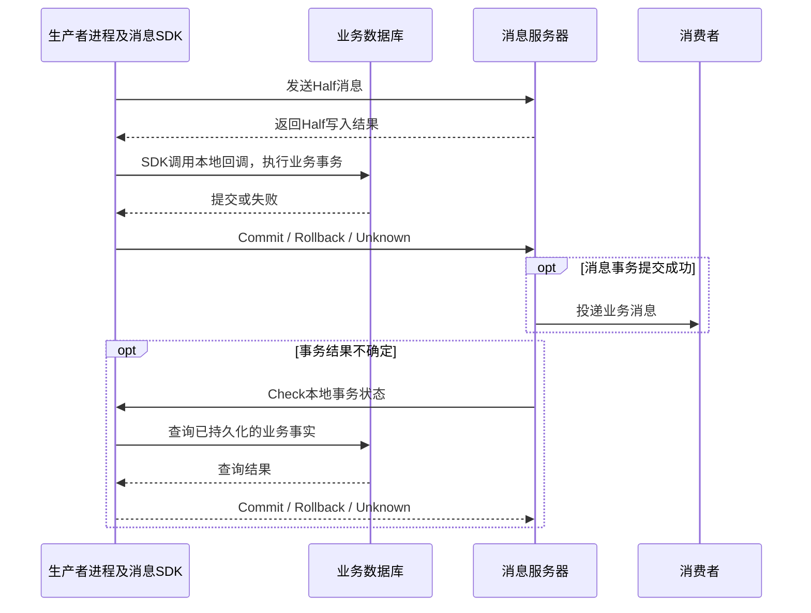

# Notify 与 MetaQ 原理：事务消息、存储模型、消费机制与 SQL 过滤

Notify 与 MetaQ 的差异，首先来自两种设计重心：**Notify 围绕每条消息的投递状态组织处理，MetaQ 围绕队列和消费位点组织处理。** 早期存储、过滤和消费模型因此不同，随后又通过共享存储内核、事务消息和属性过滤能力的迁移逐渐融合。

理解它们，需要把三层分开：生产端如何保证本地事务与事件发布一致，服务器如何存储消息及其状态，消费端如何取得消息并推进业务。不能用“Notify 是事务消息、MetaQ 是普通消息”，或者“Notify 是 MySQL、MetaQ 是文件”概括整个演进过程。

本文依据截至 2026-11-15 已读取的资料整理。ATA 文章多描述特定历史版本；Apache RocketMQ 的公开实现用于解释具体机制，不代表内部 MetaQ 所有版本完全一致。TP3 源码用于确认交易侧的调用和事务边界，不能据此推断当前线上全部流量的部署版本。

## 1. 两种核心抽象：消息状态与队列进度

| 维度 | Notify 的传统模型 | MetaQ 的典型模型 |
|---|---|---|
| 核心对象 | 消息、事务状态、目标订阅组、失败目标 | 消息队列、消息索引、消费位点 |
| 首次消费发起者 | Server 主动推送 | Client 主动拉取，常结合长轮询 |
| 完成情况 | 记录某条消息哪些订阅组尚未成功 | 消费组维护队列消费进度，失败消息另行处理 |
| 顺序性 | 传统投递模型不保证消费顺序 | 支持按队列组织的局部顺序 |
| 消费节奏 | Server 需要感知并调节投递能力 | Client 可按本地缓存和处理能力控制拉取 |
| 早期存储 | 可更新的 KV，曾采用 Oracle、MySQL | 追加日志和逻辑队列索引 |
| 后续演进 | 在队列存储上模拟 KV 更新、删除与恢复 | 增加事务消息、服务端属性过滤等能力 |

这些是设计侧重，不是永久不变的产品边界。[1]

### 1.1 Notify：维护一条消息还需要投递给谁

传统 Notify 的逻辑可以简化为：

```text
收到消息并持久化
    ↓
计算订阅关系和属性条件
    ↓
向目标订阅组并发推送
    ↓
收集消费结果
    ├─ 全部成功：逻辑删除消息
    └─ 部分失败：保存失败目标，后续重投
```

例如某条订单消息由 VCP、物流、营销三个订阅组消费，前两个成功、营销失败，服务器需要保留“营销尚未完成”的状态，而不是要求所有下游同时回滚。

KV 模型很自然地表达这类操作：以 messageId 为 key，value 中保存消息体、属性、是否提交、失败订阅组等信息。提交事务、更新失败目标、删除已完成消息，都体现为记录状态变化。[1]

### 1.2 MetaQ：消息写一次，各消费组沿队列前进

MetaQ 的典型存储结构包括：

```text
CommitLog
  保存完整消息，来自不同 Topic 的消息顺序追加
       ↑
ConsumeQueue
  按 Topic／队列组织的索引，记录消息位置和长度
       ↑
消费者按队列位点拉取
```

ConsumeQueue 不是为每个消费组复制一份完整消息，而是访问消息实体的索引。不同消费组维护各自进度，消息体可以复用。

队列结构适合顺序访问和大量积压。需要局部顺序时，还必须把相关消息路由到同一队列，并配合相应的消费机制；仅仅“使用 MetaQ”并不自动得到跨队列的全局顺序。[1]

## 2. 为什么推拉模型会影响流控和重试

假设生产端每秒产生 10,000 条消息，下游只能处理 1,000 条。

主动推送需要服务器调节投递速度。如果大量消息进入客户端队列，尚未开始处理就已超过消费超时，服务器会重投；原消息可能仍在队列中执行，重试消息又进一步增加负担，形成超时与重投互相放大的现象。

主动拉取更容易把积压留在服务器端，由客户端根据缓存水位、线程池能力控制接收量。长轮询也能提供较好的实时性，因此不能简单判断“Pull 一定慢，Push 一定快”。

Notify 团队在 2017 年总结中介绍了按订阅组维护动态窗口的重投算法，根据处理耗时、超时和繁忙结果调整投递量。**Push 不是不能流控，而是需要额外的反馈与调节机制。** 该文当时的重投限流和首次投递控制还有范围差异，不能直接当作所有后续版本的行为。[3]

2019 年维护者总结继续说明了 MetaQ Client 消费 Notify 消息的实践，目的包括改善流控、积压感知和消费超时问题。[5]

## 3. 从数据库到队列：Notify 的 KV over Queue

早期 Notify 的更新操作适合关系型数据库，但消息量、积压量增大后，大量更新、删除和恢复读取带来随机 IO 与成本压力。队列存储擅长追加和堆积，却不直接提供按消息修改、删除的接口。

Notify 3.0 的解决办法是把原始数据与操作分开：

| 队列 | 内容 |
|---|---|
| DQ：Data Queue | 原始消息数据 |
| OQ：Operate Queue | 针对原消息位点的更新、删除等操作 |

以下仅为概念示例，不是实际记录格式：

```text
DQ：
offset=100 → 消息 M，committed=false

OQ：
更新 offset=100，committed=true
更新 offset=100，失败订阅组=[A、B]
删除 offset=100
```

底层没有回头覆盖 DQ 中的旧字节，所有操作都转换为追加写。恢复时合并数据与操作记录，得到消息当前状态。

《揭秘 Notify3.0》给出了更具体的实现：数据和操作队列按相应的 Broker、queueId 配对；重试也有对应队列；恢复线程推进数据位点与操作位点，跳过已删除项，恢复需要重试的消息，对尚未确认的 Half 消息发起 Check。[2]

这里的“删除”是逻辑处理，不等于立即从文件中擦除原消息。**后台顺序扫描也不等于下游顺序消费。** 首次推送、不同服务器并发、处理耗时和重试仍可能改变业务观察到的顺序。

Notify 4.0 又进一步将 Notify 与 RocketMQ 存储内核放入同一进程，减少计算节点到存储节点的 RPC，并复用计算与 IO 资源。[3]

## 4. 事务消息：协调的是生产端本地事务与事件发布

普通消息有两个典型故障窗口：

```text
先提交数据库 → 进程宕机 → 消息没有发送

先发送可消费消息 → 数据库提交失败 → 下游处理了未成功的业务
```

事务消息引入待确认状态和回查机制：



### 4.1 回调留在生产者进程，不会发送给 Broker 执行

TP3 的调用形态是：

```java
notifyManager.sendMessage(message, callback);
```

message 发给消息系统；callback 是生产者进程中的 Java 对象，由发送侧 SDK 调用，用于执行本地事务。Broker 不会收到一段 Java 方法，更不会让 VCP 等消费者替 TP3 保存订单。

需要区分三种概念：

| 概念 | 作用 |
|---|---|
| 本地事务回调 | 在生产者进程中执行业务数据库事务 |
| 发送结果回调 | 告知发送成功或异常，本身不代表执行业务事务 |
| 消费 ACK | 消费者确认处理结果，与生产端消息事务提交不同 |

数据库已经提交后，消费者失败不会撤销生产者事务，消息提交确认失败也不能直接撤销已提交的数据库事务。消息系统通过重投和事务回查分别处理两个阶段的问题。[1][7]

### 4.2 已读 TP3 源码如何使用它

已核实路径中，创建和生效事件由 TP3 发送，buy2 负责流程编排并调用 TP3。

`TradeOrderManagerImpl.create` 构造 `create_done`，订单已为正常状态时还构造 `enable_done`，然后调用：

```java
notifyRepo.sendPackagedMsg(
    messages,
    () -> storeFacade.create(CreateParameter.of(orderInfo))
);
```

通用创单的 `TradeOrderCreateManager` 也采用相同形态。独立生效路径在 `OrderEnablerImpl` 的本地事务回调中，将主子订单从 `STATUS_INVISIBLE` 条件更新到 `STATUS_NORMAL`，再由事务消息机制协调生效事件。

业务回查器的判断分别是：创建事件查询订单存在；生效事件查询订单存在且状态为 `STATUS_NORMAL`。这些是**业务侧接口和回查源码已确认**的内容；完整 Notify SDK 内部实现尚未逐行核实。[10]

事务消息覆盖的是本地订单事务与事件发布的协调，不把支付宝支付、库存、优惠、积分、VCP 会员履约都纳入一个全局数据库事务。消费者依然需要幂等和状态校验。

## 5. append-only 如何防止消费者提前读到 Half 消息

“先发送 Half”指先写入 Broker，不是先投递业务消费者。

Apache RocketMQ 官方设计给出了一种明确实现：Half 消息进入内部 `RMQ_SYS_TRANS_HALF_TOPIC`，原业务 Topic 和 queueId 保存在属性中。业务消费者通过业务 Topic 的 ConsumeQueue 索引读取消息，不会扫描整个 CommitLog，因此 Half 虽已持久化，却没有出现在业务消费视图中。[7]

```text
Half写入内部队列
    ↓
等待生产端事务结果
    ├─ Commit：恢复业务Topic，按普通消息路径追加写入并建立消费索引
    ├─ Rollback：记录已处理，不生成可消费业务消息
    └─ Unknown：继续等待或回查
```

提交和回滚通过追加操作记录管理待确认消息，不要求覆盖 Half 原来的字节。恢复线程对照 Half 与 Op 队列推进处理。具体内部 MetaQ 版本是否完全采用该公开实现，需要另外核实。[7]

这也说明了四个不同概念：

| 概念 | 含义 |
|---|---|
| 消息已持久化 | Broker 已保存，可能尚不可投递 |
| 消息已提交 | 可以进入业务投递流程 |
| 文件顺序追加 | 存储写入方式，不代表业务消费顺序 |
| 消费有序 | 需要路由、队列、投递与消费执行共同保证 |

Half 的写入顺序不必等于最终可见顺序。A 先写入但迟迟未提交，B 后写入却先提交，不能仅凭发送先后要求消费者先看到 A。

## 6. SQL 过滤：关键是计算时机，不是 Push 或 Pull 天生优劣

这里的 SQL 过滤是对消息属性计算表达式，不是对消息存储执行数据库 SQL 查询。

### 6.1 Notify 为什么容易接入属性过滤

Notify 接收消息时，属性已在内存中，可以拿同一份属性计算订阅条件，得到目标组并立即推送。它仍可能需要计算很多组的表达式，节省的是重复读取、解码的开销，并不是把不同条件的判断全部变成一次。[1]

朴素的 Pull 过滤则可能在每个组拉取时重复执行：

```text
读取队列索引 → 读取消息记录 → 解码属性 → 计算本组SQL → 决定是否返回
```

如果一条交易消息有大量订阅组、实际匹配组很少，会产生大量无效读取和重复计算。过滤仍发生在 Broker，不是先把所有消息传给应用再过滤。[4]

### 6.2 优化：预计算加粗筛，最后精确判断

```text
写入／构建消费索引阶段：
拿到消息属性 → 计算已登记过滤条件 → 生成匹配组的布隆位图 → 保存扩展数据

消费组拉取阶段：
读取索引及位图
    ├─ 确定不匹配：跳过，不读完整消息
    └─ 可能匹配：读取属性，精确执行SQL，匹配才返回
```

公开实现 `CommitLogDispatcherCalcBitMap` 遍历 Topic 的过滤数据，对表达式返回 true 的组设置布隆位图。`ExpressionMessageFilter` 在 ConsumeQueue 层做粗筛，在 CommitLog 层执行属性精确判断。[8][9]

预计算并没有消除过滤成本，而是将部分成本前置，用额外存储换掉大量重复读取、解码。Pull 仍然保留客户端控制消费节奏的能力。

## 7. 布隆过滤器究竟存了什么

它编码的是：**某条消息匹配的消费组集合。** 布隆过滤器本身不执行 SQL。

例如三个组的条件分别为：

```text
A：bizCode = 'member'
B：amount > 100
C：sellerId = 123
```

消息属性为 `bizCode=member、amount=88、sellerId=123`，预计算得到匹配 A、C。

假设组 A 映射到位 2、7，B 映射到位 4、9，C 映射到位 7、10，将 A、C 对应位设为 1。B 拉取时发现对应位置有 0，可以立即排除；A 拉取时全部为 1，只能判断可能匹配，还要精确检查 SQL。

- 有一位为 0：在有效、兼容的预计算信息下，确定不属于匹配集合。
- 全部为 1：可能匹配，也可能由其他组的哈希碰撞造成。

新订阅、旧消息、位图缺失或参数不兼容时，不能把位图中的 0 直接当作 SQL 不匹配。源码会检查有效性，无法可靠粗筛时放行到精确判断，避免错误丢弃。[9]

## 8. 为什么不直接用精确 bitmap

可以，而且消费组数量少、编号稳定时，精确 bitmap 往往更简单、更快。布隆过滤器不是必然优于精确 bitmap。

设 G 是需要表示的消费组总数，n 是单条消息匹配的组数，p 是目标误判率。

| 方案 | 单条消息的理论空间 | 查询操作 |
|---|---|---|
| 精确 bitmap | G 位 | 读取该组独占的一位 |
| 布隆过滤器 | 最优参数下约 −n·ln(p)/(ln2)² 位 | 检查 k 位，可能误判 |

假设总共 300 个组，一条消息匹配 15 个：

| 方案 | 约占空间 | 位检查数 |
|---|---:|---:|
| 精确 bitmap | 38 字节 | 1 |
| 布隆，误判率1% | 18 字节 | 7 |
| 布隆，误判率5% | 12 字节 | 4 |

这是数学估算，不是实际 MetaQ 参数。系统通常按预期容量配置位图长度，不会逐条消息选择理论最优大小。n 超过设计容量，误判率会提高。

在 1% 误判率下，285 个不匹配组预计约有 2.85 个误判，需要额外精确检查。如果一条消息匹配 150 个组，同样目标误判率的布隆结构理论上约需 180 字节，反而明显大于精确 bitmap。

两种方案都需要预计算 SQL。精确 bitmap 设置和检查一位，布隆需要设置和检查多位；组的哈希位置可提前计算，但位操作与误判复核成本不会消失。

精确 bitmap 还需要稳定的“消费组→位编号”映射，处理扩容、删除、编号复用和历史位图兼容。布隆不需要每组独占一位，但也需要管理过滤数据版本和有效范围。映射问题是可解决的工程成本，不是精确 bitmap 无法使用的理由。

上述是方案成本分析。已读源码确认采用布隆方案，但没有找到设计者完整论证“为何不采用精确 bitmap”的材料，不能把推导写成已确认的原始选型理由。

## 9. 如何理解今天交易链路中的两套客户端

从演进过程看：

1. 早期 Notify 采用 KV 状态模型；MetaQ 采用队列模型。
2. Notify 3.0 使用 MetaQ 存储，以数据和操作队列模拟更新。
3. Notify 4.0 深度融合存储内核，同时 MetaQ 增加事务与属性过滤能力。
4. 后续支持通过 MetaQ Client 拉取消费 Notify 消息。[1][2][3][5]

2019 年团队总结说明，MetaQ 消费 Notify 的一条实现路径使用引用消息关联 Notify 消息，减少额外存储成本。2025 年发表的迁移案例又给出了交易消息从 Notify HEADER 订阅切到 MetaQ SQL92 订阅的配置和灰度实践。[5][6]

因此，下面的组合在架构上成立：

```text
TP3 使用 Notify 事务发送接口
    ↓
消息服务协调事务结果，底层使用融合后的存储能力
    ↓
VCP 使用 MetaQ 客户端筛选、拉取交易事件
    ↓
VCP 执行会员业务，失败重试并保证幂等
```

消费侧使用 MetaQ，并不会消除生产侧事务消息提供的协调保证。判断具体系统时，需要分别确认客户端版本、生产协议、Broker 实现、订阅过滤、重试与保留策略，不能只看类名或 Topic 名。

## 10. 阅读历史资料时需要排除的误解

- **事务消息不要求所有消费者同意后才提交生产者事务。** Half 未提交前不可被业务消费者消费，提交后的消费失败靠重试处理。
- **发送失败回调不等于本地事务回调。** `onSuccess/onException` 与 `doInTransaction` 的职责不同。
- **append-only 不等于无法维护状态。** 状态可由后续操作记录和可见性索引表达。
- **KV 不自动提供 FIFO。** Notify 的事件推送与重试顺序不能从存储主键推导。
- **Pull 可以做服务端 SQL 过滤。** 成本取决于计算时机、索引和预计算信息，而非只取决于推拉方向。
- **布隆过滤器不必然比 bitmap 省空间或计算。** 收益取决于匹配稀疏度、位图容量、误判率和元数据管理成本。
- **2017年的产品限制不等于当前能力。** 发表时间、更新时间和实际描述的版本需要分开判断。

检索中的《Notify 和 MetaQ 原理简析》将 Notify 事务描述为“消费者先同意，生产者再提交”，评论中已有人指出问题，该说法也与维护者文章及已读 TP3 调用不一致，本文不采用这一段作为依据。[11]

## 参考资料

1. [阿里消息中间件架构演进之路：notify和metaq](https://ata.atatech.org/articles/11000095456?spm=ata.23639746.0.0.781b20bf2IcCeD)，隆基，2017-11-29发表，页面显示2024-11-22更新。用于核心模型、历史演进、事务协议和融合背景。
2. [揭秘Notify3.0之metaq存储架构的妙用](https://ata.atatech.org/articles/11000074165)，庞永健，2017-03-07发表。用于数据／操作队列、恢复和重试实现。
3. [Notify 2017双十一总结——“喝茶”过的双十一](https://ata.atatech.org/articles/11000094672?layout=%2Fvelocity%2Flayout%2Fblank.vm)，庞永健，2017-11-20发表。用于动态窗口重投、超时放大和4.0架构。
4. [他强任他强，清风拂山岗——MetaQ 2017双11总结](https://ata.atatech.org/articles/11000094762?layout=%2Fvelocity%2Flayout%2Fblank.vm)，西古，2017-11-21发表。用于SQL过滤预计算和性能动机。
5. [2019年双十一消息中间件总结——Serverless相关实践](https://ata.atatech.org/articles/11000156700)，庞永健，2019-11-29发表。用于MetaQ消费Notify、引用消息及操作消息批量优化。
6. [Notify切Metaq实战](https://ata.atatech.org/articles/11020376033)，幻释，2025-02-20发表。用于实际过滤配置迁移、双开关切流与幂等；发表日期不等于案例中每项操作的执行日期。
7. [Apache RocketMQ：Transaction Message Design](https://apache.googlesource.com/rocketmq/+/HEAD/docs/en/Design_Transaction.md)。用于Half隔离、Commit恢复、Op记录与回查；HEAD是可变引用。
8. [CommitLogDispatcherCalcBitMap.java](https://github.com/apache/rocketmq/blob/develop/broker/src/main/java/org/apache/rocketmq/broker/filter/CommitLogDispatcherCalcBitMap.java)。用于预计算SQL与设置布隆位图；develop是可变分支。
9. [ExpressionMessageFilter.java](https://github.com/apache/rocketmq/blob/develop/broker/src/main/java/org/apache/rocketmq/broker/filter/ExpressionMessageFilter.java)。用于ConsumeQueue粗筛、CommitLog精确判断及有效性回退；develop是可变分支。
10. TP3已读源码：[TradeOrderManagerImpl](https://code.alibaba-inc.com/tradeplatform/tradeplatform3/blob/master/tp-server/src/main/java/com/alibaba/trade/fulfillment/manager/TradeOrderManagerImpl.java)、[TradeOrderCreateManager](https://code.alibaba-inc.com/tradeplatform/tradeplatform3/blob/master/tp-server/src/main/java/com/alibaba/trade/fulfillment/manager/TradeOrderCreateManager.java)、[OrderEnablerImpl](https://code.alibaba-inc.com/tradeplatform/tradeplatform3/blob/master/tp-server/src/main/java/com/taobao/trade/platform/tc/biz/create/OrderEnablerImpl.java)。核查摘要见[本地证据记录](/Users/qiuhb/Project/trade-transaction-analysis-2026-11-15/create-enable-findings.md)，用于业务侧发送、回调与事务边界，不代表已读取Notify SDK全部实现。
11. [Notify 和 MetaQ 原理简析](https://ata.atatech.org/articles/11000086698?spm=ata.23639746.0.0.781b20bf2IcCeD)，2017-07-24发表。仅用于说明资料冲突，不采用其中消费者参与生产事务提交的错误描述。
