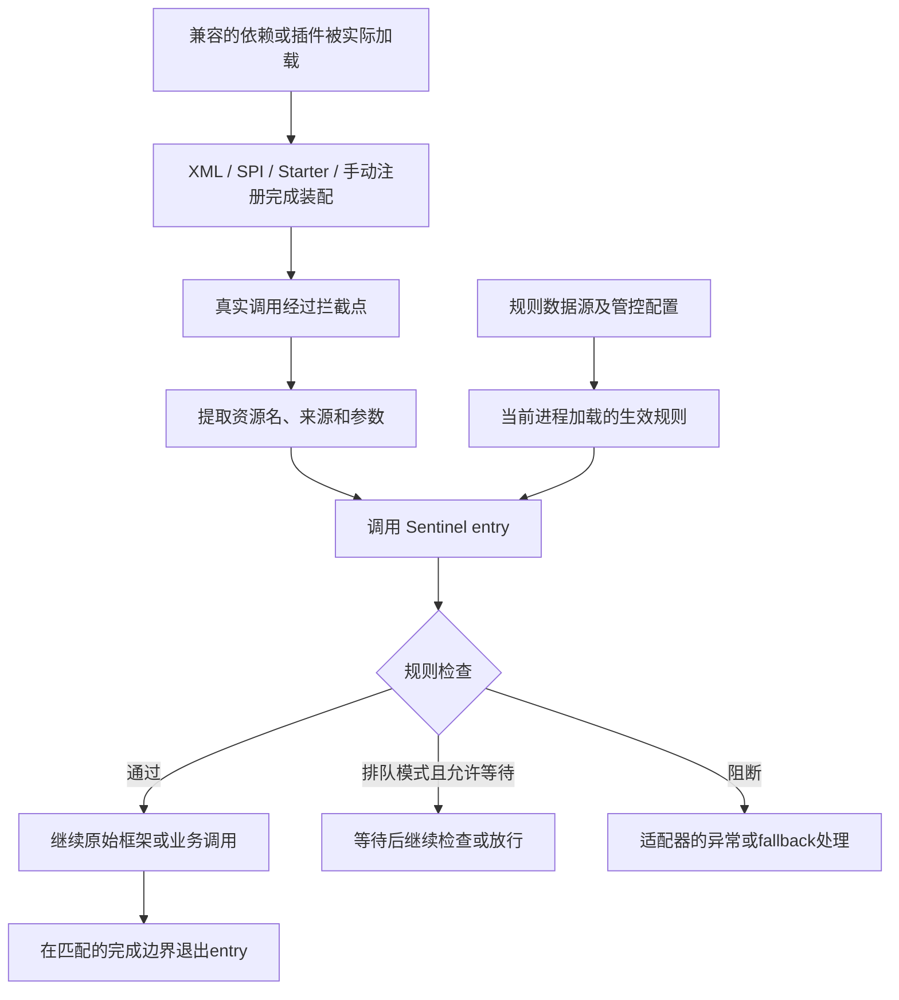
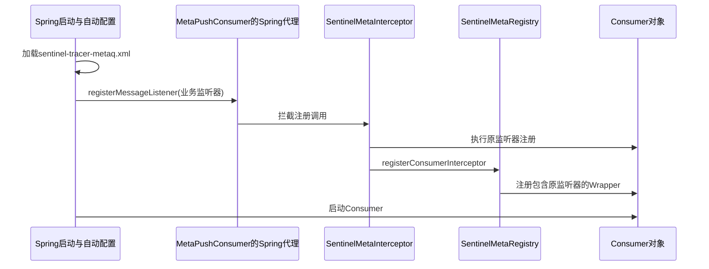
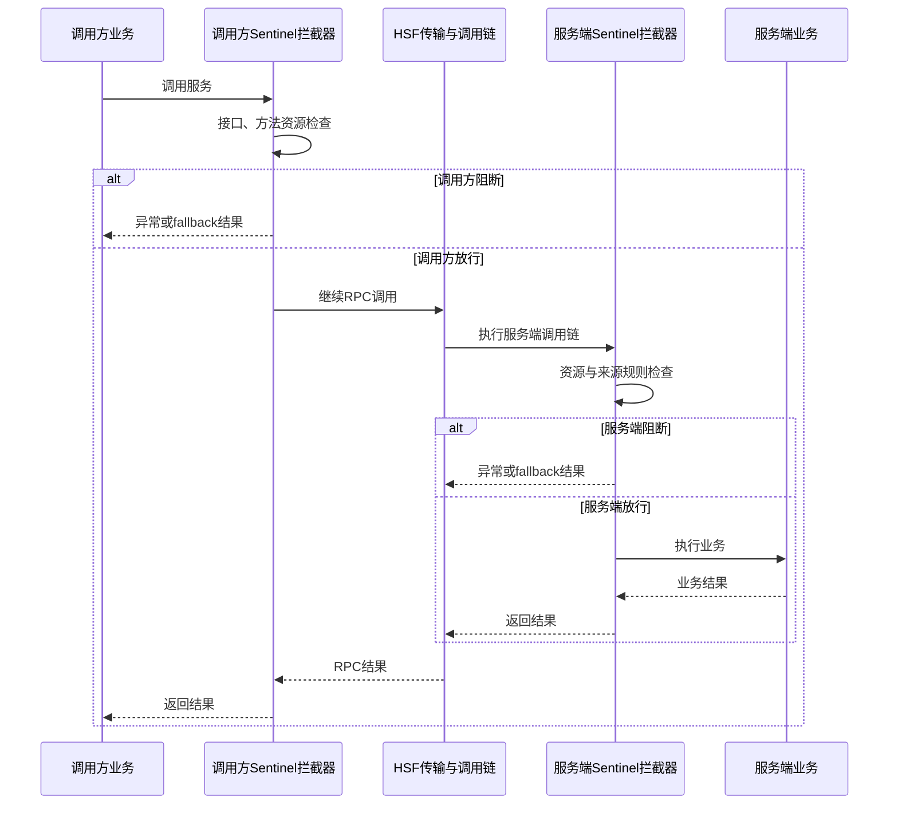

# Sentinel 中间件适配器如何生效：MetaQ、HSF 与其他框架的接入原理

Sentinel 对中间件的保护，通常通过运行在应用进程里的适配器完成：适配器利用框架的扩展点截获调用，提取资源名、来源和参数，进入 Sentinel 检查；通过后继续调用原逻辑，被拒绝则转换成框架能够处理的异常、响应或 fallback。

因此，判断“Sentinel 已生效”至少要分清三件事：**适配器已装配、实际调用已经过资源埋点、需要的规则已加载并命中。** 它们是三个不同的检查点。

本文以阿里内部 MetaQ、HSF 适配为主，补充 Servlet 和 MyBatis 两类实现。源码统一核对到 `middleware-container/pandora-sar` 提交 `f066b3ca541aeda869625549a353fcc672a1d157`；这用于说明机制，不代表某台机器当前加载的二进制必然与该提交相同。本文未修改业务代码或线上配置。

## 1. 先分清各个组件负责什么

| 组件 | 主要职责 | 不能由它单独推断的事情 |
|---|---|---|
| 中间件客户端或框架 | RPC、消息拉取与消费、HTTP 分发、SQL 执行等 | 使用框架就必然启用了 Sentinel |
| Sentinel 适配器 | 接入框架扩展点，生成资源，调用 Sentinel，处理阻断 | 自动为每个资源设置业务限流阈值 |
| Sentinel 核心 | 按生效规则执行流控、熔断等检查和运行统计 | 必然知道某个框架调用应如何返回失败 |
| Starter、Spring XML、SPI、Pandora 插件等 | 将相关实现加载、注册到调用路径 | 类在依赖树中出现就必然拦截到调用 |
| 管控端与规则数据源 | 配置、分发规则 | 管控端显示的规则必然已被所有 JVM 正确加载 |
| 应用业务 | 定义容量目标、配置规则、选择降级和重试语义 | 异步提交、超时或 fallback 能自动保证最终一致性 |

适配器中的 `SphU.entry(...)` 与业务手写的 `SphU.entry(...)` 本质上使用同一套保护入口。区别在于埋点由谁调用，以及资源如何定义。普通规则、热点参数规则、来源规则等还要满足各自的匹配条件。

## 2. 一个适配器生效的完整过程



资源名称、来源和参数决定规则匹配谁；entry 的进入和退出位置决定统计覆盖什么阶段；阻断后的处理决定框架如何看待这次调用。

没有匹配的限制规则时，埋点仍可能承担统计作用。资源出现在簇点链路中，说明相关埋点被执行过，不能据此认定某条阈值规则已经命中。

“自动接入”也不是一种统一的技术实现。HSF 可以通过扩展发现机制装配拦截器，MetaQ 可以通过 Spring 代理加入监听器包装，Servlet 依赖过滤器链，MyBatis 则依赖插件注册。

## 3. MetaQ：Spring 代理加入监听器包装

### 3.1 代码属于 Sentinel 的 MetaQ 适配模块

本次核实的模块路径为：

```text
sentinel/sentinel-adapter/sentinel-metaq-adapter
Java包：com.alibaba.csp.sentinel.adapter.metaq
```

消费保护在应用 JVM 的 MetaQ 客户端回调链上执行。这里的 `metaq:consumer:` 资源不应解释成 Broker 中的一条内置限速逻辑，也不意味着 MetaQ 核心代码与 Sentinel 适配模块是同一个组件。

### 3.2 手动接入：先注册业务监听器，再包装，最后启动

官方接入方式的关键顺序为：

```java
consumer.registerMessageListener(businessListener);
SentinelMetaRegistry.registerConsumerInterceptor(consumer);
consumer.start();
```

[`SentinelMetaRegistry`](https://code.alibaba-inc.com/middleware-container/pandora-sar/blob/f066b3ca541aeda869625549a353fcc672a1d157/sentinel/sentinel-adapter/sentinel-metaq-adapter/src/main/java/com/alibaba/csp/sentinel/adapter/metaq/SentinelMetaRegistry.java) 获取原监听器后，根据消费类型注册 `MessageListenerConcurrentlyWrapper` 或 `MessageListenerOrderlyWrapper`。若监听器已经被包装，则跳过，避免重复注册。

这里名为“注册拦截器”的操作，实际是将原始监听器替换成保存了原监听器引用的 Wrapper，后者在放行后继续调用原监听器。

### 3.3 自动配置接入：XML → Spring 代理 → 注册方法拦截 → Wrapper

[`sentinel-tracer-metaq.xml`](https://code.alibaba-inc.com/middleware-container/pandora-sar/blob/f066b3ca541aeda869625549a353fcc672a1d157/sentinel/sentinel/src/main/resources/sentinel-tracer-metaq.xml) 明确声明了：

- 拦截器 Bean：`SentinelMetaInterceptor`。
- 需要代理的类型：`com.taobao.metaq.client.MetaPushConsumer`。
- 自动代理创建器：`BeanTypeAutoProxyCreator`，为目标 Bean 配置上述拦截器。

[`SentinelMetaInterceptor.invoke`](https://code.alibaba-inc.com/middleware-container/pandora-sar/blob/f066b3ca541aeda869625549a353fcc672a1d157/sentinel/sentinel-adapter/sentinel-metaq-adapter/src/main/java/com/alibaba/csp/sentinel/adapter/metaq/SentinelMetaInterceptor.java) 检查当前调用是否为 Consumer 的 `registerMessageListener`，先执行原注册，再调用 `SentinelMetaRegistry.registerConsumerInterceptor`。



所以“无需业务手动调用 Sentinel 注册 API”仍有装配前提：相关 XML 或等价集成确实加载，目标 Consumer 被管理并经过相应代理调用，版本之间兼容。

TLens 的 [Application.java:16](/Users/qiuhb/Project/tlens/tlens-start/src/main/java/com/taobao/tlens/Application.java:16) 已导入 `sentinel-tracer-metaq.xml`；[消费者配置](/Users/qiuhb/Project/tlens/tlens-start/src/main/resources/META-INF/autoconf/application.properties:58) 指向 `latourBenefitIssueConsumer`。这比单凭依赖存在更能说明其接入路径。

### 3.4 消费时真正执行什么

[`MessageListenerConcurrentlyWrapper.consumeMessage`](https://code.alibaba-inc.com/middleware-container/pandora-sar/blob/f066b3ca541aeda869625549a353fcc672a1d157/sentinel/sentinel-adapter/sentinel-metaq-adapter/src/main/java/com/alibaba/csp/sentinel/adapter/metaq/listener/wrap/MessageListenerConcurrentlyWrapper.java) 的关键逻辑是：

```text
进入Group资源
  → 对消息进行Topic资源检查
  → 调用原始业务监听器
  → 返回消费结果、退出Group资源
```

默认资源格式由 [`MetaAdapterGlobalConfig`](https://code.alibaba-inc.com/middleware-container/pandora-sar/blob/f066b3ca541aeda869625549a353fcc672a1d157/sentinel/sentinel-adapter/sentinel-metaq-adapter/src/main/java/com/alibaba/csp/sentinel/adapter/metaq/config/MetaAdapterGlobalConfig.java) 定义：

```text
metaq:consumer:<consumerGroup>
metaq:consumer:<consumerGroup>:<topic>
```

Tag 不拼入默认 Topic 资源名，而是作为热点参数传递。热点参数索引分别为 keys=0、tags=1、body=2；文档说明热点保护适用于 Topic 资源。

需要注意 [`AbstractMessageListener.entryTopic`](https://code.alibaba-inc.com/middleware-container/pandora-sar/blob/f066b3ca541aeda869625549a353fcc672a1d157/sentinel/sentinel-adapter/sentinel-metaq-adapter/src/main/java/com/alibaba/csp/sentinel/adapter/metaq/listener/wrap/AbstractMessageListener.java) 的统计边界：该版本在 Topic 检查方法内就退出 Topic entry，业务监听器随后才执行。不能把 Topic 资源的 RT、Group 资源的 RT 和 MetaQ 消费 RT 视为完全相同的口径。

默认消费 fallback 会通过异常让 MetaQ 进入重试处理。排队等待可减少快速拒绝造成的重投开销，但会占用执行检查的消费线程；超过允许等待范围仍可能被拒绝。最终行为还取决于生效规则、fallback 和客户端版本。

### 3.5 生产者的接入方式有所不同

同一个 Registry 的 `registerProducerForbidden` 会向 Producer 注册 `SentinelForbiddenHook`。在读取到的 Spring 集成中，`SentinelMetaInterceptor.postProcessAfterInitialization` 会对识别出的 Producer Bean 执行该注册。

因此，MetaQ 消费侧是监听器包装，生产侧利用发送检查 Hook。不能把消费 Wrapper 的执行方式直接套用到生产者，更不能认为发送被拒绝后消息已经被 Broker 接收。

### 3.6 框架资源与业务资源可以同时存在

TLens [AbstractConsumer.java:62](/Users/qiuhb/Project/tlens/tlens-integrations/src/main/java/com/taobao/tlens/metaq/consumer/base/AbstractConsumer.java:62) 另外调用了 `SphU.entry(topic + "_" + tag)`。因此一条消费可能先经过适配器资源，再经过业务自行定义的资源：

```text
适配器：metaq:consumer:CID_tlens_lafite_benefit_issue_record:BP_ISSUE_RECORD_STRATEGY_88MEMBER
业务：BP_ISSUE_RECORD_STRATEGY_88MEMBER_SUCCESS
```

它们名称和维度不同，规则分别匹配。看到第一种资源的限流，不能归因于第二处代码创建了它。

## 4. HSF：扩展发现机制加入 RPC 调用链

### 4.1 为什么引入适配依赖后可以自动接入

HSF 接入文档说明，Sentinel 3.x 引入对应依赖可自动接入；2.x 需要旧的 XML 接入方式。这里的“自动”有可查的扩展声明，并非 Sentinel 无条件拦截所有 Java 方法。

`sentinel-hsf-adapter/src/main/resources/META-INF/services` 中存在两个扩展文件：

| 扩展文件 | 声明的实现 |
|---|---|
| `com.taobao.hsf.invocation.InvocationHandlerInterceptor` | `SentinelHsfProviderInterceptor` |
| `com.taobao.hsf.invocation.SyncInvocationHandlerInterceptor` | `SentinelHsfConsumerInterceptor` |

[服务端扩展声明源码](https://code.alibaba-inc.com/middleware-container/pandora-sar/blob/f066b3ca541aeda869625549a353fcc672a1d157/sentinel/sentinel-adapter/sentinel-hsf-adapter/src/main/resources/META-INF/services/com.taobao.hsf.invocation.InvocationHandlerInterceptor)、[调用方扩展声明源码](https://code.alibaba-inc.com/middleware-container/pandora-sar/blob/f066b3ca541aeda869625549a353fcc672a1d157/sentinel/sentinel-adapter/sentinel-hsf-adapter/src/main/resources/META-INF/services/com.taobao.hsf.invocation.SyncInvocationHandlerInterceptor)。

HSF 通过相应扩展发现和装配机制将实现加入调用链。类加载可见性、依赖兼容性及具体框架版本仍是必要条件，不能只检查 JAR 是否下载到了本地。

### 4.2 调用方和服务端分别保护

[`SentinelHsfConsumerInterceptor`](https://code.alibaba-inc.com/middleware-container/pandora-sar/blob/f066b3ca541aeda869625549a353fcc672a1d157/sentinel/sentinel-adapter/sentinel-hsf-adapter/src/main/java/com/alibaba/csp/sentinel/adapter/hsf/SentinelHsfConsumerInterceptor.java) 先进入接口、方法资源，通过后执行 `next.invoke`。

[`SentinelHsfProviderInterceptor`](https://code.alibaba-inc.com/middleware-container/pandora-sar/blob/f066b3ca541aeda869625549a353fcc672a1d157/sentinel/sentinel-adapter/sentinel-hsf-adapter/src/main/java/com/alibaba/csp/sentinel/adapter/hsf/SentinelHsfProviderInterceptor.java) 先解析资源和来源、进入 Sentinel 检查，再执行 `delegate.invoke`。



调用方限制当前应用的外调，服务端保护当前服务。两端是各自应用中的资源与规则，不是“只要调用方通过，服务端就一定通过”。调用方限制在继续远程调用之前，服务端检查则已经处于收到请求后的执行链。

不能仅凭服务端拦截发生在业务方法之前，就断言它一定发生在 HSF 业务线程池分配之前。是否能保护线程池入口，需要结合实际调用链顺序验证。

### 4.3 默认资源、来源和拒绝结果

默认资源为接口全名和接口方法签名：

```text
com.example.FooService
com.example.FooService:sayHello(java.lang.String,long)
```

接口资源可约束该接口下所有方法的合计流量；方法资源传入调用参数，可用于相应热点保护。文档说明默认不区分 version 和 group，同应用同时消费和提供同名服务时还可能混合统计，需要按实际场景自定义区分。

服务端可以解析调用方来源，文档说明优先使用 `SENTINEL_ORIGIN` attachment，再使用 HSF 调用方应用名。来源参与匹配不等于它天然是经过认证、不可伪造的用户身份，不能拿它代替权限校验。

阻断后进入 provider/consumer fallback。[默认实现](https://code.alibaba-inc.com/middleware-container/pandora-sar/blob/f066b3ca541aeda869625549a353fcc672a1d157/sentinel/sentinel-adapter/sentinel-hsf-adapter/src/main/java/com/alibaba/csp/sentinel/adapter/hsf/fallback/DefaultHsfFallback.java) 产生限流异常，[FallbackUtils](https://code.alibaba-inc.com/middleware-container/pandora-sar/blob/f066b3ca541aeda869625549a353fcc672a1d157/sentinel/sentinel-adapter/sentinel-hsf-adapter/src/main/java/com/alibaba/csp/sentinel/adapter/hsf/fallback/FallbackUtils.java) 将结果或异常包装成 HSF 响应。业务可以注册自定义 fallback，但必须满足接口返回值和业务语义。

HSF 是否继续重试需要检查 RPC 策略和业务代码，不能直接套用 MetaQ 的消息重投逻辑。

## 5. 其他框架：同样的保护入口，不同的注册机制

### 5.1 Servlet：在 Filter 中包围请求处理

[`CommonFilter.doFilter`](https://code.alibaba-inc.com/middleware-container/pandora-sar/blob/f066b3ca541aeda869625549a353fcc672a1d157/sentinel/sentinel-adapter/sentinel-web-servlet/src/main/java/com/alibaba/csp/sentinel/adapter/servlet/CommonFilter.java) 展示的过程为：

```text
解析请求路径并按需归一化
  → 解析来源
  → SphU.entry(路径)
  → 按配置额外进入 HTTP方法:路径 资源
  → chain.doFilter
  → finally退出entry与Context
```

阻断时调用 URL block handler 生成响应。仅引入包含 `CommonFilter` 的 JAR 不等于它已在 Servlet 容器的过滤器链中注册，注册可以由应用配置或配套自动配置完成。

路径归一化也影响是否真正控制到同一类请求。例如 `/users/1` 与 `/users/2` 若分别生成资源，可能造成资源数量膨胀和规则匹配分散，应按框架能力归一为同类路径。是否返回 429、JSON 错误或其他内容取决于 handler，不能从“使用 Sentinel”直接推断 HTTP 返回格式。

### 5.2 MyBatis：在 Executor 插件中拦截 query/update

[`SentinelMyBatisMapperInterceptor`](https://code.alibaba-inc.com/middleware-container/pandora-sar/blob/f066b3ca541aeda869625549a353fcc672a1d157/sentinel/sentinel-adapter/sentinel-mybatis-adapter/src/main/java/com/alibaba/csp/sentinel/adapter/mybatis/SentinelMyBatisMapperInterceptor.java) 通过 `@Intercepts` 声明目标为 MyBatis `Executor.query`、`Executor.update` 的指定签名，使用 MappedStatement 的 ID 构造资源：

```text
mybatis:<MappedStatement.id>
```

其核心顺序为 `SphU.asyncEntry → invocation.proceed → entry.exit`。这里使用 AsyncEntry，并不代表 SQL 被适配器自动改成了后台异步执行；真正执行仍由 `invocation.proceed()` 完成。

这个实现需要注册进实际使用的 MyBatis 配置；`@Intercepts` 声明本身不等于 Spring 或 MyBatis 会无条件扫描并安装插件。多数据源或多个 SqlSessionFactory 场景，应确认目标工厂实际装配了它。

被拒绝时，它抛出 `MyBatisSentinelBlockException`，后续是否回滚由事务边界和异常处理决定。这是在应用侧保护 Mapper 调用，不是给数据库服务端安装了一个全局限流器，也不能自动中止已经开始执行的任意 SQL。

### 5.3 其他适配模块同样要核实具体实现

本次读取的适配器目录还包含 Apache Dubbo、HttpClient、Reactor、Spring WebMVC、Tair 等模块。模块存在说明项目提供相关集成代码，不能证明 TLens 已启用全部适配，更不能推断它们共享同一种 XML、SPI 或默认规则。

对于这些框架，应继续查各自入口类、注册位置、资源格式和拒绝转换逻辑。尤其是异步、响应式场景，要核实 entry 是否覆盖到 Future 完成、Publisher 终止等真正完成边界；仅在“提交后立即退出”就无法统计完整的后续工作。

## 6. 放在一起对比

| 场景 | 本文核实的拦截点 | 典型装配方式 | 资源例子 | 阻断后的处理 |
|---|---|---|---|---|
| MetaQ 消费 | MessageListener Wrapper | 手动注册，或 XML + Spring 代理包装 | `metaq:consumer:<group>:<topic>` | 默认异常进入消费重试处理 |
| MetaQ 发送 | Producer 发送检查 Hook | Registry 注册；Spring集成可处理 Producer Bean | 默认前缀 `metaq:producer:` | 阻止本次发送继续；具体异常与调用方处理需核实 |
| HSF | Consumer/Provider 调用链拦截器 | 已核实的 SPI 扩展声明；旧版有 XML 方式 | 接口名、接口名:方法签名 | 异常或自定义 RPC fallback |
| Servlet | Filter | 容器注册或配套自动配置 | URL，可增加 HTTP 方法 | URL block handler 生成响应 |
| MyBatis | Executor 插件 | MyBatis 配置注册或配套集成 | `mybatis:<statementId>` | 包装成 MyBatis 限流异常 |

这些默认通常在应用侧生效。限制是单机还是集群，取决于规则模式及相应集群组件是否正确部署，不能由资源名字或中间件类型判断。

## 7. 为什么“有适配器”仍可能没有预期效果

可以按调用路径逐层定位，避免只在管控页面反复修改阈值。

| 现象 | 优先检查 |
|---|---|
| 依赖存在，资源从未出现 | 类是否实际加载，XML/SPI/插件是否注册，是否真实触发调用，是否走旁路或本地调用分支 |
| 有资源，目标规则不限制 | 完整资源名、所在应用与单元、机器生效副本、规则开关、来源和热点参数、单机/集群模式 |
| 配了方法规则，其他版本也受影响 | 默认资源是否省略 version/group，多个入口是否复用了同名资源 |
| 监控没有拒绝，但 RT 上升 | 是否使用匀速排队，等待是否被计入该层 RT，是否同时存在其他资源检查 |
| 拒绝很多，消息迟迟处理不完 | 重试流量是否放大，阈值是否低于必要处理能力，fallback 是否改变重试语义 |
| 限流后线程仍然很多 | 已放行任务是否阻塞，等待发生在哪个线程，线程数是配置、活跃数还是采样窗口聚合 |
| 异步任务 RT 很短但整体很慢 | entry 是否只覆盖提交阶段，是否匹配真实异步完成边界 |

判断时最好保留“框架注册源码 → 实际加载类和版本 → 当前资源 → 当前规则 → 命中结果与业务后果”的证据链。

## 8. 与线程池、事务、重试的关系

**限流限制新调用继续执行，不负责让所有已执行任务及时结束。**

QPS 规则通过后，handler、数据库或 RPC 仍可能长时间阻塞。匀速排队还可能占住执行 entry 的线程，所以不能用限流替代连接池隔离、调用超时、总并发限制和有界等待。

同样，默认 fallback 主要负责把 Sentinel 的阻断转换成框架结果，不自动完成业务补偿。MetaQ 的重试、HSF 的重试、数据库事务回滚是不同机制：

- 消息重试要求业务能处理重复消费，不保证当前被卡住的线程立即退出。
- RPC 重试要求识别失败性质和幂等边界，不能把所有异常都当成安全重试。
- 本地事务回滚不能撤销已发送的 MQ 或已完成的远程副作用。
- 自定义 fallback 返回正常对象后，业务必须能识别它是否代表真正成功，不能制造“监控成功、业务未完成”的结果。

## 9. 版本与结论边界

MetaQ FAQ 指出 Sentinel 3.9.34 之前存在非 JSON 消息体解析问题；API 从 3.9.33 提供，不等于该版本已修复所有已知问题。HSF FAQ 给出 HSF 3.x 与 Sentinel 3.9.27 及以上的兼容要求，并说明部分本地调用、Mesh 和定制 SAR 场景有差异。这些是相关文档的版本条件，不是今天统一的升级目标。

Pandora 插件是否 deploy、项目依赖是否覆盖、框架扩展是否采用另一种适配路径，都可能影响实际生效实现。应以当前 JVM 实际加载类、版本和调用栈核实，不能单凭 POM、旧文档或仓库主干推断。

此外，`EntryType.IN/OUT` 是 Sentinel 的资源分类参数，不宜仅凭它来判断“这是 provider 还是 consumer”。例如本文核实的 HSF provider 实现中，接口 entry 使用 OUT、方法 entry 使用 IN；准确含义需要结合整个适配逻辑理解。

## 10. 参考资料

- [消息 Notify, MetaQ 限流接入文档](https://yuque.alibaba-inc.com/sentinel2c/sentinelfaq/kfoai7gu4ffmc827)：XML 接入要求、版本问题、热点参数、fallback 与排队实践。
- [HSF 服务限流接入](https://aliyuque.antfin.com/sentinel2c/sentinelfaq/fzynf3)：自动埋点、资源格式、version/group、来源与版本兼容说明。
- [MetaQ 官方接入简版](https://mw.alibaba-inc.com/sentinel/quick-start/MetaQ)。
- [本文核实的适配器源码目录](https://code.alibaba-inc.com/middleware-container/pandora-sar/tree/f066b3ca541aeda869625549a353fcc672a1d157/sentinel/sentinel-adapter)。
- [MetaQ 消费 RT 升高排查：限流排队、线程池与消息堆积](/Users/qiuhb/Project/Blogs/分布式与微服务/MetaQ消费RT升高排查：限流排队、线程池与消息堆积.md)。
- [异步事务长时间阻塞：从后置处理到系统级故障](/Users/qiuhb/Project/Blogs/编程语言/Java/异步事务长时间阻塞：从后置处理到系统级故障.md)。
