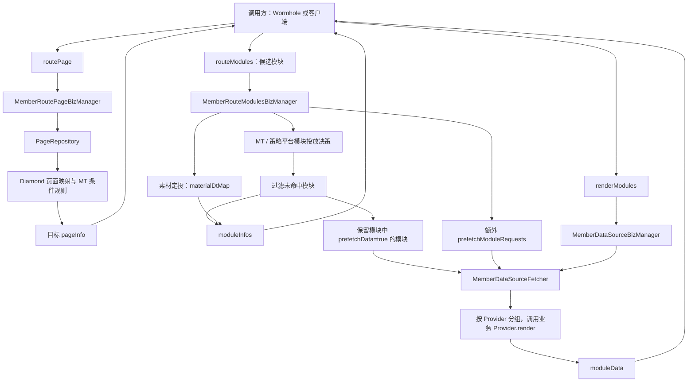
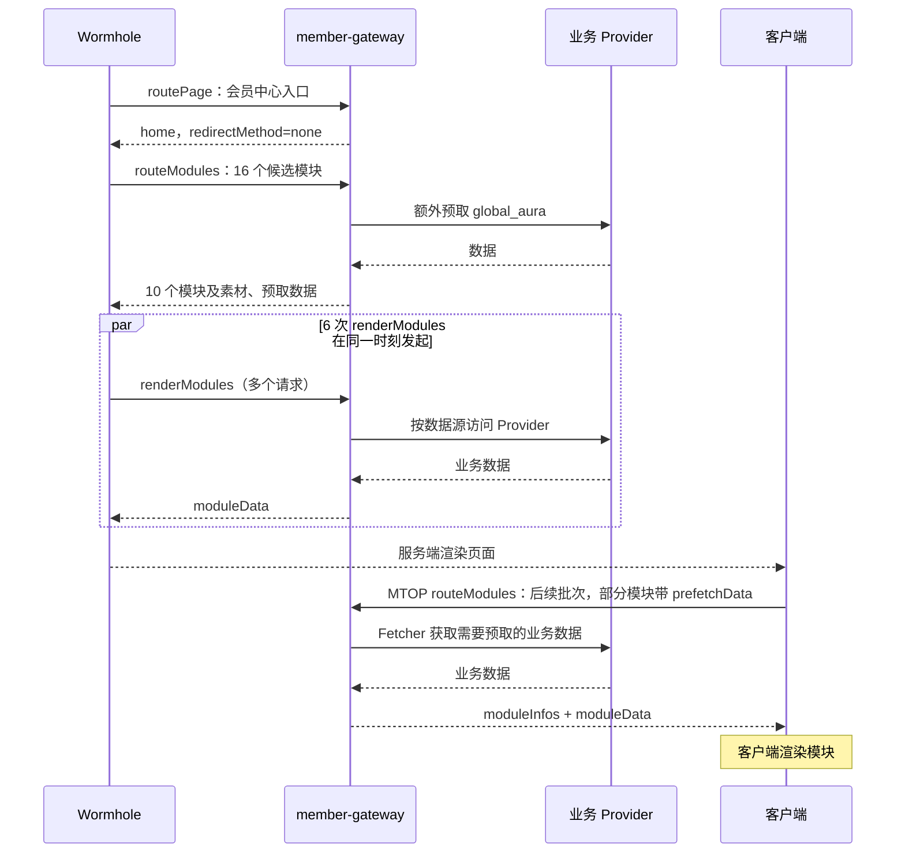

# 会员中心页面路由、模块路由与数据渲染调用链

> 核对日期：2026-11-09。依据 member-gateway 源码、生产页面路由配置，以及会员中心真实访问 Trace。本文区分接口能力与具体页面的调用方式，不把某次访问的行为视为所有页面的固定协议。

## 1. 三类接口的职责与关系

| 接口 | 决策或处理对象 | 输入重点 | 输出重点 |
| --- | --- | --- | --- |
| `routePage` | 当前用户进入哪个页面 | 用户、当前页面、URL 参数、设备信息 | `pageInfo`：页面 ID、URL、内部路径、跳转方式 |
| `routeModules` | 本批候选模块哪些保留，以及模块素材 | `moduleRequests`、投放参数、数据源描述 | `moduleInfos`，可以同时返回 `moduleData` |
| `renderModules` | 给定模块需要哪些业务数据 | 模块实例、`moduleDataSources`、业务参数 | `moduleData` |

三个接口各自进入独立业务流程。`routePage` 不会自动调用 `routeModules`，`routeModules` 也不会通过调用 `renderModules` 接口完成预取。页面流程由 Wormhole 或客户端组织。

模块路由与数据渲染的实际连接点，是二者复用的 `MemberDataSourceFetcher`。`routeModules` 可以直接使用它访问业务 Provider，从而一次返回模块信息和业务数据。

`renderModules` 的“渲染”是业务数据获取，不是在 Java 网关生成 HTML。组件或 HTML 的渲染由 Wormhole、浏览器承担。



图中的主处理、后置素材处理是职责展示；不表示所有处理器在所有业务配置中按同一串行顺序执行。

## 2. 页面路由：选择页面，不返回整页模块结构

```text
MemberPageServiceImpl.routePage
  → MemberRoutePageBizManager.routePage
  → MemberRoutePageMainProcessor.process
  → PageRepository.queryPageList
  → MemberMaterialServiceFacade / 会员素材引擎
  → MT 配置读取、条件判断、选取首条命中页面
  → pageInfo
```

`PageRepository.buildContext` 注入用户身份、无线设备信息、业务扩展字段，并将 `pageRequest.urlParams` 合并到条件上下文。通过 `product#scene#pageId` 查找 MT 配置，查询数量设置为 `size=1`。

会员中心当前生产映射为：

```text
应用：member-gateway
Diamond Group：vipmember.gateway.config.BLACK_VIP
Diamond DataId：page.route.config

BLACK_VIP#MEMBER_CENTER#blackvip_v_home → 301617
```

配置入口：[MT 301617：线上会员中心页面路由决策配置](https://mt2.alibaba-inc.com/core/data/dataEntityEdit.htm?id=301617)。

这条页面路由从 MT 读取规则并由会员策略引擎执行，不应与斑马模块的策略平台资源位混为一谈。`blackvip_v_home` 是网关业务页面标识，斑马页面 `3208743` 是另一层页面 ID。

### 2.1 当前线上页面分流规则

已发布配置共 29 条：截至核对日期，16 条处于上线有效期，11 条下线，2 条已过期。处于有效期不等于某个用户会命中。

默认按 `priority` 升序稳定排序，检查状态、时间、标签与条件，取第一条命中结果。下表中的“人群”是 Auge 人群 ID；未进一步读取人群包内部定义，不能仅凭配置名称断言其业务口径。

| 优先级 | 配置条件摘要 | 目标 |
| --- | --- | --- |
| 0 | `blackVip=true` | `blackvip_v_home`，`redirectMethod=none` |
| 1 | 人群 1078300 且命中 `ios_ban` | `super-sp` |
| 2 | 非会员、人群 1078300，且 IP 为境外或港澳台 | `super`，海外支付版本 |
| 2 | 人群 1239142，排除指定三类 cardType，排除人群 1053833、795080 | `ai-open-card` |
| 3 | 人群 1078808 且 `from=st_cart_piaotiao_vip_youhui` | `super-c` |
| 3 | 人群 837586，排除指定三类 cardType，排除人群 1053833 | `super-c` |
| 3 | 人群 1078300 且 `vipDirect=blackvip_second_all-benefit` | `second/all-benefit` |
| 3 | 人群 1244006，配置名“熟龄会员中心Y页面_生活” | `super-y`，附带 `cardType=CO_BRANDED_CARD` |
| 3 | 人群 1244007，配置名“熟龄会员中心Y页面_购物” | `super-y`，附带 `cardType=E_COMMERCE_CARD` |
| 4 | 三条分别判断人群 1191766、1191767、1191768 | 均为 `ai-open-card` |
| 9 | 人群 1078808，配置名“FY26_未开卡会员中心” | `super-c` |
| 9 | 同样是人群 1078808，配置名“AB版兜底” | `super` |
| 10 | 人群 1077833，配置名“2025年08月邀约开卡” | `super-c` |
| 98 | `always_true` | `high-b`，最终兜底 |

指定三类 cardType 为 `CO_BRANDED_CARD`、`E_COMMERCE_CARD`、`UNION_ALL_CARD`。海外规则另外存在个别用户白名单，本文不保存名单用户 ID。以上为正常条件摘要，完整条件以线上配置为准。

需要特别注意：

- 已开卡会员优先命中优先级 0，继续当前会员首页，后面的低优先级规则不再决定目标页面。
- 优先级 9 的两条规则条件相同。当前默认排序和数组顺序下，`super-c` 在前；后面的“AB版兜底”并不是随机 AB 分流。
- 名为“淘气值800-源码页面”的规则实际是 `always_true`，不能由名称推断它检查了淘气值。
- `ios_ban` 使用审核配置、设备信息及审核 SDK 判断；不能直接等同于规则名称中写的“iOS 北京上海海外”。

## 3. 模块路由：从候选列表中筛选实例

```text
MemberModuleServiceImpl.routeModules
  → MemberRouteModulesBizManager.routeModules
  → MemberRouteModulesMainBizProcessor.process
      → ModuleRepository.queryModuleList：旧 MT 模块定投
      → ModuleOperationRepository.queryModuleList：策略平台模块定投
      → filterDtModules：筛选候选模块
      → postFetchData：按需获取业务数据
  → 后置处理器：素材定投、排序等（依业务配置）
  → moduleInfos + moduleData
```

调用方先根据斑马页面结构提交 `moduleRequests`。接口校验这个列表不能为空；网关不是仅凭 `pageId` 自行生成完整模块列表。

模块主处理器按实例 ID 匹配投放结果，核心逻辑为：

```java
boolean isDt = isDt参数 || operationDt参数;
if (isDt && 没有命中的模块配置) {
    continue; // 过滤该实例
}
result.add(moduleInfoRequest);
```

| 参数 | 参与位置 | 作用 |
| --- | --- | --- |
| `isDt=true` | `ModuleRepository` | 旧 MT 模块投放 |
| `operationDt=true` | `ModuleOperationRepository` | 策略平台模块投放，决定实例是否保留 |
| `materialDt=true` | 素材定投后置处理器 | 查询素材，补充 `extend.materialDtMap` |
| `prefetchData=true` | 模块主处理器的 `postFetchData` | 对保留模块获取业务数据 |
| `prefetchModuleRequests` | 独立预取处理器 | 获取额外指定的数据源数据 |

`operationDt` 决定“模块是否出现”；`materialDt` 决定“模块拿到什么素材”。只有 `materialDt` 不会触发上述模块过滤分支。

## 4. 数据渲染：网关如何调用业务后端

```text
MemberDataSourceServiceImpl.renderModules
  → MemberDataSourceBizManager.renderModules
  → MemberDataSourceMainBizProcessor.process
  → MemberDataSourceFetcher.fetchData
  → 解析数据源并确定 providerVersion
  → 分组、构造 MemberDataSourceRequestDTO
  → MemberDataSourceProvider.render（HSF）
  → 汇总 moduleData
```

`ModuleDataSourceDTO` 约定了前后端的数据连接方式：

| 字段 | 含义 |
| --- | --- |
| `moduleDataSource` | 数据源标识 |
| `moduleSchemaKey` | 数据映射到前端组件的字段 |
| `providerVersion` | 业务 Provider 服务版本 |
| `appCode` | 数据源提供应用标识 |
| `moduleExtra` | 此数据源需要的业务参数 |

Provider 通过 `MemberDataSourceProviderSpiRepository` 中的 HSF Consumer 获取；其配置来自 `vipmember.gateway.config.global` / `datasource.provider.spi.config`。Fetcher 最终执行 `provider.render(requestDTO)`，此处进入具体业务后端。

Fetcher 支持对多个数据获取任务并发执行，但具体分组、线程池和串并行方式受开关控制。一个模块可以声明多个数据源，一个 Provider 调用也可能包含多个模块，因此“模块数”“renderModules 接口次数”“Provider 调用次数”不能互相等同。

## 5. prefetch 如何连接模块路由与数据获取

`MemberRouteModulesMainBizProcessor` 先过滤模块，再从保留的模块中挑选 `extend.prefetchData=true` 的实例，构造 `RenderModulesRequestDTO` 并直接执行 Fetcher：

```text
routeModules
  → 模块选择
  → 保留模块中筛选 prefetchData=true
  → MemberDataSourceFetcher.fetchData
  → 业务 Provider.render
  → 路由结果中附带 moduleData
```

独立渲染入口则是：

```text
renderModules
  → 数据主处理器
  → 同一个 MemberDataSourceFetcher.fetchData
  → 业务 Provider.render
```

所以，预取复用的是数据获取组件，不是再调用一次 `renderModules` 接口。监控上可能只有一次 `routeModules` 入口调用，但它已经访问了业务后端。

另外，`MemberRouteModulesPrefetchBizProcessor` 消费 `prefetchModuleRequests`，用于额外数据获取。它与普通候选模块上的 `prefetchData=true` 是两个入口，不能混为一个参数。

`routePage` 的已核对处理链不消费 `prefetchData`，页面选择也不因此自动获取模块数据。

## 6. 真实会员中心请求验证

Trace：`2497e41817942281887316000e`。

访问时间：2026-11-09 20:43:08（北京时间）。入口：`/wow/z/blackvip/v/home`。

### 6.1 页面路由结果

同一 Trace 的业务用户信息包含 `blackVip=true`。`PageRepository.queryPageList.M` 明确记录：

```text
mtId=301617
 tag=BLACK_VIP#MEMBER_CENTER#blackvip_v_home
 materialId=blackvip_v_home
 materialCode=blackvip_v_home
```

返回：

```json
{
  "pageId": "blackvip_v_home",
  "pageTitle": "新版已开卡会员中心",
  "redirectMethod": "none",
  "url": "",
  "path": ""
}
```

与 MT 优先级 0 的已开卡会员规则一致，继续渲染当前首页。

### 6.2 模块路由结果

本批入参对应斑马页面 `3208743`，投放资源位 `resource_10965`：16 个候选实例中，6 个不参与模块定投直接保留；10 个参与模块定投，保留 4 个、过滤 6 个。最终返回 10 个实例。

模块名前缀均为 `pegasus-project--dragon-vip--`，下表省略此前缀。

| 模块 | 实例 ID | 本次结果 | 模块投放策略组 |
| --- | --- | --- | --- |
| black-nav | 7664915210 | 保留，另有素材定投 | — |
| global | 5114899210 | 保留 | — |
| ng-black-card | 3993580130 | 保留，另有素材定投 | — |
| ng-open-full | 3295019790 | 过滤 | strategyGroup_137849 |
| coupons-card | 4163203220 | 过滤 | strategyGroup_131069 |
| coupons-card | 2069582790 | 保留 | strategyGroup_131000 |
| auto-scroll | 9062506520 | 过滤 | strategyGroup_47332 |
| moqie | 4516039290 | 保留 | strategyGroup_25730 |
| moqie | 8510306590 | 过滤 | strategyGroup_48678 |
| benefit-banner | 9474225960 | 保留，另有素材定投 | strategyGroup_40688 |
| renew-bar | 1992778850 | 过滤 | strategyGroup_123407 |
| moqie | 8580977810 | 过滤 | strategyGroup_84774 |
| moqie | 5736268090 | 保留 | — |
| moqie-tile | 7585415630 | 保留 | — |
| marketing-puzzle | 2068942040 | 保留，另有素材定投 | strategyGroup_27688 |
| ng-black-mk | 5326337200 | 保留 | — |

同名模块可能是不同实例，不能只按 `moduleKey` 判断页面位置。被过滤说明未进入本次返回结果；没有进一步展开各策略组，不能断言具体是哪个人群条件未命中。

投放配置入口：[策略平台 resource_10965](https://vip-one.alibaba-inc.com/operation/resource/strategy-group/resource_10965?bizCode=zebra_material_delivery&embed=false)。

本次 `black-nav` 的结果包含 `materialDtMap` 中的导航、助手配置；`ng-black-card` 返回了卡片素材配置。该路由请求还通过 `prefetchModuleRequests` 获取了 `global_aura` 数据，说明 SSR 的路由调用同样可以包含预取。

### 6.3 SSR 与后续客户端请求



本次 SSR 服务入口统计：`routePage` 1 次、`routeModules` 1 次、`renderModules` 6 次。6 次数据接口在 20:43:08.960 同时开始；不能据此认为一个模块对应一次接口。

通过相同 `pvUuid` 关联到后续客户端 MTOP 调用。其中一批提交 10 个候选模块：`dynamic-component`、`new-quad-card`、`zxbt-entry`、`point-money-v2`、`point-money-v3`、`moqie`、`early-bird`、`feeds2`、`ng-open`、`m-pop`，8 个带 `prefetchData`。这份列表是客户端提交的候选清单，不在本文中视为全部最终展示模块。

关联依据为 Trace 和日志中的 `pvUuid`，未取得该访问的浏览器 HAR；客户端发起位置由 MTOP 入口及日志佐证。

## 7. SSR / CSR 的边界

| 维度 | SSR | CSR |
| --- | --- | --- |
| 请求组织者 | Wormhole 服务端 | 浏览器 / App WebView 客户端 |
| 页面选择 | 可先调用 routePage 决定页面 | 需要页面选择的流程也可以先调用 routePage |
| 模块选择 | 调用 routeModules | 可通过 MTOP 调用 routeModules |
| 业务数据 | 可单独调用 renderModules，也可预取 | 可通过 routeModules 预取，接口能力上也存在独立数据入口 |
| 组件渲染 | 服务端执行并输出页面 | 客户端执行组件渲染 |

“首屏 SSR，后续批次 CSR”是本次会员中心观察到的组织方式，不是网关接口强制的协议。`prefetchData` 也不是 CSR 专属开关。

网关为三个请求分别构建上下文，传递页面、用户、设备等信息；没有要求后两个接口必须读取前一次 routePage 的执行状态。页面和模块结果如何用于后续调用，由调用方负责。不能仅从网关源码推导出所有页面都一定先请求 routePage，也不能把整页访问画成网关内部的三个接口级联。

## 8. 源码与证据索引

源码基于本地 `/Users/qiuhb/Project/member-gateway` 核对；网关 Git 版本为 `8a2ecdae90c64160d0cd08681444b46a5531c626`。线上配置与真实 Trace 分别补证配置和运行行为，不等同于证明线上部署提交与本地提交完全相同。

- [页面路由入口](/Users/qiuhb/Project/member-gateway/member-gateway-service/src/main/java/com/alibaba/taobao/vipmember/gateway/service/impl/MemberPageServiceImpl.java:62)
- [模块路由入口](/Users/qiuhb/Project/member-gateway/member-gateway-service/src/main/java/com/alibaba/taobao/vipmember/gateway/service/impl/MemberModuleServiceImpl.java:64)
- [数据渲染入口](/Users/qiuhb/Project/member-gateway/member-gateway-service/src/main/java/com/alibaba/taobao/vipmember/gateway/service/impl/MemberDataSourceServiceImpl.java:62)
- [页面配置读取及上下文](/Users/qiuhb/Project/member-gateway/member-gateway-biz/src/main/java/com/alibaba/taobao/vipmember/gateway/biz/repository/PageRepository.java:98)
- [模块选择、过滤、预取](/Users/qiuhb/Project/member-gateway/member-gateway-biz/src/main/java/com/alibaba/taobao/vipmember/gateway/biz/processor/module/MemberRouteModulesMainBizProcessor.java:75)
- [额外预取模块](/Users/qiuhb/Project/member-gateway/member-gateway-biz/src/main/java/com/alibaba/taobao/vipmember/gateway/biz/processor/module/MemberRouteModulesPrefetchBizProcessor.java:53)
- [策略平台模块投放](/Users/qiuhb/Project/member-gateway/member-gateway-biz/src/main/java/com/alibaba/taobao/vipmember/gateway/biz/repository/ModuleOperationRepository.java:55)
- [素材定投处理器](/Users/qiuhb/Project/member-gateway/member-gateway-biz/src/main/java/com/alibaba/taobao/vipmember/gateway/biz/processor/module/MemberRouteModulesResourceDtWithStrategyBizProcessor.java:89)
- [业务数据 Fetcher](/Users/qiuhb/Project/member-gateway/member-gateway-biz/src/main/java/com/alibaba/taobao/vipmember/gateway/biz/component/MemberDataSourceFetcher.java:391)
- [Provider SPI 仓库](/Users/qiuhb/Project/member-gateway/member-gateway-biz/src/main/java/com/alibaba/taobao/vipmember/gateway/biz/spi/MemberDataSourceProviderSpiRepository.java:40)
- [页面路由规则清单 CSV](/Users/qiuhb/.codex/visualizations/2026/11/08/01a1b92f-31cd-7753-9fe1-f3c8cf72e5a1/88vip-monitor-20261109/会员中心页面路由规则.csv)
- [页面路由核对 JSON](/Users/qiuhb/.codex/visualizations/2026/11/08/01a1b92f-31cd-7753-9fe1-f3c8cf72e5a1/88vip-monitor-20261109/会员中心页面路由核对.json)
- [模块路由入参与返回对照 JSON](/Users/qiuhb/.codex/visualizations/2026/11/08/01a1b92f-31cd-7753-9fe1-f3c8cf72e5a1/88vip-monitor-20261109/会员中心模块路由核对.json)
- [真实访问 Trace 与客户端关联记录](/Users/qiuhb/.codex/visualizations/2026/11/08/01a1b92f-31cd-7753-9fe1-f3c8cf72e5a1/88vip-monitor-20261109/会员中心真实访问Trace核对.json)

延伸阅读：[斑马、Pegasus 与 Wormhole：搭建原理、渲染链路与会员页面验证](/Users/qiuhb/Project/Blogs/前端/斑马、Pegasus%20与%20Wormhole：搭建原理、渲染链路与会员页面验证.md)。
