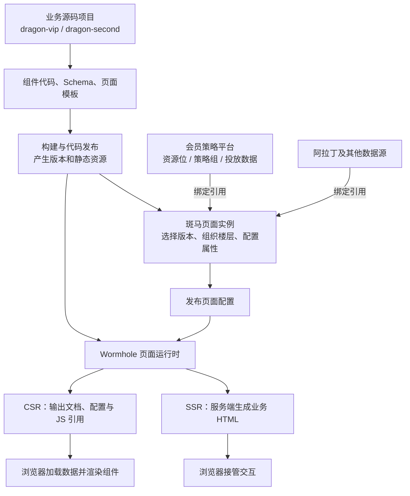
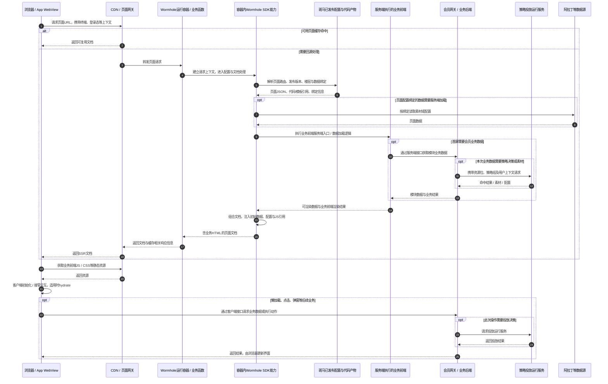
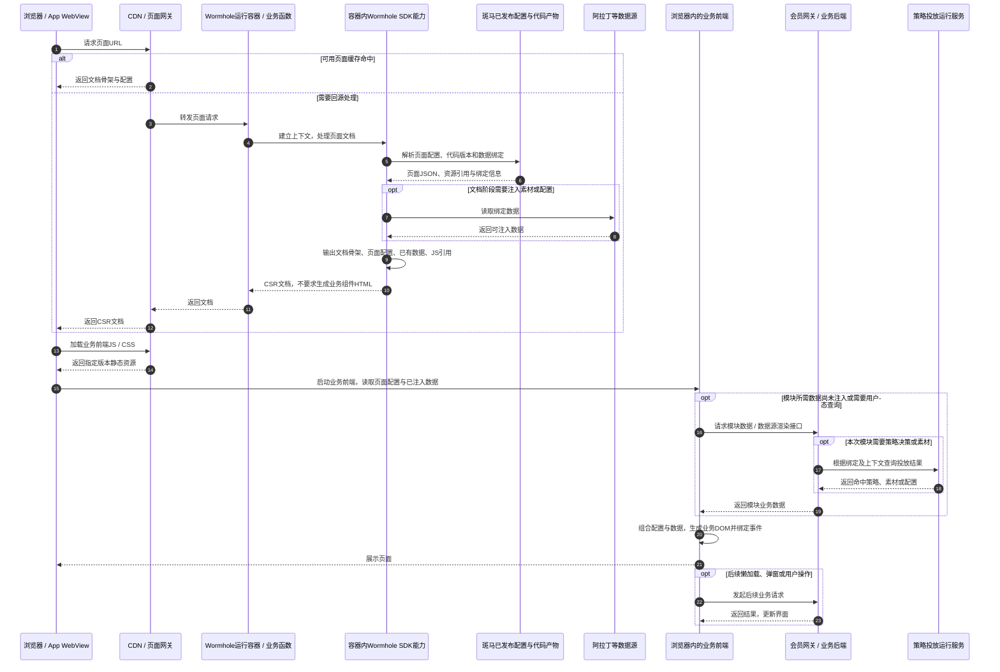
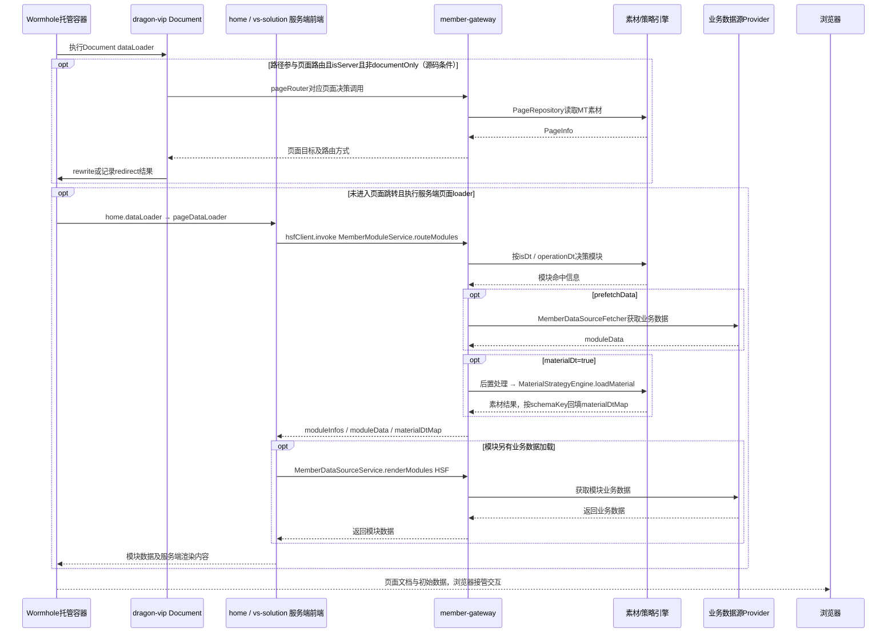
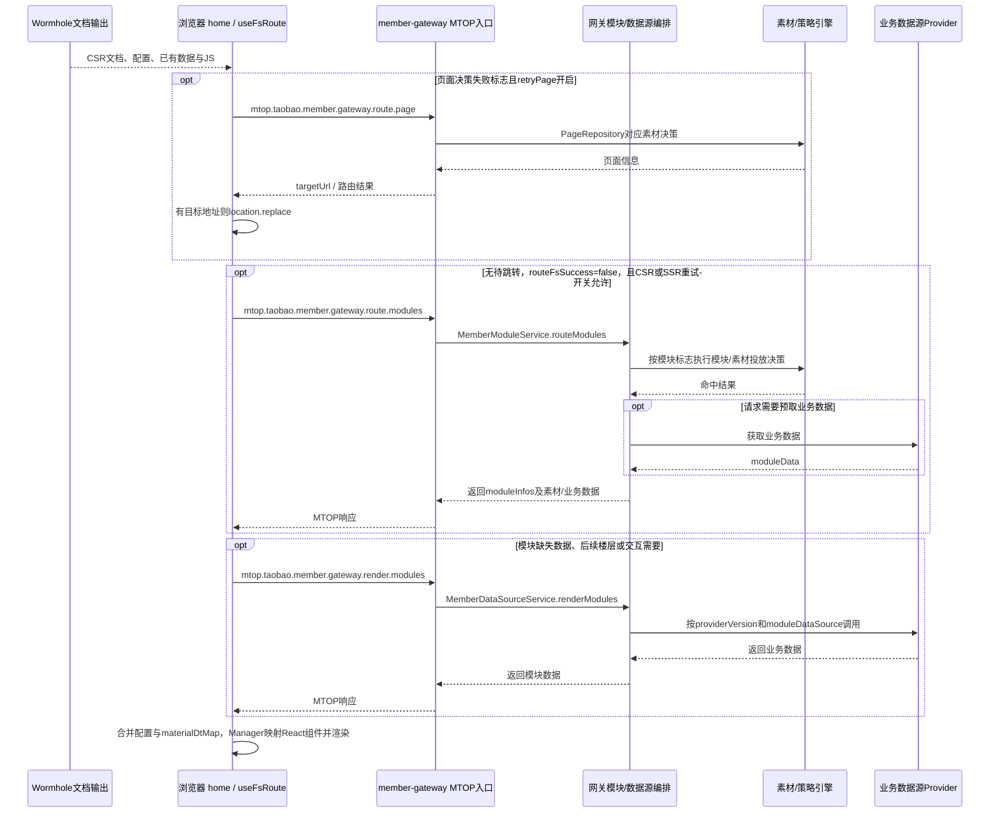

# 斑马、Pegasus 与 Wormhole：搭建原理、渲染链路与会员页面验证

本文基于 ATA「我在阿里做搭建」专题的 12 篇文章、斑马知识库中的相关手册，以及 2026 年 11 月 8 日对会员中心页面的只读核对整理。历史文章用于解释设计演进；具体页面的实现以实际配置和响应为准。

## 一、先区分搭建、业务代码、投放和运行时

斑马负责组织和发布页面；Pegasus（天马）提供搭建基础设施；Wormhole 提供页面托管与运行时处理能力；业务源码项目提供组件和业务逻辑；策略平台提供部分投放配置与数据。

| 名称 | 所在层 | 主要职责 |
| --- | --- | --- |
| 斑马 | 搭建产品 | 站点、分组、页面管理，组织楼层，配置属性，绑定数据，预览与发布 |
| Pegasus / 天马 | 通用搭建基础设施 | 模块规范、模块中心、构建工具、编辑器、SDK，以及搭建和渲染相关基础能力 |
| Wormhole | 页面托管与运行时 | 结合页面配置、模板或业务代码、数据源，输出页面文档，支持不同渲染方案 |
| dragon-vip | 会员业务源码项目 | 本次验证的会员中心页面及其组件、交互和业务逻辑 |
| dragon-second | 另一会员业务源码项目 | 前面皮肤广场等页面所使用的项目，不能代指全部会员页面 |
| 会员策略平台 | 投放系统 | 通过资源位、策略组、策略等管理投放数据和规则，与斑马绑定集成 |
| 阿拉丁等系统 | 数据来源 | 提供素材、配置或其他数据；同一页面可以接入多种来源 |

从历史演进看，斑马源自原有搭建体系，通用能力逐步抽离成天马，斑马成为使用这些基础设施的上层搭建产品之一。方舟、鸿雁等也可以使用通用能力，并有自己的业务管理方式。

因此，斑马和 Pegasus 不是两个需要依次请求的业务接口；Wormhole 和 dragon-vip 也不是互相替代的 Web 服务概念，前者提供运行能力，后者提供业务实现。

## 二、搭建的核心是“代码约定＋页面配置＋数据绑定”

一张搭建页面可以理解成一份有明确规范的配置：使用哪些模块、模块怎样排列、采用哪个代码版本、字段取什么值，以及字段绑定哪个数据来源。

### 1. 模块、Schema 与模块实例

- **模块代码**决定怎样展示和交互，例如导航、卡面、弹窗、商品流。
- **Schema**描述可配置字段及其结构，编辑器据此生成表单。
- **模块定义**是可复用组件的身份。
- **模块实例**是组件被放进某张页面后的一个具体楼层，通常具有自己的 UUID 和配置。
- **Mock**为本地开发提供模拟数据，不等于线上真实投放。

运营在编辑器修改配置，最终仍由业务代码消费这些配置。Schema 声明某个字段，并不会自动实现该字段对应的业务行为。

### 2. 源码搭建

源码搭建把研发开发与运营配置连接起来：开发者在源码项目中预制页面结构和模块能力，发布代码后，运营在对应页面中配置数据、采用代码版本并发布页面。

知识库《源码页面编辑器》说明，源码搭建的可用模块由开发者预制，修改模块集合需要调整源码模板。源码搭建仍然使用搭建平台管理页面与数据，并不是脱离斑马另写一张普通页面。

### 3. Solution

Solution 可以理解成页面级运行方案：负责容器、布局、初始化、数据加载和模块启动等公共工作。模块解决某块业务内容怎么展示，Solution 解决这些模块怎样组成并运行在一张页面上。

历史体系中的 XTemplate、seed、combo，与后续 JavaScript 模板、SSR 和 Worker 运行时属于不同阶段，不能直接把早期文章的细节套到所有当前页面。

## 三、整体架构与发布流程



图中是常见托管方案的职责关系。数据可能在服务端注入，也可能在浏览器阶段请求；不能从“存在数据绑定”直接推出所有数据都由 Wormhole 同步获取。

发布过程中至少要区分三件事：

1. **代码发布**：研发构建并发布新的代码版本。
2. **页面采用版本**：某个斑马页面实例升级到指定版本。
3. **页面发布**：把该页面当前配置发布出去。

代码仓库存在新版本，不代表每张页面已经升级；编辑器出现变更，也不代表线上已经生效。投放系统还可能具有独立排期和发布状态，应分别核对。

## 四、SSR、CSR 与 Wormhole 的关系

SSR/CSR 回答的是“业务组件的 HTML 在哪里生成”；经过哪个平台回答的是“请求和页面产物由谁处理”。它们不是同一个维度。

| 阶段 | SSR 常见流程 | CSR 常见流程 |
| --- | --- | --- |
| 发布 | 斑马发布结构、版本、数据绑定 | 同样可以由斑马发布 |
| 文档输出 | 运行时输出包含业务 HTML 的文档 | 运行时输出文档骨架、配置和 JS 引用 |
| 业务组件渲染 | 主要在服务端完成首屏 HTML 生成 | 主要由浏览器执行 JS 完成 |
| 后续交互 | 浏览器接管交互，也可能继续请求接口 | 浏览器请求数据并处理交互 |

**CSR 可以经过 Wormhole，也可以继续使用斑马配置。** Wormhole 不仅能执行业务 SSR，也能承担页面配置解析、文档输出、数据注入等工作。

同时也不能反向泛化成“所有使用 Pegasus 的页面请求都必须实时经过 Wormhole”。ATA 内容详情案例使用了搭建能力，但采用自己的线上运行链路，Wormhole 在发布阶段参与产物处理。平台能力可以被组合接入。

URL 中的 `x-ssr=true` 表示请求携带了相关参数，不足以单独证明实际响应完成 SSR。最终应结合响应内容、运行上下文及服务端证据判断。

### 1. 阅读链路图前的约定

下面两图展开的是**采用 Wormhole 托管或通过 SDK 接入的源码页面方案**，用于说明参与方和调用方向，不是对所有斑马页面部署方式的断言。第九节进一步给出了 dragon-vip 源码与线上产物核对结果；其中构建插件/context接入、页面路由与模块路由的具体条件，应以第九节为准。

- **业务前端有两个执行位置**：SSR 时部分前端代码在服务端运行，浏览器里仍有负责接管交互的前端代码；CSR 时主要在浏览器生成业务 DOM。
- **业务后端**指会员网关、数据源 Provider、业务服务等。它与运行前端 SSR 的 Node/Worker/函数不是同一职责。
- **Wormhole SDK 是运行时内部的库**，不是浏览器到后端之间的独立网络服务。已读取 SDK 的导出包括 `WormholeDataHandler`、`WormholeDocRenderer` 和 `ModuleRenderer`。图中按这些能力划分步骤，不能据此认定当前托管容器加载的 SDK 包名、版本和完整内部调用顺序。
- **策略平台有管理入口和运行时服务两面**：运营在管理端配置资源位、策略组、素材与规则；线上请求消费对应投放服务或缓存结果，不是请求策略管理页面 URL。
- 图中的 `opt` 表示按需发生。缓存、已注入数据和不同数据源会改变实际请求次数；不能把图中每一步视作每次页面打开必定触发。

### 2. SSR：业务前端先在服务端生成 HTML



图中业务前端调用业务后端，强调的是业务数据加载职责；SDK 也可以通过已配置的数据源适配能力组织数据请求。**到底由 SDK 适配器还是业务 data loader 发起某一笔调用，需要查看具体代码和 Trace，不能只从平台名称判断。**

服务端业务调用可以使用 HSF 等内部接口，浏览器业务调用可以使用 MTOP 等客户端接口。此前读取的 `dragon-second 2.6.98` 产物包含这类分流线索，但它不是当前 `dragon-vip 4.0.29` 的逐行验证结果，因此图中保留通用接口描述。

### 3. CSR：Wormhole可以先输出文档，浏览器再渲染业务组件



CSR 的“客户端渲染”不代表服务器完全不处理配置和数据。当前会员中心的响应既包含 `$pegasus` 页面配置和 `$pageData` 数据，又声明 `documentOnly=true、renderMode="CSR"`，正是“文档阶段已有服务端处理，业务组件仍由客户端渲染”的实例。

浏览器阶段不会因为使用 CSR 就必须再调用一次 Wormhole SDK；两图里的 SDK 都位于服务端运行单元内。浏览器使用的是对应客户端业务代码及客户端框架能力。

### 4. 策略平台在什么时间参与

| 时间 | 参与动作 | 与SSR/CSR的关系 |
| --- | --- | --- |
| 配置阶段 | 运营配置资源位、策略组、素材、规则及排期；斑马记录字段绑定 | 两种渲染模式都可以使用 |
| 服务端文档或数据阶段 | 数据源适配器或业务后端按需读取投放结果，也可能使用缓存 | SSR可用，CSR文档阶段也可能发生 |
| 浏览器业务数据阶段 | 前端请求业务后端，后端按需消费策略投放服务 | CSR常见，SSR后的懒加载和交互也会发生 |

两图把策略服务画在业务后端之后，表示一条常见消费路径，**不是所有投放的唯一调用关系**。配置适配器也可以在文档阶段取得投放数据；仅凭页面里的 `strategyGroupCode` 无法确定调用者、调用时机和命中结果。

### 5. 当前页面已确认到哪一步

| 证据 | 能确认 | 不能直接确认 |
| --- | --- | --- |
| `x-via`包含`wormholesource` | 本次响应经过Wormhole来源链路 | 每次请求均实时回源或均重新渲染 |
| `documentOnly=true、renderMode="CSR"` | 本次返回CSR文档 | 所有用户均CSR，或选择CSR的具体原因 |
| `$pegasus`中的`resource_10965`与策略组 | 页面已记录策略绑定 | 本次一定调用策略服务、命中某个策略 |
| `$pageData`中的阿拉丁ID与数据 | 响应已有相关来源的数据 | 数据一定在本次请求同步回源取得 |
| SDK源码中的数据与渲染导出 | SDK提供相关复用能力 | 当前托管环境必定采用该SDK版本与同一调用顺序 |


## 五、Wormhole SDK、函数化应用和去中心化

**FaaS（Function as a Service）**是一种以函数作为部署和执行单元的服务形态。开发者提交请求处理函数，平台负责运行环境、资源调度和相关托管工作。

**函数化应用**把业务服务组织成函数入口及其依赖；它仍然有业务代码、配置、发布和运行环境，并不是只有一个孤立的 JavaScript 函数。

在 Wormhole 3.0 所讨论的渐进式方案中，业务可以新建函数或应用作为运行承载，把 Wormhole 提供的能力通过 SDK 接入。函数或应用承载请求处理入口，SDK 提供可复用的页面配置、数据处理和文档渲染等能力；具体职责随 SDK 版本和接入方式变化。

这里的“去中心化”主要指业务能够在自己的运行单元中组合和定制渲染逻辑，不必把全部业务逻辑持续堆进一个中心服务。它不等于业务必须自建物理服务器，也不等于摆脱所有统一平台。函数运行资源仍可以由统一基础设施托管。

Wormhole SDK 不是完整的托管平台源码。读到 SDK，只能确认其提供的能力和接口，不能据此认定已掌握网关、调度、发布、缓存等全部实现。当前会员页面的响应可以证明经过 Wormhole 托管链路，但还不足以确认所有会员应用采用同一种部署模式。

## 六、会员中心页面的实证：3208743

验证入口：

- [斑马编辑器：会员中心页面及导航楼层](https://zebra.alibaba-inc.com/web/zoo?componentId=7664915210&pageId=3208743)
- [会员中心线上页面](https://pages-fast.m.taobao.com/wow/z/blackvip/v/home?disableNav=YES&status_bar_transparent=true&x-preload=true&disableProgress=true&forceThemis=true&x-ssr=true)

### 1. 页面、项目与版本

| 项目 | 实际值 |
| --- | --- |
| 页面名称 | 已开卡会员中心 |
| 斑马 pageId | `3208743` |
| 源码项目 / 源码 Page | `dragon-vip` / `home` |
| 线上代码版本 | `4.0.29` |
| 编辑器显示的最新版本 | `4.0.30` |
| 线上配置 publishTime | `2026-11-06 10:07:01` |
| 线上配置 customConfig.path | `banff-pages/pegasus-project--dragon-vip/4.0.29/pages/home` |
| 页面设置中的 wormholePath | `/wh/tms/tmall/page/z/blackvip/v/home-phone` |

线上 HTML 同时引用了 `@ali/pegasus-project-dragon-vip/4.0.29` 的 JS 和 CSS，页面设置与实际代码版本可以相互印证。

编辑器显示 40 个楼层，而本次线上 `$pegasus.components` 中有 27 个模块记录，不能把编辑草稿数量当成线上发布数量。

### 2. URL 中的 componentId 实际对应哪个 ID

本次选中的导航模块，线上配置包含：

```json
{
  "uuid": "7664915210",
  "componentId": 129589,
  "fullName": "@ali/pegasus-project--dragon-vip--black-nav",
  "version": "4.0.29"
}
```

因此，这个编辑器链接中的 `componentId=7664915210` 对应的是楼层实例 UUID，模块定义 ID 则是 `129589`。排查时要以具体字段语义为准，不能只看 URL 参数名。

### 3. 同一模块同时绑定策略平台和阿拉丁

导航模块的策略投放绑定如下：

```json
{
  "resourceCode": "resource_10965",
  "pageId": "3208743",
  "dtList": [
    {
      "schemaKey": "helperConfig",
      "strategyGroupCode": "strategyGroup_16829"
    },
    {
      "schemaKey": "moduleConfig",
      "strategyGroupCode": "strategyGroup_16943"
    }
  ]
}
```

其余字段还绑定了阿拉丁来源：

| 模块字段 | 来源 |
| --- | --- |
| `subModels`：拦截弹窗数据 | 阿拉丁 `35996229` |
| `globalConfig`：开发配置 | 阿拉丁 `36000069` |
| `moreConfig`：右侧 ICON 等配置 | 阿拉丁 `36000070` |
| `baseConfig`：通用配置 | 阿拉丁 `35993281` |

线上返回的 `subModels` 中还能看到：

```json
{
  "moduleDataSource": "multi_scene_open_card_exit_pop",
  "moduleExtra": "{\"multiOpenCardScene\":\"[{\\\"scene\\\":\\\"MEMBER_CENTER\\\",\\\"subScene\\\":\\\"BACK\\\",\\\"handlerType\\\":\\\"fatigue\\\"}]\"}"
}
```

这说明弹窗请求所需的业务参数也可以来自配置数据。这里是 `MEMBER_CENTER/BACK` 场景，不能当作皮肤 `IP_SKIN_POP` 场景发布结果的证明。

### 4. 经过 Wormhole，但本次返回 CSR

本次使用移动端 UA、未登录方式读取线上页面，响应同时包含：

```text
x-via: ... wormholesource033004080120.center.na610
runtime: v10.0.0-Aworker
documentOnly: true
renderMode: "CSR"
```

这直接证明该次请求经过 Wormhole，业务组件采用 CSR。即使请求 URL 含 `x-ssr=true`，实际模式仍应以返回结果为准。

这是一次具体请求的观察，不能推断所有登录会员、所有终端都采用 CSR，也不能仅凭这些字段确定本次选择 CSR 的原因。

## 七、斑马配置实际存在哪里

应区分配置内容与引用关系：

| 内容 | 应怎样理解 |
| --- | --- |
| 页面标题、路径、组件集合、代码版本 | 页面搭建配置 |
| 某个楼层的字段对应哪个资源位、策略组 | 页面与投放系统的绑定关系 |
| 策略组里的素材、规则和投放内容 | 由对应投放系统管理 |
| 阿拉丁绑定的数据 | 来自阿拉丁等数据系统 |
| 用户相关业务数据 | 由业务数据源或服务提供 |

所以，“斑马上的配置都存储在会员策略平台”并不准确。更准确的是：斑马管理页面及其数据绑定，部分绑定接入会员策略平台；该平台不是唯一数据来源。

当前证据确认了系统职责和引用关系，没有核查后台数据库表，不能据此断言每个字段的物理存储位置。线上响应中的 `PRE_PUBLISH` 等环境字段也应原样记录，不能单凭字段名断言实际消费了哪个后端环境。

## 八、以后排查页面来源的顺序

1. **确定页面实例**：拿到线上 URL 和 pageId，避免把权限申请地址、编辑器地址和用户访问地址混为一谈。
2. **确定源码和版本**：查看源码项目、源码 Page、线上采用版本，并核对实际 JS/CSS 引用。
3. **确定楼层实例**：区分 UUID、模块定义 ID、模块版本和业务活动 ID。
4. **追踪字段绑定**：检查页面字段来自静态配置、阿拉丁、策略投放还是业务接口。
5. **核对发布状态**：分开检查代码版本、页面发布、素材排期和投放发布。
6. **确认实际请求**：从原始日志、入参、调用链或网络请求确定来源；不要从参数名字推断调用行为。
7. **判断渲染方式**：查看实际响应和运行上下文，不只依赖 URL 中的 SSR/CSR 参数。

例如，任务列表日志出现 `activityId=1257`，本身不能证明它由 `anchorLotteryAcivityId` 转换而来；需要找到前端消费与参数构造代码，或记录了完整入参的请求证据。模块被配置、被调用、成功返回、最终展示，也是不同阶段。

## 九、结合 dragon-vip 源码核对的真实调用链

本节于 2026-11-09 补充，用代码核对前述职责示意。**页面路由、模块路由和素材定投都是业务决策；Wormhole负责提供运行环境，并不会因为页面里有资源位字段就自动完成会员策略决策。**

### 1. 证据范围与版本

本次已能通过代码 MCP 读取 [dragon-vip 仓库](https://gitlab.alibaba-inc.com/pegasus-project/dragon-vip)，不能再沿用“无法获取该仓库源码”的判断。读取固定提交为 `2065ca2a8a6164cf63b30e37ed093b3b9785b96f`，该提交 `package.json` 的版本是 `3.4.11`；它不等于此前线上页面的 `4.0.29`。

为避免混用版本，同时读取了此前线上 HTML 引用的三个 `4.0.29` 构建产物：

- [data-loader.js](https://g.alicdn.com/code/npm/@ali/pegasus-project-dragon-vip/4.0.29/js/data-loader.js)：可确认服务端首屏模块路由、HSF 调用和素材定投请求构造。
- [p_home-index.js](https://g.alicdn.com/code/npm/@ali/pegasus-project-dragon-vip/4.0.29/js/p_home-index.js)：可确认客户端页面路由、模块路由、业务数据请求及重试条件。
- [main.js](https://g.alicdn.com/code/npm/@ali/pegasus-project-dragon-vip/4.0.29/js/main.js)：可核对公共页面配置、业务常量和绑定读取。

源码映射地址返回 404，因此没有把构建产物分析称作恢复到了完整原始 TypeScript。后端核对的是本地 `member-gateway` 提交 `8a2ecdae90c64160d0cd08681444b46a5531c626` 中相关 Java 文件，不代表已确认生产实例部署的提交。这些证据确认调用逻辑和接口衔接，不等于本次抓取文档已实际执行每笔调用。

### 2. 三种“路由”与素材定投分别解决什么问题

| 层次 | 入口或配置 | 决定什么 | 是否负责业务DOM |
| --- | --- | --- | --- |
| 页面URL与前端框架路由 | `/blackvip/v/home`、源码Page `home`、ICE路由 | 请求加载哪份页面代码 | 负责选中页面，不负责投放决策 |
| 会员页面路由 | `route.page` / `pageRouter` | 当前用户是否应被送往另一页面，返回URL及redirect/rewrite方式 | 不生成DOM |
| 会员模块路由 | `route.modules` / `moduleRouter` | 当前页面哪些楼层保留，携带什么全局信息、预取数据 | 不生成DOM |
| 素材定投 | `dtMaterialConfig`、`materialDt=true` | 楼层内某个Schema字段使用哪个策略组命中的素材 | 不生成DOM |
| 业务数据源渲染 | `render.modules`、`moduleDataSources` | 为模块字段取得业务数据 | 此处render指数据源处理，不等于React渲染HTML |
| React组件渲染 | `Manager`、`FsModsRender`、`NsModsRender`等 | 把模块配置和业务数据转成界面 | 是 |

`src/pages/home/manager.tsx` 是模块名称到 React 组件的映射表。例如 `pegasus-project--dragon-vip--black-nav` 对应 `BlackNav`。它不替代后端模块决策，也不直接查询策略平台。

### 3. 页面路由：在Document阶段或客户端重试阶段调用后端

固定提交的 `src/document.tsx` 中，Document data loader 先检查 `ROUTE_PAGE_LIST.includes(pagePath)`；仅在 `isServer && !documentOnly` 时调用 `pageRouter(ROUTE_PAGE_LIST)`。结果写入：

```text
window.__doc_need_redirect
window.__routePageSuccess
window.__routeMethod
```

`rewrite` 分支调用 `@ali/wormhole-context` 暴露的 `rewrite(targetUrl)`；`redirect` 分支记录结果，交给文档里的 `RedirectRouter` 处理。源码注释指出特定 MTOP SSR 链路不能简单使用服务端 302。

`ROUTE_PAGE_LIST` 包含 `/blackvip/v/home` 等业务路径。它是一组参与会员页面决策的路径，不是斑马全部页面的路由清单。

线上 `4.0.29` 客户端产物可确认：当 `__routePageSuccess === false` 且 `retryPage` 开启时，客户端会调用 `mtop.taobao.member.gateway.route.page`；返回目标地址时使用 `location.replace`。这是受条件控制的重试，不是所有页面初始化都无条件调用。

后端的衔接为：

```text
MemberPageMtopServiceImpl.routePage
  → MemberPageServiceImpl.routePage
  → MemberRoutePageBizManager
  → MemberRoutePageMainProcessor
  → PageRepository.queryPageList
  → MemberMaterialServiceFacade.getMemberMaterialLoadResult
```

`PageRepository` 根据 `product#scene#pageId` 查询 `page.route.config` 对应的 MT ID，再构造素材加载上下文，取首个命中素材转成 `PageInfo`；管理器最终返回 `pageInfo`。URL 参数也可进入上下文，成为投放条件输入。

**这里的MT素材加载路径与下面的会员策略平台 `dtMaterialConfig` 路径需要分开看。** 不能把所有出现“素材”的代码都描述成访问同一个策略组。

### 4. 首屏模块路由：真正调用 member-gateway 的明确位置

`src/pages/home/index.tsx` 注册 `dataLoader`，调用 `@ali/vs-solution/esm/services` 的 `pageDataLoader()`。线上 `4.0.29` 产物可确认其内部链路：

```text
home.dataLoader
  → pageDataLoader
  → routeFsPreProcessor
     读取页面模块和数据，拆分首屏/后续楼层，准备预取请求
  → 当isServer且没有待处理页面跳转时：moduleRouter
  → queryModuleRouterService
  → wormhole-context.hsfClient.invoke
     MemberModuleService:1.0.0 / group=HSF / method=routeModules
  → member-gateway
```

请求包括 `product`、用户信息、`pageRequest`、`moduleRequests`、`prefetchModuleRequests`、无线端上下文。没有用户ID或没有模块请求时存在提前返回分支，所以“函数有该调用”不等于每次打开必然发送。

后端 `MemberModuleServiceImpl.routeModules` 进入 `MemberRouteModulesBizManager`；主处理器 `MemberRouteModulesMainBizProcessor` 执行：

1. 从 `ModuleRepository` 和 `ModuleOperationRepository` 获取模块投放决策。
2. 对标记 `isDt` 或 `operationDt` 的楼层进行过滤；未命中相应配置可被排除。
3. 对带 `prefetchData` 的请求，通过 `MemberDataSourceFetcher` 取得业务数据。
4. 后置处理器继续处理素材定投等能力，并返回模块信息与数据。

因此，`route.modules` 不只是返回模块名，也可以合并一部分业务数据，减少客户端再请求。

### 5. 素材定投：moduleRequests.extend → 策略引擎 → Schema字段

线上 `4.0.29` 的 `getDTExtend` 明确把页面配置转换为请求扩展：

```text
存在deliveryConfig → operationDt=true
否则页面模块定投开关命中 → isDt=true
存在dtMaterialConfig → materialDt=true，并附带dtMaterialConfig
```

这里有两种不同的投放：`deliveryConfig` 参与“整个模块是否保留”的决策；`dtMaterialConfig` 为楼层内部具体字段填充素材。同一个模块可以同时配置两种能力。

素材定投的后端调用链已确认到如下方法：

```text
MemberRouteModulesResourceDtWithStrategyBizProcessor.postProcess
  → 筛选extend.materialDt=true的请求
  → 解析extend.dtMaterialConfig，按resourceCode归集策略组
  → ModuleResourceStrategyOperationRepository.queryResourceDtInfo
  → MemberStrategyServiceFacade.getMaterialStrategyLoadResult
  → MaterialStrategyEngine.loadMaterial(context)
  → enrichResourceDtInfo
  → module.extend.materialDtMap[schemaKey] = 命中素材data
```

仓库通过 `StrategyPlatformMaterialStrategyLoadAddress` 指定 `resourceCode` 和 `strategyGroupCodes`，并设置 `FIND_ALL`。这确认 member-gateway 调用了策略引擎接口；引擎内部是否发远程请求、读本地缓存、访问哪些服务，不在本次已核查代码范围内，图中不应强行画成一次固定HTTP请求。

会员中心导航实例 `7664915210` 对应：

```text
resource_10965
  strategyGroup_16943 → moduleConfig
  strategyGroup_16829 → helperConfig
```

前端 `getAfterJudgeComponents` / `routeFsAfterProcessor` 从后端模块的 `extend.materialDtMap` 取回素材结果，再通过 `mergeModData` 等逻辑合并进模块数据。这里才形成“某个策略组的命中素材成为组件某个字段”的闭环。

### 6. 业务数据源：可能随路由预取，也可能单独请求

`moduleDataSources` 中的 `providerVersion`、`moduleDataSource`、`moduleSchemaKey` 和 `moduleExtra` 描述了请求哪个业务数据源以及结果落在哪个字段。它们和资源位、策略组不是同一类地址。

- **随模块路由预取**：`prefetchData` 触发网关 `postFetchData`，由 `MemberDataSourceFetcher` 按Provider版本等组织调用。
- **SSR模块数据加载**：线上页面产物还包含 `MemberDataSourceService:1.0.0.renderModules` 的 HSF 调用。
- **浏览器补取、重试或交互**：线上客户端产物包含 `mtop.taobao.member.gateway.render.modules`。

网关负责路由和编排，具体会员业务数据由对应 Provider/业务服务处理；浏览器最终拿到数据后由 React 渲染。`member-gateway` 既不等同于策略平台，也不是浏览器组件渲染器。

### 7. 两条经过代码核对的链路图

以下把已确认的入口连接起来。SSR的Document条件来自固定源码提交；模块HSF、客户端MTOP及素材标志构造同时得到线上 `4.0.29` 产物支持。它们是带条件的程序链路，并非一条已抓取完整Trace的实际请求。





### 8. Wormhole SDK具体在哪里接入：业务工程与容器分工

固定源码的 `ice.config.mts` 明确配置：

```ts
PegasusPlugin({
  previewMode: 'local',
  documentOnly: false,
  runInWormholeContainer: true,
});

server: { format: 'cjs', bundle: 'page' }
```

`package.json` 声明 `@ali/build-plugin-pegasus-project`、`@ali/vs-solution` 和 `@ali/wormhole-context`，未直接声明 `@ali/wormhole-sdk`。已读取的页面、Document和构建配置也没有直接实例化 `WormholeDocRenderer`。

所以当前能确认的接入方式是：

```text
构建阶段：PegasusPlugin生成适配Wormhole容器的页面产物
运行阶段：统一容器执行业务Document与页面代码
上下文桥接：@ali/wormhole-context读取容器注入能力
业务阶段：vs-solution利用hsfClient调用member-gateway
```

线上 `4.0.29` 的 `wormhole-context` 实现直接读取 `__wormhole__` 和 `__wormhole_extend__`，其中 `hsfClient`、`mtopEvent`、日志及性能能力来自扩展上下文。这里的 **context桥接包、构建插件、完整Wormhole SDK是三个不同角色**。

前面把“容器内Wormhole SDK能力”画成统一参与方，是架构层的能力概括；结合源码后，应进一步限定：**业务仓库已确认通过构建插件和context接入托管容器；生产容器内部具体在哪个文件创建哪个版本的SDK对象，仍需容器源码或部署依赖才能确定。** 不能把另一份已读取的SDK源码中存在某类，写成dragon-vip直接调用了该类。

`documentOnly:false` 是该源码提交的构建配置，也不能覆盖此前线上响应中实际观察到的 `documentOnly:true、renderMode:"CSR"`。构建配置、部署版本和每次请求的运行决策需要分别核对。

### 9. 关键源码入口

- [dragon-vip：home页面入口](https://gitlab.alibaba-inc.com/pegasus-project/dragon-vip/blob/2065ca2a8a6164cf63b30e37ed093b3b9785b96f/src/pages/home/index.tsx)
- [dragon-vip：Document路由与上下文使用](https://gitlab.alibaba-inc.com/pegasus-project/dragon-vip/blob/2065ca2a8a6164cf63b30e37ed093b3b9785b96f/src/document.tsx)
- [dragon-vip：Wormhole构建接入](https://gitlab.alibaba-inc.com/pegasus-project/dragon-vip/blob/2065ca2a8a6164cf63b30e37ed093b3b9785b96f/ice.config.mts)
- [dragon-vip：模块组件映射](https://gitlab.alibaba-inc.com/pegasus-project/dragon-vip/blob/2065ca2a8a6164cf63b30e37ed093b3b9785b96f/src/pages/home/manager.tsx)
- [member-gateway：页面路由素材查询](https://gitlab.alibaba-inc.com/vipshop/member-gateway/blob/8a2ecdae90c64160d0cd08681444b46a5531c626/member-gateway-biz/src/main/java/com/alibaba/taobao/vipmember/gateway/biz/repository/PageRepository.java)
- [member-gateway：模块决策和业务数据预取](https://gitlab.alibaba-inc.com/vipshop/member-gateway/blob/8a2ecdae90c64160d0cd08681444b46a5531c626/member-gateway-biz/src/main/java/com/alibaba/taobao/vipmember/gateway/biz/processor/module/MemberRouteModulesMainBizProcessor.java)
- [member-gateway：素材定投后置处理与字段回填](https://gitlab.alibaba-inc.com/vipshop/member-gateway/blob/8a2ecdae90c64160d0cd08681444b46a5531c626/member-gateway-biz/src/main/java/com/alibaba/taobao/vipmember/gateway/biz/processor/module/MemberRouteModulesResourceDtWithStrategyBizProcessor.java)
- [member-gateway：策略地址和上下文构造](https://gitlab.alibaba-inc.com/vipshop/member-gateway/blob/8a2ecdae90c64160d0cd08681444b46a5531c626/member-gateway-biz/src/main/java/com/alibaba/taobao/vipmember/gateway/biz/repository/ModuleResourceStrategyOperationRepository.java)
- [member-gateway：策略引擎调用](https://gitlab.alibaba-inc.com/vipshop/member-gateway/blob/8a2ecdae90c64160d0cd08681444b46a5531c626/member-gateway-integrations/src/main/java/com/alibaba/taobao/vipmember/gateway/integrations/strategy/facade/MemberStrategyServiceFacade.java)


## 参考资料与验证边界

- [ATA 专题：我在阿里做搭建（12 篇）](https://ata.atatech.org/specials/10000000623?layout=%2Fvelocity%2Flayout%2Fblank.vm)：模块、模块中心、Wormhole、源码搭建、Solution，以及各业务接入案例。
- [ATA：页面渲染服务 Wormhole](https://ata.atatech.org/articles/11000147358?utm_source=open&utm_medium=hsf&utm_campaign=_OPEN_AONE)
- [ATA：源码页面搭建](https://ata.atatech.org/articles/11000148606?utm_source=open&utm_medium=hsf&utm_campaign=_OPEN_AONE)
- [ATA：谈谈 Solution](https://ata.atatech.org/articles/11000156946?utm_source=open&utm_medium=hsf&utm_campaign=_OPEN_AONE)
- [ATA：内容详情 2.0 特色搭建](https://ata.atatech.org/articles/11000170426?utm_source=open&utm_medium=hsf&utm_campaign=_OPEN_AONE)
- [ATA：淘天前台页面托管服务 Wormhole](https://ata.atatech.org/articles/11020089609?utm_source=open&utm_medium=hsf&utm_campaign=_OPEN_AONE)
- [斑马知识库](https://alidocs.dingtalk.com/i/spaces/nb9XJJvaYJw9OXyA/overview)：本次选择阅读了原理、源码搭建、编辑器、升级和投放等相关文档，并非全部知识库。
- [斑马是什么](https://alidocs.dingtalk.com/i/nodes/QG53mjyd800agdlKHE601NxN86zbX04v)
- [源码页面开发指南](https://alidocs.dingtalk.com/i/nodes/lyQod3RxJKe9QjOMipLNqjl0Wkb4Mw9r)
- [源码页面编辑器](https://alidocs.dingtalk.com/i/nodes/ZX6GRezwJlzeYoPLFoDL754RWdqbropQ)
- [数据投放介绍](https://alidocs.dingtalk.com/i/nodes/ydxXB52LJqPvwoK0IEXO5r75VqjMp697)
- [斑马 Next](https://alidocs.dingtalk.com/i/nodes/EpGBa2Lm8aZxe5myCQeqrEbwWgN7R35y)

文档中的线上版本和配置为核对时的快照，后续可能变化。本文没有验证斑马或会员策略平台的完整数据库实现，也没有将 SDK 源码视为完整 Wormhole 服务源码。
