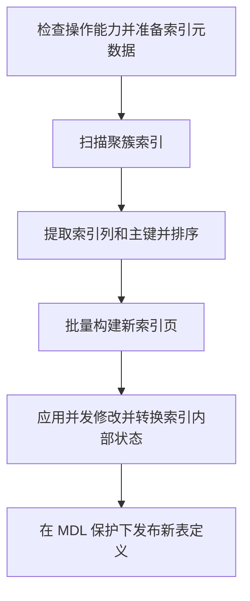
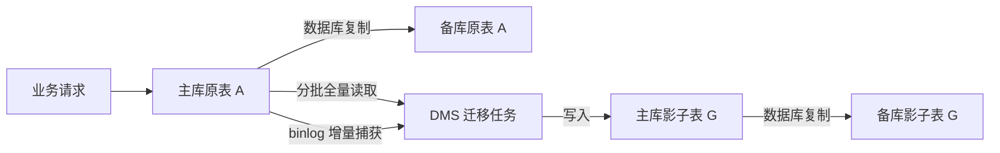
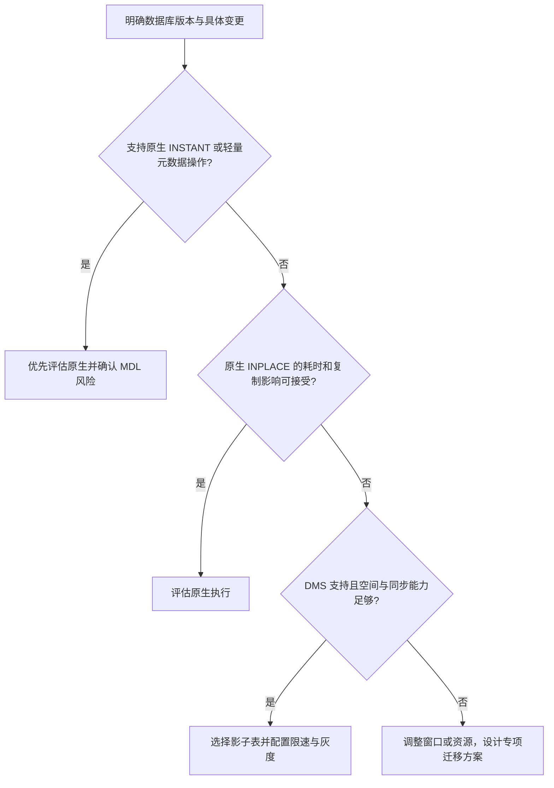

# MySQL Online DDL 与 DMS 无锁结构变更：原理、复制延迟与选型

原生 Online DDL 由数据库内部完成结构变更；DMS 自研无锁结构变更通过影子表、全量拷贝、binlog 增量回放和切表完成变更。两者都需要维持并发写入期间的一致性，但承担成本的位置、复制端的工作形态和负载控制方式不同。

本文主要以 InnoDB、MySQL 5.7 和基于 binlog 的逻辑复制为背景，同时说明 MySQL 8.0 的 INSTANT 能力。云数据库内核、数据库小版本、DMS 部署版本和执行配置均可能改变具体行为，不能把公有云能力表直接当成某次集团工单的执行记录。

> [!important] 先记住四个边界
> - INPLACE 不等于“不重建表”，LOCK=NONE 不等于“全程没有锁”。
> - DMS 自研方案通常增加整表拷贝和影子表写入成本；优势在于分批调度、限速和控制切表时机。
> - 备库通常既回放原表业务写入，也回放影子表写入；DMS 没有免除原表复制。
> - “通过 DMS 提交 ALTER”不等于“必定使用影子表”，需要看执行策略和实际任务日志。

## 1. 概念与比较范围

| 概念 | 含义 | 不能混同的概念 |
| --- | --- | --- |
| DDL | 建表、修改字段、添加索引等结构操作 | INSERT、UPDATE、DELETE 等 DML |
| 原生 Online DDL | 数据库在特定操作下允许结构变更与业务访问并发的能力 | 一个统一的“完全无锁算法” |
| ALGORITHM | 指定数据库内部执行算法 | 并发访问级别 |
| LOCK | 指定 DDL 主要执行阶段允许的并发访问程度 | 是否完全没有 MDL、行锁和内部 latch |
| DMS | 数据库管理平台，可调度原生或自研结构变更 | 自研影子表引擎本身 |
| DMS 自研无锁结构变更 | 通过影子表和数据同步完成结构替换的 OSC 方案 | 先改备库再切换主备 |
| DTS | 数据传输服务，负责数据迁移、同步和订阅 | DMS 的同义词；DMS 使用 binlog 不等于必然创建了 DTS 任务 |

### 1.1 原生算法和并发选项是两个维度

| 算法 | 主要做什么 | 需要关注什么 |
| --- | --- | --- |
| INSTANT | 使用受支持的元数据变更路径，借助记录格式兼容机制解释已有行 | 不扫描重写已有行；受版本和表结构限制，仍需要 MDL 协调 |
| INPLACE | 使用存储引擎原生变更路径 | 可以扫描数据、构建索引或重建整表；不保证始终使用同一份文件，也不保证允许并发写 |
| COPY | 由 Server 层组织表复制，通过逐行搬迁完成结构替换 | 通常长时间阻止业务写入 |

LOCK=NONE 允许并发查询和 DML；LOCK=SHARED 允许查询但阻止 DML；LOCK=EXCLUSIVE 阻止查询和 DML。省略 LOCK 等同于 LOCK=DEFAULT，即按操作能力尽量提供并发。若显式要求的算法或并发能力不受支持，数据库应报错，而不是把要求理解为提示。[^mysql-alter]

MySQL 8.0.12 起部分加列操作支持 INSTANT，8.0.29 又扩展了相关能力；并非所有表、所有加列位置和组合操作都支持。新增普通二级索引仍需要真正构建索引树，不能使用 INSTANT。[^mysql-operations]

### 1.2 INSTANT 与 INPLACE 作为算法取值，区别是什么

ALGORITHM 是对执行路径的约束，不是仅按最终修改了多少字节分类。INSTANT 要求该操作存在元数据变更路径；INPLACE 要求使用存储引擎支持的原生变更路径，而不是 Server 层的 COPY 路径。两者不是同一个算法的快慢档。[^mysql-alter]

INSTANT 不扫描重写已有行。以受支持的瞬时加列为例，旧行可以暂时没有新列的物理内容，InnoDB 借助元数据和记录格式兼容规则，在读取时提供对应值；后续新行按适用的格式写入。“只改元数据”仍然涉及元数据持久化和锁协调，不等于完全没有磁盘写入。

INPLACE 的成本跨度很大：某些操作只调整元数据，新增普通二级索引要扫描并建树，某些加列、改主键等操作则需要整表重建。判断是否重建、是否允许并发 DML，必须继续查具体操作的能力矩阵。[^mysql-operations]

### 1.3 同一个加字段操作，为什么两种算法成本不同

以下示例是假设目标 MySQL 8.0 小版本、表结构和加列位置都满足支持条件时的两种替代执行方式，不是连续执行两次：

```sql
ALTER TABLE activity_record
  ADD COLUMN status INT NOT NULL DEFAULT 0,
  ALGORITHM=INSTANT;
```

该路径主要更新元数据，旧记录不需要立即逐行补写 status；读取旧行时由引擎按规则提供该列值。

```sql
ALTER TABLE activity_record
  ADD COLUMN status INT NOT NULL DEFAULT 0,
  ALGORITHM=INPLACE,
  LOCK=NONE;
```

在该操作需要重建的 INPLACE 路径中，引擎扫描旧聚簇索引、生成包含新列的记录并构建新结构，同时处理并发修改。即使逻辑结果相同，执行成本也可能从元数据操作变成与表规模相关的重建。MySQL 5.7 没有 INSTANT 算法，不能直接套用第一个示例。[^mysql-operations]

### 1.4 普通加索引为什么不能直接 INSTANT

普通二级索引必须包含已有记录的索引列值和主键，并按照比较规则组成 B+ 树。仅发布一份索引定义，无法让已有数据自动出现在新树中，因此必须读取历史数据并实际建树。这类新增普通索引支持 INPLACE，不能用 INSTANT 消除构建成本。[^mysql-operations]

### 1.5 显式算法、默认选择与锁等待

在支持 INSTANT 的 MySQL 8.0 中，省略 ALGORITHM 时通常优先选择受支持的 INSTANT，再考虑 INPLACE，最后 COPY。显式指定某种算法而该操作不支持时会报错，不能理解为“尽量采用，失败后随意降级”。[^mysql-alter]

算法与并发选项需要分别判断。INPLACE 不自动等于 LOCK=NONE；显式 LOCK=NONE 不受支持也会报错。INSTANT 只接受适用的 LOCK=DEFAULT，仍可能因 MDL 冲突等待。即使操作最终只修改少量元数据，也可能被长事务拖住。[^mysql-alter][^mysql-performance]

## 2. 原生 INPLACE 新增二级索引的原理

假设给活动记录新增索引：

```sql
ALTER TABLE activity_record
  ADD INDEX idx_user_end (user_id, end_time),
  ALGORITHM=INPLACE,
  LOCK=NONE;
```

以下讨论普通二级 B+ 树索引，不直接套用于 FULLTEXT、SPATIAL、改主键或任意字段类型变更。

### 2.1 物理上新增了什么

普通二级索引的叶子记录主要包含索引列值和定位原行的主键值，非叶子页保存用于导航的键与子页引用。加一个索引是为整张表新增一棵索引 B+ 树，而不是每行各建一棵树。

这类原生操作通常保留已有聚簇索引和旧二级索引，只新增目标索引。相比把全部行重新插入一张新表，它可能节省大量数据重写和旧索引维护工作。修改主键则不同：主键决定聚簇组织，二级索引又包含主键，因此通常涉及更广泛的重建。

### 2.2 扫描、排序、批量建树



排序后批量建立索引，可以减少普通逐行插入中的反复查树和页分裂。批量加载阶段也有专门的日志与持久化优化，不能把它等价为“全表执行 INSERT”；这些优化不表示业务 DML 不再产生正常 redo。[^mysql-sorted]

### 2.3 并发写入如何进入新索引

建索引期间，业务仍然修改原表：已有索引按正常路径维护，修改受事务锁、undo、redo 和提交流程保护。对构建中的索引，InnoDB 根据其内部状态记录修改或直接维护索引，最终让候选索引反映一致的有效数据。

其中 online modification log，也常称 row log，是为本次在线构建服务的临时日志，**不是 binlog，也不是 undo log**。它记录构建需要补齐的修改；文件达到上限可能使 DDL 失败。`innodb_online_alter_log_max_size` 限制的是相关临时日志大小，不能简单当成所有业务事务的缓存大小。[^mysql-space]

对于 MySQL 5.7 普通二级索引，`row_merge_build_indexes()` 中包含 `row_log_apply()`；回放末尾及状态转换通过索引内部锁协调。它与重建整表时的 `row_log_table_apply()` 路径不同。因此，不能统一画成“所有 row log 都等到取得最终 MDL X 后才开始回放”。[^mysql57-merge][^mysql57-rowlog]

### 2.4 会加哪些锁

| 保护机制 | 保护什么 | 对其他操作的影响 |
| --- | --- | --- |
| MDL_SHARED_UPGRADABLE | 构建期间表定义的稳定性 | 允许主要阶段的正常 DML，协调其他结构操作 |
| 准备和发布所需的 MDL X | 初始化、替换和发布相关结构状态 | 申请时可能等长事务，获得后阻止不兼容访问 |
| 正常 DML 事务锁 | 原表记录及相关索引资源 | 同行更新、删除和范围操作仍可能冲突 |
| 页、索引、日志内部 latch / mutex | 进程内共享结构 | 即使没有行锁阻塞链，也可能因内部同步而等待 |

典型风险是：事务 A 查询过表但一直没有结束；DDL 等待 A 持有的 MDL；后续查询、更新又可能排在待授予的 MDL X 后面。原先只是一笔长事务，最终可能演变成大量请求排队。**准备阶段也可能等待，不是只有提交阶段才会卡住。**[^mysql-performance][^mysql57-table]

### 2.5 原生 Online DDL 会不会创建新表再切换

需要区分新增索引与整表重建，不能统一回答“会”或“不会”：

| 操作路径 | 构建什么 | 最终发布什么 |
| --- | --- | --- |
| 普通二级索引的 INPLACE 新增 | 在保留原聚簇索引的情况下新增索引树 | 新索引及对应表定义 |
| 需要整表重建的 INPLACE 变更 | 引擎内部的新聚簇索引及相关二级索引结构 | 替换后的表结构与存储对象 |
| 受支持的 INSTANT 变更 | 不重建历史行，也不为新增索引构建树 | 支持新旧记录解释规则的元数据 |

MySQL 5.7 的整表重建路径会创建内部新表，搬迁数据、应用并发修改，再在提交阶段协调剩余增量、数据字典及表空间替换。它不要求始终在原数据文件上逐页修改。临时文件可能用于排序，也可能用于重建，因此不能仅凭出现临时文件就认定创建了完整影子表。[^mysql57-rebuild]

这种引擎内部重建与 DMS 外部影子表迁移处于不同层次：原生路径由 InnoDB 管理新结构和 online row log；DMS 通过可见的影子表、分批 DML 和 binlog 订阅调度迁移。基于逻辑复制时，原生重建不会把全部内部搬迁转换为影子表 INSERT 传给备库，备库通常仍执行 ALTER；DMS 的影子表写入则会成为复制工作量。内部重建的恢复与持久化仍由数据库负责，不能理解为不需要日志。[^mysql57-table][^dms-overview]

## 3. DMS 自研影子表变更的原理

### 3.1 从结构修改转化为数据迁移

DMS 先创建与原表相似的空影子表，在影子表上执行目标变更，再分批迁移历史数据，并订阅原表 binlog 处理增量。追平后切换表名，按平台策略延迟处理旧表。这是同一实例内的新旧表替换，不是数据库主备角色互换。[^dms-overview]

下列 SQL 是说明流程的示例，不代表任意工单都应手工执行：

```sql
CREATE TABLE activity_record_ghost LIKE activity_record;

ALTER TABLE activity_record_ghost
  ADD INDEX idx_user_end (user_id, end_time);
```

目标索引在影子表为空时建立，主要成本很小。随后历史行写入影子表时，数据库会同时维护其聚簇索引和全部二级索引。这与原生“只构建一棵新增索引”的工作量不同。

### 3.2 全量拷贝与增量捕获

全量按 PK/UK 定位的范围分批搬迁。官方给出的典型拷贝路径包含 `INSERT IGNORE`、索引提示和 `LOCK IN SHARE MODE`。与此同时，DMS 捕获源表变化，将其转化为对影子表的增删改。

两部分是配合运行的任务，不能理解为“全量结束才开始记录增量”。但公开的阶段描述也不证明每个瞬间全量写入与增量写入都在同时执行，具体调度由引擎控制。[^dms-overview]

### 3.3 数据正确性不能只靠 INSERT IGNORE

全量与增量交错时至少需要处理以下情况：

| 并发情况 | 同步算法必须保证的结果 |
| --- | --- |
| 全量读到旧值，增量已经写入新值 | 旧的全量值不能覆盖更新后的值 |
| 源表记录被删除，旧全量批次稍后写入 | 被删除的行不能最终复活 |
| 同一行经不同路径重复处理 | 重复处理不能破坏正确状态 |
| PK/UK 变化或不同记录发生唯一键冲突 | 正确定位记录、保持顺序，或明确拒绝不支持场景 |

这要求一致的捕获边界、操作顺序和校验机制。时间戳比较、按范围串行、重读、删除状态记录等是可能的通用设计，**不能在没有实现证据时认定 DMS 必然用了其中某一种**。官方的架构介绍不足以还原其全部并发算法。

`INSERT IGNORE` 只定义冲突时的语句行为，不自动解决更新顺序和删除复活问题。DMS 官方另有数据校验、并发调度与异常处理能力说明。[^dms-comparison]

### 3.4 最后切表怎样保证不丢写

正确性要求是：协调源表写入，在受控边界内补齐切换前的修改，再原子替换表名，使后续请求访问新表。典型切换形式为一条包含两次重命名的 `RENAME TABLE`，而不是在两次独立改名之间留下空窗。

这个边界仍然需要 MDL 等锁保护。长查询、未结束事务可能阻止切表；等锁时间和已获得锁后的临界区时间要分别看。业务请求可能等待或超时，应用仍需正确处理重试，不能把“原子切表”理解为“所有请求都必然成功”。

切表后业务新写入落在新表，旧表不再自动拥有这些变化。因此，“保留旧表”不等于可以任意时刻直接切回且不丢新数据；回滚必须考虑结构兼容和切换后的增量。

### 3.5 DMS 仍然有锁与负载

源表锁定拷贝可能与业务更新、删除冲突；影子表插入和增量回放也有事务锁，重复键检查可能申请 S 锁，需要更新的路径需要 X 锁。`IGNORE` 不会取消锁。最后还有切表 MDL。

普通 MVCC SELECT 通常不被记录 S 锁阻塞，但仍会争用 CPU、磁盘和缓存。源表范围拷贝对新 INSERT 的影响，要结合实际间隙锁、隔离级别和访问路径判断。相关唯一键等待及死锁机制见 [[MySQL 死锁了，怎么办？]]。

DMS 的高 TPS、增量校验冲突、订阅带宽不足等，都可能导致迁移积压或失败。“无锁”应理解为尽量避免长时间阻止业务访问，不是没有任何锁或资源成本。[^dms-faq]

## 4. 为什么原生 DDL 可能造成主备延迟

### 4.1 逻辑复制传递变更事件，而不是已建好的索引页

原生新增索引通常先在主库执行成功，再将 ALTER 作为结构事件写入 binlog。备库读到事件后，需要根据本地数据重新扫描、排序和构建索引。ROW 模式不表示 DDL 也转换成索引页复制。[^mysql57-table]

下面是示意时间线，不是某次实际执行记录：

| 时间 | 主库 | 备库 |
| --- | --- | --- |
| 12:00 | 开始原生建索引，主要阶段允许业务 DML | 继续回放已收到的业务事务 |
| 12:00—12:10 | 扫描、排序、构建 | 可处理排在 ALTER 事件之前的事务 |
| 12:10 | DDL 完成，记录结构事件 | 随后读到 ALTER，开始本地建索引 |
| 12:10—12:20 | 继续产生业务事务 | 执行 DDL，后续受其约束的事务积压 |
| 12:20 以后 | 持续写入 | DDL 完成后追赶积压 |

不能说“主库开始 DDL 后的所有业务事务都必然在备库等到 DDL 后面”。应根据它们在日志里的位置和复制依赖判断。

### 4.2 存储引擎允许并发，不等于复制调度自动并发

主库的 ALTER 与业务 DML 来自不同连接。单线程回放则会被正在执行的 ALTER 占用，后续事件无法继续执行。并行复制也必须满足结构与数据的依赖关系，DDL 可能形成同步屏障，影响范围取决于复制模式、通道与版本，不能保证只影响一张表，也不能断言所有通道都停止。

因此，LOCK=NONE 并不能自动给复制回放增加另一条可越过 DDL 的执行路径。MySQL 官方将耗时 Online DDL 列为复制延迟来源。[^mysql-limitations]

### 4.3 日志已经同步，数据仍可能没追平

日志接收、持久化与 SQL 回放是不同进度。备库可以继续收到日志，而执行端卡在 DDL、锁等待或大事务上，待回放队列持续增长。

AliSQL X-Cluster 使用 X-Paxos 复制基于 binlog 的逻辑日志，Follower 再通过协调线程和 worker 回放。多数派日志提交不代表每个 Follower 的表数据都已应用到相同位置。该架构与直接复制已生成数据页的物理复制不同，不能混用两者的 DDL 成本模型。[^xcluster]

## 5. DMS 为什么能控制主备延迟，却可能增加总工作量

### 5.1 备库既复制原表，也复制影子表



此图以影子表写入正常进入 binlog、未被过滤或特殊转换的逻辑复制链路为前提。备库原表本来已经存在，只需继续回放业务增量；新影子表则需要接收全量写入及后续修改。

对某次业务修改，源表事务先提交，DMS 读取其日志后才衍生影子表事务。但整条日志流是交错的，不是“先同步完所有原表，再同步所有影子表”：

```text
原表业务 B1 → 影子表拷贝 C1 → 原表业务 B2
    → 影子表增量 U1 → 影子表拷贝 C2 → 原表业务 B3 → …
```

ROW 模式下，备库回放拷贝产生的目标行事件，通常不重新执行源端 SELECT 扫描，也不会把源端那把共享读锁复制过去；它仍需插入数据、维护目标索引并完成本地持久化。

### 5.2 优势是拆小和控制输入，不是减少复制对象

原生方式可能表现为一个耗时 ALTER 挡住后续回放；DMS 把主要工作变成一批批行变更，并可控制拷贝、回放速度和并发。新索引在空影子表上准备好，后续随数据逐批插入维护，不需要等全表装满后再执行一次同等规模的新增索引。

DMS 因此可能以更长的总变更时间，换取更低的瞬时压力和更短的单次阻塞。它不能随意提升业务事务优先级，也不能让业务事件越过已经排队的大拷贝事务；控制主要发生在后续批次产生之前。

官方描述的可调度能力包括拷贝与回放限流、性能自适应等；是否启用了何种主备检查和阈值，需要核对具体任务配置。[^dms-comparison][^dms-execute]

### 5.3 用负载模型解释限速边界

设 B 为原表业务回放成本，C 为影子表全量写入成本，U 为影子表增量写入成本，R 为备库处理能力。粗略地说，持续保持以下关系才有机会不扩大积压：

```text
B + C + U < R
```

这是统一换算后的工作量模型，不是按 SQL 条数比较，也不假设每种事务成本相同。索引数量、热点、读流量和磁盘水位都会改变 R。

| 工作 | 示例工作单位/秒 |
| --- | ---: |
| 原表业务 B | 2000 |
| 影子表增量 U | 2500 |
| 全量拷贝 C | 3000 |
| 合计 | 7500 |
| 备库能力 R | 10000 |

如果 C 提高到 8000，合计变成 12500，就可能持续积压。放慢全量可减压；放慢增量也可暂时减压，但会扩大影子表对原表的落后，延后切表。

如果 B 和持续追平所需的 U 已经超过 R，即使 C 降为零，也不能同时满足业务持续写入、两类同步追平和变更快速完成。限速不能创造处理能力。已经进入复制队列的工作也不会因暂停任务瞬间消失。

### 5.4 两类延迟必须分别观察

| 延迟 | 谁落后于谁 | 影响 |
| --- | --- | --- |
| DMS 增量延迟 | 主库影子表落后主库原表 | 是否能收敛并安全切表 |
| 主备复制延迟 | 备库回放落后主库 | 副本数据新鲜度、读流量及切换追平时间 |

主备延迟受控时，DMS 增量可能仍在积压；影子表已追平时，某个备库也可能仍未追平。不能用其中一项替代另一项。

## 6. 支持边界与 DMS 执行策略

### 6.1 实例配置会改变实际执行方式

| 当前官方执行策略 | 主要路径 | 例外 |
| --- | --- | --- |
| DMS 自研方式 | 影子表迁移 | 空表、新增 UK 等转原生；原生不能满足要求时失败 |
| 原生无锁优先，失败转 DMS | 优先尝试原生 Online DDL | 按平台检测和转换条件回退，不是任意 SQL 报错都可无条件重做 |
| 关闭无锁结构变更 | 直接下发原生 DDL | 由数据库与实际 SQL 决定是否阻塞读写 |

以上是官方产品说明，不能反推某个历史时刻的实例配置。当前配置也不必然等于任务执行时配置。[^dms-enable]

### 6.2 已有 PK/UK 与新增 UK 是两回事

DMS 需要可用主键或唯一键进行分段和增量定位，但自研影子表方式不支持新增唯一键。假设原表里有两行主键不同、phone 相同，影子表提前加上 UNIQUE(phone)，再 IGNORE 拷贝，就可能跳过其中一行。

这是目标表少拷了数据，不是源表数据被自动删除。即使预检查没有重复，原表在迁移期间也可能继续产生新约束不允许的数据。原生新增唯一索引则有专门的约束检查流程：无法满足时 DDL 失败，不通过丢弃原表行来宣告成功。[^mysql-failure]

### 6.3 其他条件要按操作核实

- DMS 自研方式要求 ROW binlog 和可用 PK/UK，并有权限、空间、网络和引擎限制；如果修改其迁移依赖的键，可能不支持或失败。
- “对已有分区表修改列或索引”与“新增、删除、调整分区定义”是两类操作；官方概述支持前者中的受支持变更，FAQ 将分区变更列为不支持。
- 外键、触发器、删除迁移定位键、复杂混合 DDL 等不能假设支持，需要预检查与具体版本文档确认。
- 公有云和集团版 DMS 的接入、开关及限制可能不同。不能把当前官方能力矩阵当作集团实例的完整说明。

## 7. 优缺点与选型

### 7.1 对比表

| 维度 | 原生 Online DDL | DMS 自研影子表 |
| --- | --- | --- |
| 执行主体 | 数据库内部 | 平台迁移任务配合数据库 |
| 普通二级索引新增 | 扫描原表，构建新增索引 | 全量复制行，并维护影子表全部索引 |
| 已有数据重写 | 由操作决定，可能无需重写整表 | 典型方案全量复制 |
| 并发增量 | 引擎内部同步与 online log | binlog 捕获、回放和校验 |
| 锁风险 | 首尾 MDL、内部同步、正常事务锁 | 拷贝和回放事务锁、切表 MDL |
| 逻辑复制 | 备库重新执行耗时 DDL | 备库逐批回放额外行变更 |
| 负载控制 | 社区 5.7 原生执行中可直接控制的手段有限 | 平台可调批次、并发、限速与切表窗口 |
| 空间 | 新索引、排序和日志；重建时更大 | 影子表及其索引、日志、旧表保留等，通常更大 |
| 总执行效率 | 普通加索引、元数据操作可能更高效 | 迁移全部行，可能更慢 |
| 一致性责任 | 数据库处理构建和事务并发 | 数据库事务之外还依赖迁移边界、顺序、校验与切换协议 |
| 中断与恢复 | 受版本、操作和阶段影响，清理或回滚可能耗时 | 可调度暂停不等于已提交写入消失；恢复是否重新开始需看任务语义 |
| 回滚 | 已完成 DDL 通常需逆向变更；不要把 5.7 当成 8.0 原子 DDL | 切表前后策略不同，旧表不能直接保证无损回切 |

### 7.2 按实际操作选择

| 场景 | 优先评估 | 原因与前提 |
| --- | --- | --- |
| 当前版本明确支持 INSTANT 的操作 | 原生 INSTANT | 无需为元数据变更复制整表；仍排查 MDL |
| 设置默认值、部分索引删除等轻量操作 | 原生方式 | 通常不值得整表迁移；按能力矩阵确认 |
| 普通二级索引，耗时和备库延迟可接受 | 原生 INPLACE | 只构建所需索引，常有较小总成本 |
| 很大表加索引，对副本新鲜度要求高 | 比较原生与 DMS 的实测结果 | 权衡长 DDL 屏障与额外行复制、空间及限速 |
| 原生需要 COPY，业务不能长时间停写 | 受支持的 DMS / OSC 方案 | 把结构重写迁移到影子表 |
| 新增唯一键 | 原生支持路径 | 预检历史重复，同时考虑并发写入造成失败 |
| 高频写、频繁修改迁移定位键 | 谨慎评估影子表 | 增量可能不能收敛，存在支持限制 |
| 空间紧张 | 先算峰值空间再选型 | 原生重建也需要空间，不能只看最终索引大小 |
| 小表、低流量、有维护窗口 | 原生往往足够 | 流程简单，影子表收益有限 |
| 物理复制、共享存储等架构 | 按对应内核专项评估 | 不直接套用 binlog 逻辑复制的重建与流量模型 |



ATA 文章提出的“大表优先 DMS”来自特定版本和实践，可以作为评估起点；不能推广成“所有变更都优先复制整表”。尤其要区分“新增一个索引”和“必须重写整表”两种成本。[^ata-practice]

## 8. 执行前与执行中怎么验证

### 8.1 执行前把方案落到具体对象

确认版本和复制架构；对照具体 DDL 的能力矩阵，区分是否重建、是否允许并发写；核对 PK/UK、外键、触发器、分区和 SQL 组合；估算所有副本及临时目录的峰值空间；检查长事务、当前读写量和回放余量。

对多分片工单，另外核对灰度顺序、同实例并发、结束窗口和异常停止条件。多个物理表同时运行，即使单表负载可接受，也可能在共享磁盘和复制通道上叠加。

原生路径可显式要求支持的 ALGORITHM、LOCK，防止无意使用更强阻塞方式；DMS 路径要记录实际策略、任务参数和执行器选择，不能只保留审批 SQL。

### 8.2 各阶段的证据

| 想确认的问题 | 优先证据 |
| --- | --- |
| 实际是否原生建索引 | 原表 ALTER 的真实执行记录、执行阶段与耗时 |
| 是否自研影子表迁移 | 影子表创建、范围拷贝、增量追平、切表等任务日志 |
| 是否被 MDL 阻塞 | 待授予 MDL、持有者事务、对应查询和事务结束时间 |
| 是否行锁冲突 | 持锁者与等待者、索引、记录或范围、事务及 SQL |
| 是否资源瓶颈 | CPU、磁盘吞吐与时延、物理读、刷脏、日志量、热点 |
| 是否接收慢或回放慢 | 接收/提交位点、回放位点及差距，按通道或 Group 对齐 |
| 是否影响业务 | SQL RT、超时与错误、吞吐、连接池和实际业务结果 |

MySQL 8.0 可结合 `performance_schema.data_locks`、`data_lock_waits`；5.7 主要结合 `INNODB_TRX`、`INNODB_LOCKS`、`INNODB_LOCK_WAITS` 和 `SHOW ENGINE INNODB STATUS`。MDL 单独查 `metadata_locks` 等可用观测，注意 instrumentation 是否开启。5.7 的锁视图不完整枚举所有无竞争锁。

`Threads_running` 上升不能单独区分锁等待和资源争用；worker 等 event 不表示所有 worker 都空闲；协调线程等 worker 释放分区不证明一定正在执行 ALTER。名为 `last_apply_index_delta` 的指标也必须先核对语义：增量为零、积压为零与没有回放工作是不同概念。

### 8.3 完成后验证

逐分片确认结构和索引；检查实际执行计划和扫描行数；对齐业务 RT、错误和吞吐；确认 DMS 任务终态、主备回放追平及旧表清理策略。dry-run 的性能收益不能直接替代生产实测。

## 9. 本次 vipshop 工单怎样应用这些原则

本节引用本次讨论中已经读取的审批和审计信息，不把原理推演当成现场还原。

| 已读取的信息 | 能支持的结论 | 不能推出的结论 |
| --- | --- | --- |
| AICF 11911793 关联 DMS 41127874 | 是同一批新增索引变更 | 审批完成不等于 SQL 已执行完成 |
| 两组 0000—1023 分表新增普通联合索引 | 范围大，需关注分片并发与实例共享资源 | 审批脚本顺序不等于实际执行顺序 |
| 活动记录索引为 user_id、biz_type、activity_id、end_time | 不属于新增唯一键约束例外 | 不能只凭 ALTER 文本判断执行引擎 |
| 奖励表索引为 user_id、biz_type、activity_id、reward_type | 同样是普通索引 | 不能认定所有分表都走同一路径 |
| 审计出现影子表范围拷贝 SQL | 至少相关执行阶段使用了自研影子表迁移 | 不能据此排除其他任务的原生路径、切表等待或重试 |

影子表阶段可以通过“额外复制工作量增加”“源表拷贝与业务锁冲突”“影子表回放与校验竞争”解释潜在影响；原生阶段则需关注备库 DDL 屏障和资源占用。两类因素可以叠加。

当前尚未取得完整执行日志及同时刻的锁链，不能把 12:52、13:25、13:43、14:00 的每次报警分别确定为切表、原生收尾或全量拷贝。需要将 SQL_JOB、物理分表、拷贝结束、追平、切表、锁等待和复制进度放到同一时间轴核对。

审批入口：[AICF 11911793](https://aicf.alibaba-inc.com/aicf/approval/detailV2/11911793?tab=summary)；任务入口：[DMS 41127874](https://dms.alibaba-inc.com/?pid=41127874)。

## 10. 相关笔记与参考资料

相关笔记：[[Online ddl 与 DMS无锁变更的实践]]、[[MySQL 死锁了，怎么办？]]、[[MySQL 有哪些锁？]]、[[Mysql的存储结构]]、[[Mysql日志总结]]。

参考资料核对日期：2026-11-21。官方概述和支持矩阵可能简化版本差异，执行前仍需对照目标版本及实际表结构。

[^ata-practice]: [驰晖：Online ddl 与 DMS无锁变更的实践](https://ata.atatech.org/articles/11020595613?utm_source=open&utm_medium=hsf&utm_campaign=_OPEN_AONE)，2026-03-05；本文作为实践背景引用，不照搬其所有版本概括。
[^mysql-alter]: [MySQL：ALTER TABLE](https://dev.mysql.com/doc/refman/8.0/en/alter-table.html)。
[^mysql-operations]: [MySQL：Online DDL Operations](https://dev.mysql.com/doc/refman/8.0/en/innodb-online-ddl-operations.html)。
[^mysql-sorted]: [MySQL：Sorted Index Builds](https://dev.mysql.com/doc/refman/8.0/en/sorted-index-builds.html)。
[^mysql-space]: [MySQL：Online DDL Space Requirements](https://dev.mysql.com/doc/refman/8.0/en/innodb-online-ddl-space-requirements.html)。
[^mysql-performance]: [MySQL：Online DDL Performance and Concurrency](https://dev.mysql.com/doc/refman/8.0/en/innodb-online-ddl-performance.html)。
[^mysql-limitations]: [MySQL：Online DDL Limitations](https://dev.mysql.com/doc/refman/8.0/en/innodb-online-ddl-limitations.html)。
[^mysql-failure]: [MySQL：Online DDL Failure Conditions](https://dev.mysql.com/doc/refman/8.0/en/innodb-online-ddl-failure-conditions.html)。
[^mysql57-table]: [MySQL 5.7：sql_table.cc](https://github.com/mysql/mysql-server/blob/5.7/sql/sql_table.cc)。
[^mysql57-merge]: [MySQL 5.7：row0merge.cc](https://github.com/mysql/mysql-server/blob/5.7/storage/innobase/row/row0merge.cc)。
[^mysql57-rowlog]: [MySQL 5.7：row0log.cc](https://github.com/mysql/mysql-server/blob/5.7/storage/innobase/row/row0log.cc)。
[^dms-overview]: [DMS：无锁结构变更概述](https://help.aliyun.com/zh/dms/lock-free-structure-change)。
[^dms-comparison]: [DMS：无锁结构变更方案对比](https://help.aliyun.com/zh/dms/comparison-of-lock-free-schema-change-solutions)。
[^dms-enable]: [DMS：开启无锁结构变更与执行策略](https://help.aliyun.com/zh/dms/enable-the-lock-free-schema-change-feature)。
[^dms-execute]: [DMS：通过无锁变更工单实现无锁结构变更](https://help.aliyun.com/zh/dms/perform-lock-free-ddl-operations)。
[^dms-faq]: [DMS：无锁结构变更常见问题](https://help.aliyun.com/zh/dms/lock-free-structure-change-faq)。
[^xcluster]: [X-Cluster：基于 X-Paxos 的高性能强一致 MySQL 数据库](https://ata.atatech.org/articles/11000074292?utm_source=open&utm_medium=hsf&utm_campaign=_OPEN_AONE)。

[^mysql57-rebuild]: [MySQL 5.7：handler0alter.cc 中的重建提交与表空间替换](https://github.com/mysql/mysql-server/blob/5.7/storage/innobase/handler/handler0alter.cc)。
