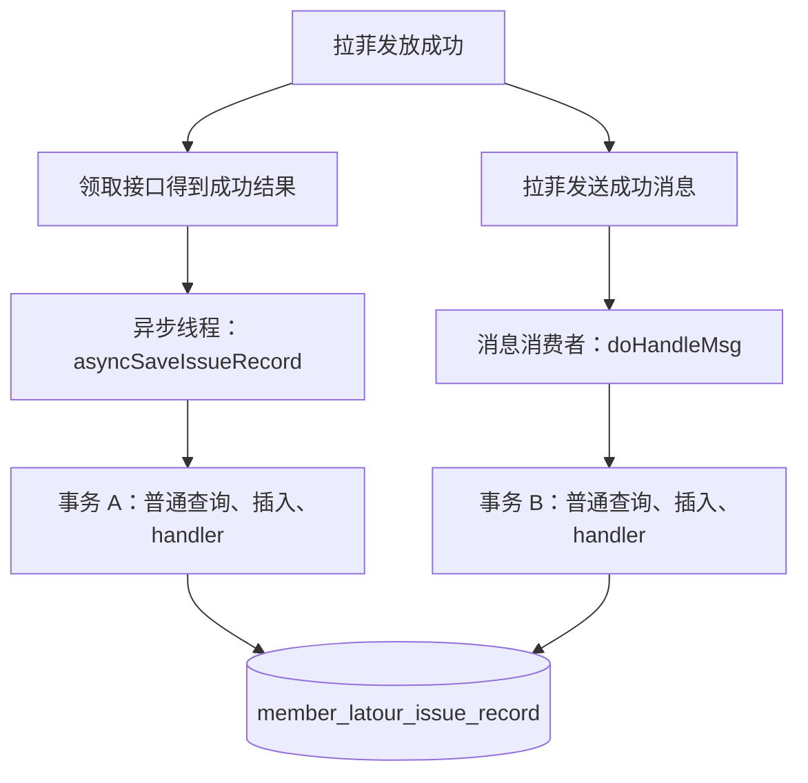
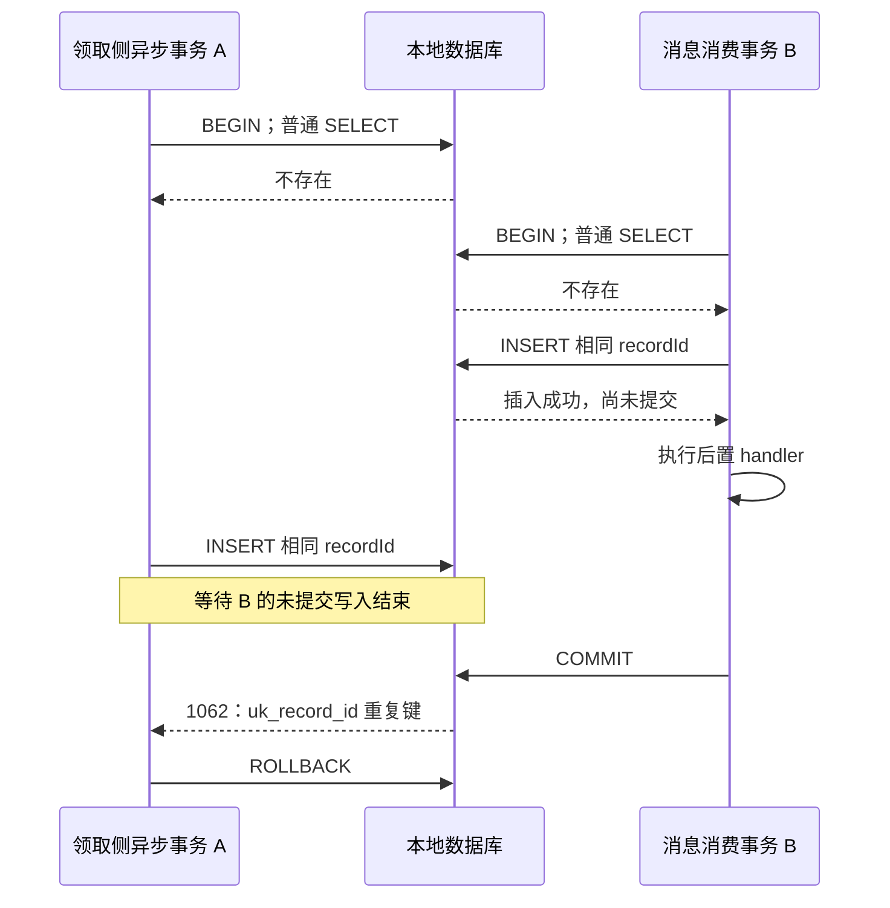
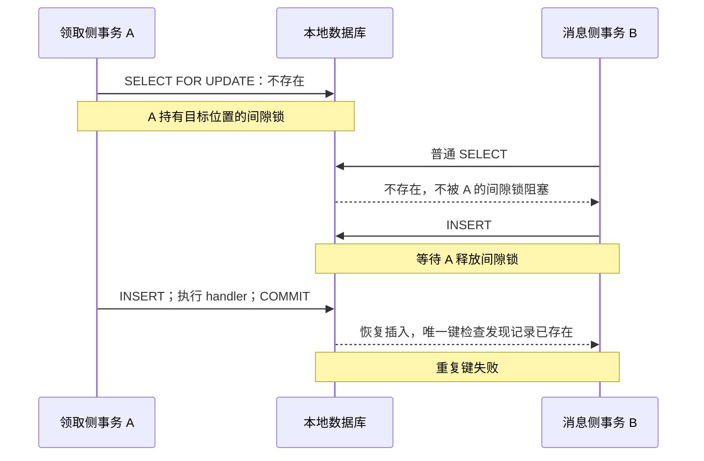
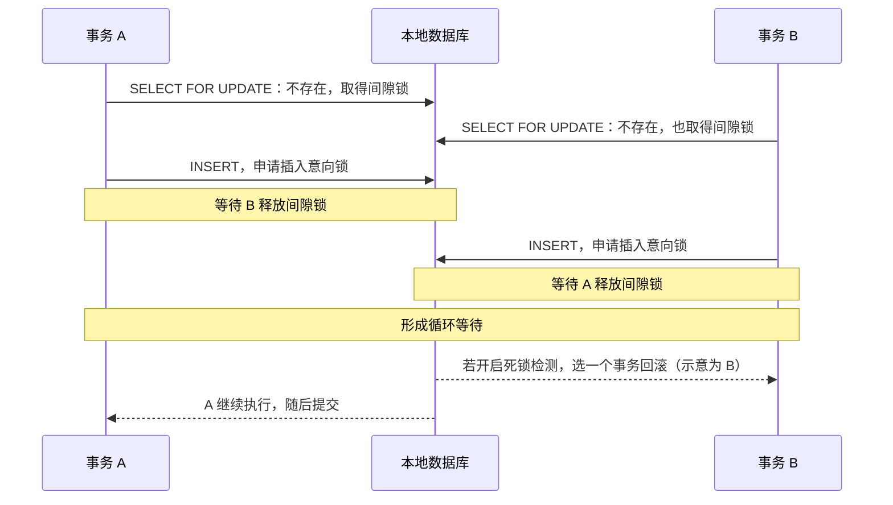

大家好，我是小林。

说个很早之前自己遇到过数据库死锁问题。

有个业务主要逻辑就是新增订单、修改订单、查询订单等操作。然后因为订单是不能重复的，所以当时在新增订单的时候做了幂等性校验，做法就是在新增订单记录之前，先通过 `select ... for update` 语句查询订单是否存在，如果不存在才插入订单记录。

而正是因为这样的操作，当业务量很大的时候，就可能会出现死锁。

接下来跟大家聊下 **为什么会发生死锁，以及怎么避免死锁** 。

## 死锁的发生

本次案例使用存储引擎 Innodb，隔离级别为可重复读（RR）。

接下来，我用实战的方式来带大家看看死锁是怎么发生的。

我建了一张订单表，其中 id 字段为主键索引，order\_no 字段普通索引，也就是非唯一索引：

```sql
CREATE TABLE `t_order` (
  `id` int NOT NULL AUTO_INCREMENT,
  `order_no` int DEFAULT NULL,
  `create_date` datetime DEFAULT NULL,
  PRIMARY KEY (`id`),
  KEY `index_order` (`order_no`) USING BTREE
) ENGINE=InnoDB ;
```

然后，先 `t_order` 表里现在已经有了 6 条记录：


假设这时有两事务，一个事务要插入订单 1007 ，另外一个事务要插入订单 1008，因为需要对订单做幂等性校验，所以两个事务先要查询该订单是否存在，不存在才插入记录，过程如下：


可以看到，两个事务都陷入了等待状态（前提没有打开死锁检测），也就是发生了死锁，因为都在相互等待对方释放锁。

这里在查询记录是否存在的时候，使用了 `select ... for update` 语句，目的为了防止事务执行的过程中，有其他事务插入了记录，而出现幻读的问题。

如果没有使用 `select ... for update` 语句，而使用了单纯的 select 语句，如果是两个订单号一样的请求同时进来，就会出现两个重复的订单，有可能出现幻读，如下图：


## 为什么会产生死锁？

可重复读隔离级别下，是存在幻读的问题。

**Innodb 引擎为了解决「可重复读」隔离级别下的幻读问题，就引出了 next-key 锁** ，它是记录锁和间隙锁的组合。

- Record Lock，记录锁，锁的是记录本身；
- Gap Lock，间隙锁，锁的就是两个值之间的空隙，以防止其他事务在这个空隙间插入新的数据，从而避免幻读现象。

普通的 select 语句是不会对记录加锁的，因为它是通过 MVCC 的机制实现的快照读，如果要在查询时对记录加行锁，可以使用下面这两个方式：

```sql
begin;
//对读取的记录加共享锁
select ... lock in  mode;
commit; //锁释放

begin;
//对读取的记录加排他锁
select ... for update;
commit; //锁释放
```

行锁的释放时机是在事务提交（commit）后，锁就会被释放，并不是一条语句执行完就释放行锁。

比如，下面事务 A 查询语句会锁住 `(2, +∞]` 范围的记录，然后期间如果有其他事务在这个锁住的范围插入数据就会被阻塞。


next-key 锁的加锁规则其实挺复杂的，在一些场景下会退化成记录锁或间隙锁，我之前也写一篇加锁规则，详细可以看这篇： [MySQL 是怎么加锁的？ (opens new window)](https://xiaolincoding.com/mysql/lock/how_to_lock.html)

需要注意的是，如果 update 语句的 where 条件没有用到索引列，那么就会全表扫描，在一行行扫描的过程中，不仅给行记录加上了行锁，还给行记录两边的空隙也加上了间隙锁，相当于锁住整个表，然后直到事务结束才会释放锁。

所以在线上千万不要执行没有带索引条件的 update 语句，不然会造成业务停滞，我有个读者就因为干了这个事情，然后被老板教育了一波，详细可以看这篇： [update 没加索引会锁全表？ (opens new window)](https://xiaolincoding.com/mysql/lock/update_index.html)

回到前面死锁的例子。


事务 A 在执行下面这条语句的时候：

```sql
select id from t_order where order_no = 1007 for update;
```

我们可以通过 `select * from performance_schema.data_locks\G;` 这条语句，查看事务执行 SQL 过程中加了什么锁。


从上图可以看到，共加了两个锁，分别是：

- 表锁：X 类型的意向锁；
- 行锁：X 类型的next-key 锁（临键锁）

这里我们重点关注行锁，图中 LOCK\_TYPE 中的 RECORD 表示行级锁，而不是记录锁的意思，通过 LOCK\_MODE 可以确认是 next-key 锁，还是间隙锁，还是记录锁：

- 如果 LOCK\_MODE 为 `X`，说明是 X 型的 next-key 锁；
- 如果 LOCK\_MODE 为 `X, REC_NOT_GAP`，说明是 X 型的记录锁；
- 如果 LOCK\_MODE 为 `X, GAP`，说明是 X 型的间隙锁；

**因此，此时事务 A 在二级索引（INDEX\_NAME: index\_order）上加的是 X 型的 next-key 锁，锁范围是`(1006, +∞]`** 。

next-key 锁的范围 (1006, +∞\]，是怎么确定的？

根据我的经验，如果 LOCK\_MODE 是 next-key 锁或者间隙锁，那么 LOCK\_DATA 就表示锁的范围最右值，此次的事务 A 的 LOCK\_DATA 是 supremum pseudo-record，表示的是 +∞。然后锁范围的最左值是 t\_order 表中最后一个记录的 index\_order 的值，也就是 1006。因此，next-key 锁的范围 (1006, +∞\]。

TIP

有的读者问， [MySQL 是怎么加锁的？ (opens new window)](https://xiaolincoding.com/mysql/lock/how_to_lock.html) 这篇文章讲非唯一索引等值查询时，说「当查询的记录不存在时，加 next-key lock，然后会退化为间隙锁」。为什么上面事务 A 的 next-key lock 并没有退化为间隙锁？

如果表中最后一个记录的 order\_no 为 1005，那么等值查询 order\_no = 1006（不存在），就是 next key lock，如上面事务 A 的情况。

如果表中最后一个记录的 order\_no 为 1010，那么等值查询 order\_no = 1006（不存在），就是间隙锁，比如下图：


当事务 B 往事务 A next-key 锁的范围 (1006, +∞\] 里插入 id = 1008 的记录就会被锁住：

```sql
Insert into t_order (order_no, create_date) values (1008, now());
```

因为当我们执行以下插入语句时，会在插入间隙上获取插入意向锁， **而插入意向锁与间隙锁是冲突的，所以当其它事务持有该间隙的间隙锁时，需要等待其它事务释放间隙锁之后，才能获取到插入意向锁。而间隙锁与间隙锁之间是兼容的，所以两个事务中 `select ... for update` 语句并不会相互影响** 。

案例中的事务 A 和事务 B 在执行完后 `select ... for update` 语句后都持有范围为`(1006,+∞]`的next-key 锁，而接下来的插入操作为了获取到插入意向锁，都在等待对方事务的间隙锁释放，于是就造成了循环等待，导致死锁。

> 为什么间隙锁与间隙锁之间是兼容的？

在MySQL官网上还有一段非常关键的描述：

*Gap locks in InnoDB are “purely inhibitive”, which means that their only purpose is to prevent other transactions from Inserting to the gap. Gap locks can co-exist. A gap lock taken by one transaction does not prevent another transaction from taking a gap lock on the same gap. There is no difference between shared and exclusive gap locks. They do not conflict with each other, and they perform the same function.*

**间隙锁的意义只在于阻止区间被插入** ，因此是可以共存的。 **一个事务获取的间隙锁不会阻止另一个事务获取同一个间隙范围的间隙锁** ，共享和排他的间隙锁是没有区别的，他们相互不冲突，且功能相同，即两个事务可以同时持有包含共同间隙的间隙锁。

这里的共同间隙包括两种场景：

- 其一是两个间隙锁的间隙区间完全一样；
- 其二是一个间隙锁包含的间隙区间是另一个间隙锁包含间隙区间的子集。

但是有一点要注意， **next-key lock 是包含间隙锁+记录锁的，如果一个事务获取了 X 型的 next-key lock，那么另外一个事务在获取相同范围的 X 型的 next-key lock 时，是会被阻塞的** 。

比如，一个事务持有了范围为 (1, 10\] 的 X 型的 next-key lock，那么另外一个事务在获取相同范围的 X 型的 next-key lock 时，就会被阻塞。

虽然相同范围的间隙锁是多个事务相互兼容的，但对于记录锁，我们是要考虑 X 型与 S 型关系。X 型的记录锁与 X 型的记录锁是冲突的，比如一个事务执行了 select... where id = 1 for update，后一个事务在执行这条语句的时候，就会被阻塞的。

但是还要注意！对于这种范围为 (1006, +∞\] 的 next-key lock，两个事务是可以同时持有的，不会冲突。因为 +∞ 并不是一个真实的记录，自然就不需要考虑 X 型与 S 型关系。

> 插入意向锁是什么？

注意！插入意向锁名字虽然有意向锁，但是它并不是意向锁，它是一种特殊的间隙锁。

在MySQL的官方文档中有以下重要描述：

*An Insert intention lock is a type of gap lock set by Insert operations prior to row Insertion. This lock signals the intent to Insert in such a way that multiple transactions Inserting into the same index gap need not wait for each other if they are not Inserting at the same position within the gap. Suppose that there are index records with values of 4 and 7. Separate transactions that attempt to Insert values of 5 and 6, respectively, each lock the gap between 4 and 7 with Insert intention locks prior to obtaining the exclusive lock on the Inserted row, but do not block each other because the rows are nonconflicting.*

这段话表明尽管 **插入意向锁是一种特殊的间隙锁，但不同于间隙锁的是，该锁只用于并发插入操作** 。

如果说间隙锁锁住的是一个区间，那么「插入意向锁」锁住的就是一个点。因而从这个角度来说，插入意向锁确实是一种特殊的间隙锁。

插入意向锁与间隙锁的另一个非常重要的差别是：尽管「插入意向锁」也属于间隙锁，但两个事务却不能在同一时间内，一个拥有间隙锁，另一个拥有该间隙区间内的插入意向锁（当然，插入意向锁如果不在间隙锁区间内则是可以的）。

另外，我补充一点，插入意向锁的生成时机：

- 每插入一条新记录，都需要看一下待插入记录的下一条记录上是否已经被加了间隙锁，如果已加间隙锁，此时会生成一个插入意向锁，然后锁的状态设置为等待状态（ *PS：MySQL 加锁时，是先生成锁结构，然后设置锁的状态，如果锁状态是等待状态，并不是意味着事务成功获取到了锁，只有当锁状态为正常状态时，才代表事务成功获取到了锁* ），现象就是 Insert 语句会被阻塞。

## Insert 语句是怎么加行级锁的？

Insert 语句在正常执行时是不会生成锁结构的，它是靠聚簇索引记录自带的 trx\_id 隐藏列来作为 **隐式锁** 来保护记录的。

> 什么是隐式锁？

当事务需要加锁的时，如果这个锁不可能发生冲突，InnoDB会跳过加锁环节，这种机制称为隐式锁。隐式锁是 InnoDB 实现的一种延迟加锁机制，其特点是只有在可能发生冲突时才加锁，从而减少了锁的数量，提高了系统整体性能。

隐式锁就是在 Insert 过程中不加锁，只有在特殊情况下，才会将隐式锁转换为显示锁，这里我们列举两个场景。

- 如果记录之间加有间隙锁，为了避免幻读，此时是不能插入记录的；
- 如果 Insert 的记录和已有记录存在唯一键冲突，此时也不能插入记录；

### 1、记录之间加有间隙锁

每插入一条新记录，都需要看一下待插入记录的下一条记录上是否已经被加了间隙锁，如果已加间隙锁，此时会生成一个插入意向锁，然后锁的状态设置为等待状态（ *PS：MySQL 加锁时，是先生成锁结构，然后设置锁的状态，如果锁状态是等待状态，并不是意味着事务成功获取到了锁，只有当锁状态为正常状态时，才代表事务成功获取到了锁* ），现象就是 Insert 语句会被阻塞。

举个例子，现在 t\_order 表中，只有这些数据， **order\_no 是二级索引** 。


现在，事务 A 执行了下面这条语句。

```sql
# 事务 A
mysql> begin;
Query OK, 0 rows affected (0.01 sec)

mysql> select * from t_order where order_no = 1006 for update;
Empty set (0.01 sec)
```

接着，我们执行 `select * from performance_schema.data_locks\G;` 语句 ，确定事务 A 加了什么类型的锁，这里只关注在记录上加锁的类型。


本次的例子加的是 next-key 锁（记录锁+间隙锁），锁范围是`（1005, +∞]`。

然后，有个事务 B 在这个间隙锁中，插入了一个记录，那么此时该事务 B 就会被阻塞：

```sql
# 事务 B 插入一条记录
mysql> begin;
Query OK, 0 rows affected (0.01 sec)

mysql> insert into t_order(order_no, create_date) values(1010,now());
### 阻塞状态。。。。
```

接着，我们执行 `select * from performance_schema.data_locks\G;` 语句 ，确定事务 B 加了什么类型的锁，这里只关注在记录上加锁的类型。


可以看到，事务 B 的状态为等待状态（LOCK\_STATUS: WAITING），因为向事务 A 生成的 next-key 锁（记录锁+间隙锁）范围`（1005, +∞]` 中插入了一条记录，所以事务 B 的插入操作生成了一个插入意向锁（`LOCK_MODE: X,INSERT_INTENTION`），锁的状态是等待状态，意味着事务 B 并没有成功获取到插入意向锁，因此事务 B 发生阻塞。

### 2、遇到唯一键冲突

如果在插入新记录时，插入了一个与「已有的记录的主键或者唯一二级索引列值相同」的记录（不过可以有多条记录的唯一二级索引列的值同时为NULL，这里不考虑这种情况），此时插入就会失败，然后对于这条记录加上了 **S 型的锁** 。

- 如果主键索引重复，插入新记录的事务会给已存在的主键值重复的聚簇索引记录 **添加 S 型记录锁** 。
- 如果唯一二级索引重复，插入新记录的事务都会给已存在的二级索引列值重复的二级索引记录 **添加 S 型 next-key 锁** 。

#### 主键索引冲突

下面举个「主键冲突」的例子，MySQL 8.0 版本，事务隔离级别为可重复读（默认隔离级别）。

t\_order 表中的 id 字段为主键索引，并且已经存在 id 值为 5 的记录，此时有个事务，插入了一条 id 为 5 的记录，就会报主键索引冲突的错误。


但是除了报错之外，还做一个很重要的事情，就是对 id 为 5 的这条记录加上了 **S 型的记录锁** 。

可以执行 `select * from performance_schema.data_locks\G;` 语句，确定事务加了什么锁。


可以看到，主键索引为 5 （LOCK\_DATA）的这条记录中加了锁类型为 S 型的记录锁。注意，这里 LOCK\_TYPE 中的 RECORD 表示行级锁，而不是记录锁的意思。如果是 S 型记录锁的话，LOCK\_MODE 会显示 `S, REC_NOT_GAP`。

所以，在隔离级别是「可重复读」的情况下，如果在插入数据的时候，发生了主键索引冲突，插入新记录的事务会给已存在的主键值重复的聚簇索引记录 **添加 S 型记录锁** 。

#### 唯一二级索引冲突

下面举个「唯一二级索引冲突」的例子，MySQL 8.0 版本，事务隔离级别为可重复读（默认隔离级别）。

t\_order 表中的 order\_no 字段为唯一二级索引，并且已经存在 order\_no 值为 1001 的记录，此时事务 A，插入了 order\_no 为 1001 的记录，就出现了报错。


但是除了报错之外，还做一个很重要的事情，就是对 order\_no 值为 1001 这条记录加上了 **S 型的 next-key 锁** 。

我们可以执行 `select * from performance_schema.data_locks\G;` 语句 ，确定事务加了什么类型的锁，这里只关注在记录上加锁的类型。


可以看到， **index\_order 二级索引加了 S 型的 next-key 锁，范围是(-∞, 1001\]** 。注意，这里 LOCK\_TYPE 中的 RECORD 表示行级锁，而不是记录锁的意思。如果是记录锁的话，LOCK\_MODE 会显示 `S, REC_NOT_GAP`。

此时，事务 B 执行了 select \* from t\_order where order\_no = 1001 for update; 就会阻塞，因为这条语句想加 X 型的锁，是与 S 型的锁是冲突的，所以就会被阻塞。


我们也可以从 performance\_schema.data\_locks 这个表中看到，事务 B 的状态（LOCK\_STATUS）是等待状态，加锁的类型 X 型的记录锁（LOCK\_MODE: X,REC\_NOT\_GAP ）。


上面的案例是针对唯一二级索引重复而插入失败的场景。

> 接下来，分析两个事务执行过程中，执行了相同的 insert 语句的场景。

现在 t\_order 表中，只有这些数据， **order\_no 为唯一二级索引** 。


在隔离级别可重复读的情况下，开启两个事务，前后执行相同的 Insert 语句，此时 **事务 B 的 Insert 语句会发生阻塞** 。


两个事务的加锁过程：

- 事务 A 先插入 order\_no 为 1006 的记录，可以插入成功，此时对应的唯一二级索引记录被「隐式锁」保护，此时还没有实际的锁结构（执行完这里的时候，你可以看查 performance\_schema.data\_locks 信息，可以看到这条记录是没有加任何锁的）；
- 接着，事务 B 也插入 order\_no 为 1006 的记录，由于事务 A 已经插入 order\_no 值为 1006 的记录，所以事务 B 在插入二级索引记录时会遇到重复的唯一二级索引列值，此时事务 B 想获取一个 S 型 next-key 锁，但是事务 A 并未提交， **事务 A 插入的 order\_no 值为 1006 的记录上的「隐式锁」会变「显示锁」且锁类型为 X 型的记录锁，所以事务 B 向获取 S 型 next-key 锁时会遇到锁冲突，事务 B 进入阻塞状态** 。

我们可以执行 `select * from performance_schema.data_locks\G;` 语句 ，确定事务加了什么类型的锁，这里只关注在记录上加锁的类型。

先看事务 A 对 order\_no 为 1006 的记录加了什么锁？

从下图可以看到， **事务 A 对 order\_no 为 1006 记录加上了类型为 X 型的记录锁** （ *注意，这个是在执行事务 B 之后才产生的锁，没执行事务 B 之前，该记录还是隐式锁* ）。


然后看事务 B 想对 order\_no 为 1006 的记录加什么锁？

从下图可以看到， **事务 B 想对 order\_no 为 1006 的记录加 S 型的 next-key 锁，但是由于事务 A 在该记录上持有了 X 型的记录锁，这两个锁是冲突的，所以导致事务 B 处于等待状态** 。


从这个实验可以得知，并发多个事务的时候，第一个事务插入的记录，并不会加锁，而是会用隐式锁保护唯一二级索引的记录。

但是当第一个事务还未提交的时候，有其他事务插入了与第一个事务相同的记录，第二个事务就会 **被阻塞** ， **因为此时第一事务插入的记录中的隐式锁会变为显示锁且类型是 X 型的记录锁，而第二个事务是想对该记录加上 S 型的 next-key 锁，X 型与 S 型的锁是冲突的** ，所以导致第二个事务会等待，直到第一个事务提交后，释放了锁。

如果 order\_no 不是唯一二级索引，那么两个事务，前后执行相同的 Insert 语句，是不会发生阻塞的，就如前面的这个例子。


## 机制补充：唯一键冲突为什么还会加锁？

> 补充于 2026-11-21。以下解释 InnoDB 的唯一性检查与事务锁机制，以 MySQL 5.7 实现为主要参照。具体记录锁、间隙锁和 next-key 锁的范围需结合版本、隔离级别及主键/唯一二级索引分别判断。这里的“唯一键冲突”不是一种独立锁类型。

### 1. 先锁住可能重复的记录，再判断是否报错

“插入已经失败，为什么还加锁”容易让人误以为数据库先返回错误，之后又补了一把锁。典型的实际顺序是：

```text
沿唯一索引查找待插入的键
    ↓
找到可能重复的索引记录
    ↓
申请检查需要的事务锁
    ├─ 与其他事务冲突：等待，随后重新检查
    └─ 可以获得：继续判断记录是否有效、是否违反唯一性
                        ↓
                  返回重复键或继续插入
```

MySQL 5.7 的 `row_ins_duplicate_error_in_clust()` 处理聚簇索引重复检查，`row_ins_scan_sec_index_for_duplicate()` 处理唯一二级索引重复检查。普通插入路径会对可能重复的记录申请 S 锁；需要更新、替换冲突记录的路径则申请 X 锁。重复判断函数 `row_ins_dupl_error_with_rec()` 的调用前提也包括已经取得相应记录锁。[MySQL 5.7：row0ins.cc](https://github.com/mysql/mysql-server/blob/5.7/storage/innobase/row/row0ins.cc)

S 锁不是为了修改已有记录，而是让依赖这条记录的唯一性检查，与其他事务的删除、更新、插入结果协调起来。多个普通插入者可以同时持有 S 锁；需要修改冲突记录的 X 锁则与其冲突。

### 2. 发现相同键值，不代表已经能够确定结果

下面使用主键举例，避免把唯一二级索引扫描涉及的间隙范围混进基本时序：

```sql
CREATE TABLE t_unique_demo (
    id BIGINT PRIMARY KEY,
    value INT NOT NULL
) ENGINE=InnoDB;
```

假设开始时没有 `id=1`：

| 时间 | 事务 A | 事务 B |
| --- | --- | --- |
| T1 | `BEGIN` | |
| T2 | `INSERT INTO t_unique_demo VALUES (1, 10)`，尚未提交 | |
| T3 | | `BEGIN` |
| T4 | | 尝试插入 `(1, 20)`，发现相同主键，申请 S 记录锁，等待 A |
| T5a | 如果 A `COMMIT` | B 被唤醒、重新检查，确认重复并返回 1062 |
| T5b | 如果 A `ROLLBACK` | B 被唤醒、重新检查，可以继续尝试插入 |

T5a、T5b 是两个互斥的分支。**B 在 T4 只是遇到了可能的重复记录并进入等待，还不能把最终重复键错误当成已经返回的事实。**

唯一性检查不能简单使用普通 SELECT 的 MVCC 快照：即使事务快照看不到另一个事务刚插入、刚提交的记录，也不能据此允许重复值成功提交。检查必须处理当前写入及其提交、回滚结果。

A 对未提交插入的保护最初可能表现为隐式 X 锁；发生竞争时，InnoDB 可以将其转换为显式锁，并让 B 的 S 锁请求进入等待队列。“暂时没有独立的显式锁对象”不等于“没有锁保护”。

### 3. 报错后为什么锁还可能保留？

这里要分清两个问题：**检查时为什么加锁，以及检查结束后为什么没有立即释放锁。** 前者属于并发约束检查，后者涉及 InnoDB 的事务锁生命周期，不能笼统解释成“返回错误必须锁到事务结束”。

普通重复键错误通常只回滚当前 SQL，不会自动结束显式事务。语句回滚也不会像整个事务结束一样释放其持有的记录锁。因此，在这里讨论的重复键检查路径中，插入报错后仍可能持有检查取得的 S 锁。[MySQL：InnoDB 错误处理](https://dev.mysql.com/doc/refman/8.0/en/innodb-error-handling.html)

例如，预先提交一条记录：

```sql
INSERT INTO t_unique_demo VALUES (1, 10);
```

然后在两个会话中依次执行：

```sql
-- 会话 A：显式开启事务
BEGIN;
INSERT INTO t_unique_demo VALUES (1, 20);
-- 返回 1062；事务仍然没有结束，对重复主键记录的 S 锁可能继续保留

-- 会话 B：此时执行
BEGIN;
DELETE FROM t_unique_demo WHERE id = 1;
-- 需要该记录的 X 锁，与 A 的 S 锁冲突，等待

-- 回到会话 A
ROLLBACK;
-- A 结束事务并释放锁，B 才能继续

-- 回到会话 B：实验结束后撤销删除
ROLLBACK;
```

如果是 `autocommit=1`、没有外层显式事务的独立 INSERT，错误处理后该事务结束，锁通常随之释放。不能把上述显式事务中的持锁现象，套用为“每次重复键报错都会长期锁住数据”。

MySQL 5.7 源码还说明，对可能重复记录加锁，历史上也服务于逻辑日志重放时重复键判断的一致性。这不表示 ROW 模式可以直接跳过唯一性检查，也不表示所有锁持有时长在理论上都不可优化。[MySQL 5.7：重复键检查说明](https://github.com/mysql/mysql-server/blob/5.7/storage/innobase/row/row0ins.cc)

### 4. 单向等待怎样变成死锁？

前面的 A 未提交、B 等 A，只是单向等待。一个经典的死锁场景需要再加入事务 C：

| 时间 | 事务 A | 事务 B | 事务 C |
| --- | --- | --- | --- |
| T1 | 插入 `id=1`，持有未提交写入的 X 保护 | | |
| T2 | | 尝试插入 `id=1`，申请 S 锁，等待 A | |
| T3 | | | 尝试插入 `id=1`，申请 S 锁，等待 A |
| T4 | `ROLLBACK`，撤销插入并释放 X 锁 | 等待中的 S 锁请求可以被授予 | 等待中的 S 锁请求可以被授予 |
| T5 | | 准备继续插入，需要 X 锁，但被 C 的 S 锁阻塞 | 准备继续插入，需要 X 锁，但被 B 的 S 锁阻塞 |

此时等待关系变成：

```text
B 持有 S，申请 X → 等待 C 释放 S
C 持有 S，申请 X → 等待 B 释放 S
```

S 与 S 兼容，所以两个检查者能同时通过共享锁等待；随后它们都要执行插入，X 请求又不能越过对方已经持有的 S 锁，于是可能形成循环等待。启用死锁检测时，InnoDB 会选择一个事务回滚，另一个事务才有机会继续。这是官方文档列出的重复插入死锁场景；实际执行结果仍受时序影响。[MySQL：不同语句设置的锁及重复键死锁示例](https://dev.mysql.com/doc/refman/8.0/en/innodb-locks-set.html)

因此，**唯一键能保证不会成功提交两条冲突记录，但不能保证竞争插入永不等待、永不死锁。** 应用仍需区分 1062、1213、1205，并按事务边界处理。

### 5. INSERT IGNORE 和冲突更新会不会绕过锁？

| 写法 | 发生重复时的行为 | 典型加锁特点 |
| --- | --- | --- |
| 普通 `INSERT` | 返回重复键错误 | 对可能重复的索引记录申请 S 锁 |
| `INSERT IGNORE` | 将可忽略的重复键错误转为警告，跳过该行 | 仍需做唯一性检查，可能取得 S 锁 |
| `INSERT ... ON DUPLICATE KEY UPDATE` | 更新冲突记录 | 需要 X 锁；主键冲突与唯一二级索引冲突的范围可能不同 |
| `REPLACE` | 按替换语义处理冲突记录 | 需要 X 锁，并可能涉及多条冲突记录 |

`IGNORE` 改变错误处理方式，不取消约束检查。也不能认为 `ON DUPLICATE KEY UPDATE` 把 S 换成 X 就必然避免死锁：多行、多个唯一索引或不同加锁顺序仍可能产生循环等待。普通插入的 S 锁也不一定总是纯记录锁；唯一二级索引重复检查可能涉及 next-key 或间隙锁，需以实际现场为准。

### 6. 放回 DMS 影子表拷贝场景看

对于如下形态的拷贝语句，必须把源表和目标表上的锁分开：

```sql
INSERT IGNORE INTO ghost_table (...)
SELECT ...
FROM source_table
WHERE 主键范围条件
LOCK IN SHARE MODE;
```

- **源表**：显式锁定读对扫描范围加共享锁，可能与原表业务更新、删除冲突。
- **影子表**：成功插入的记录需要写入保护；遇到已存在的主键、唯一键时，仍要进行带锁的重复检查。
- **增量回放**：若需要更新同一条影子表记录，就可能与拷贝持有的共享锁发生冲突，反方向也可能由增量写入阻塞拷贝检查。

所以，“全量拷贝使用 INSERT IGNORE，遇到重复就跳过”不代表完全没有目标表锁竞争。分批事务的大小、持锁时间、拷贝与回放访问记录的顺序，都可能影响吞吐。以上解释的是可能机制，不能单凭 SQL 形态认定某次复制延迟或报警就是由它导致；仍需同时间点的持锁者、等待者和 SQL 证据。

### 7. 排查时具体看什么？

1. 确认冲突的是 `PRIMARY` 还是哪个唯一二级索引，不把所有重复键都当成主键冲突。
2. 区分锁请求是 `GRANTED` 还是 `WAITING`，看 S/X 和是否包含 GAP，不能只看到一个锁对象就认为已经获得锁。
3. 找到持有冲突锁的事务，确认它正在执行、已经空闲但未提交，还是只结束了失败语句而没有结束事务。
4. 还原等待方向：只有一方等待是锁等待；形成环才是死锁。并记录错误码和事务最终提交、回滚的位置。
5. MySQL 8.0 可结合 `performance_schema.data_locks`、`data_lock_waits`；MySQL 5.7 主要结合 `INFORMATION_SCHEMA.INNODB_TRX`、`INNODB_LOCKS`、`INNODB_LOCK_WAITS` 和 `SHOW ENGINE INNODB STATUS`。5.7 的这些视图并不完整枚举所有无竞争锁，不能把“没查到”直接当成“没有锁”。

## 如何避免死锁？

死锁的四个必要条件： **互斥、占有且等待、不可强占用、循环等待** 。只要系统发生死锁，这些条件必然成立，但是只要破坏任意一个条件就死锁就不会成立。

在数据库层面，有两种策略通过「打破循环等待条件」来解除死锁状态：

- **设置事务等待锁的超时时间** 。当一个事务的等待时间超过该值后，就对这个事务进行回滚，于是锁就释放了，另一个事务就可以继续执行了。在 InnoDB 中，参数 `innodb_lock_wait_timeout` 是用来设置超时时间的，默认值时 50 秒。
	当发生超时后，就出现下面这个提示：
- **开启主动死锁检测** 。主动死锁检测在发现死锁后，主动回滚死锁链条中的某一个事务，让其他事务得以继续执行。将参数 `innodb_deadlock_detect` 设置为 on，表示开启这个逻辑，默认就开启。
	当检测到死锁后，就会出现下面这个提示：

上面这个两种策略是「当有死锁发生时」的避免方式。

我们可以回归业务的角度来预防死锁，对订单做幂等性校验的目的是为了保证不会出现重复的订单，那我们可以直接将 order\_no 字段设置为唯一索引列，利用它的唯一性来保证订单表不会出现重复的订单，不过有一点不好的地方就是在我们插入一个已经存在的订单记录时就会抛出异常。

## 业务案例补充：皮肤领取的异步写入与消息写入为什么撞唯一键？

> 补充于 2026-11-21。以下根据 TLens 旧领取链路代码和 2026-11-20 的线上日志整理。代码事实、实际观测与用于解释机制的假设时序分别说明；未取得线上连接的实际隔离级别，不能直接套用原文案例的 RR 前提。

### 1. 同一条领取记录有两个写入入口

拉菲发放成功后，本地 `member_latour_issue_record` 有两条写入路径：领取接口提交异步任务写入，以及消费拉菲成功消息后写入。两条路径可能处理同一份拉菲 `recordId`，即使用户只点击了一次，也可能发生并发。



代码中的事务边界如下：

| 写入入口 | 事务入口 | 查询方法 | 后续操作 |
| --- | --- | --- | --- |
| 领取侧异步任务 | `BenefitIssueRecordRepository.asyncSaveIssueRecord()` 中的 `transactionTemplate.execute()` | `getIdByRecordId(userId, recordId)` | 不存在则插入，插入成功后执行 handler，然后提交 |
| 拉菲消息消费 | `LatourBenefitIssueConsumer.doHandleMsg()` 中的 `transactionTemplate.execute()` | `saveIssueRecord()` 内调用 `getMemberLatourIssueRecordDTO(userId, recordId)`，再调用 `selectByParam()` | 不存在则插入并执行 handler；已存在时按消息状态判断是否更新 |

**两条路径各自是一个数据库事务，不是两条路径共享同一个事务。** 同一条路径内的查询和插入也不是两个独立事务再套一个“外层事务”：MyBatis 与 `DataSourceTransactionManager` 使用同一个 `vipshopDs`，Mapper 调用参与当前线程中的 Spring 事务。

领取侧实际查询是：

```sql
SELECT id
FROM member_latour_issue_record
WHERE user_id = ? AND record_id = ?;
```

消息侧查询返回的字段更多，但同样是普通 `SELECT`，没有 `FOR UPDATE`。**进入事务并不会自动把普通查询变成锁定读。** 在 InnoDB 的 RC、RR 下，普通查询通常通过 MVCC 读取可见版本，不会因为另一事务插入了同一条未提交记录就等待它提交。[MySQL：事务隔离级别](https://dev.mysql.com/doc/refman/8.0/en/innodb-transaction-isolation-levels.html)

### 2. 同一个事务内先查后写，为什么仍然重复键？

先查后写并不是一个原子操作。查询得到“不存在”，只表示这次查询没有看到记录，无法保证后面的插入仍然没有竞争者。

下面是一种可能的执行顺序，不代表已经还原了某条线上消息的真实时序：



另一种顺序是消息侧先插入但没有提交，领取侧随后普通查询。领取侧看不到未提交数据，也会判断不存在；直到插入阶段才等待消息侧事务结束。如果消息侧提交，领取侧插入报重复键；如果消息侧回滚，领取侧插入可能继续成功。

因此，“消息侧先开启事务”“消息侧先插入”“消息侧先提交”是三个不同的时间点。不能仅凭领取侧报重复键，就断定消息一定先开始消费，更不能断定线上通常都是消息先到。

这里与原文中 `order_no` 为普通索引的例子还有一个区别：**本地领取表有 `uk_record_id` 唯一键，所以不会成功存入两条相同唯一键的记录；竞争表现为其中一方插入失败。** 唯一键守住了数据约束，但应用仍需要把这种竞争处理成合适的业务结果。

这类等待也不等于死锁。上图只有 A 等待 B，B 不等待 A，没有循环等待。重复键错误 `1062`、死锁错误 `1213`、锁等待超时 `1205` 应分别排查，不能把它们混为一谈。

### 3. 已经取得的线上证据，以及还不能下的结论

2026-11-20 的一个正式环境样本：

- 主机：`33.102.104.29`。
- 拉菲记录：`recordId=3865237649509`。
- [调用链 214781e217951638318268374e111c](https://x.alibaba-inc.com/tracePage/traceDetail?traceId=214781e217951638318268374e111c)。
- 入口日志：`syncIssueRecord=false`、`claimWin=true`、`_success=Y`，走的是旧异步链路。

| 操作 | 时间（北京时间） | 观测结果 |
| --- | --- | --- |
| 领取入口返回 | 16:37:11.921 | 入口记录领取成功；异步写入尚未完成 |
| 本地记录 QUERY | 16:37:11.936，耗时 1ms | 后续执行了 INSERT，结合代码可知查询分支判断不存在 |
| 本地记录 INSERT | 16:37:12.135，耗时 37ms | 插入失败，异常指向 `uk_record_id` 重复键 |
| 本地事务 ROLLBACK | 16:37:12.183 | 异步事务回滚 |

查询结束到插入开始之间约有 **198ms**，这是观测到的竞争窗口，不能直接命名为某个 Java 方法的耗时。另一失败样本的窗口约为 142ms，旧代码也观察到约 2ms 的窗口并发生重复键，说明即使窗口很短，也不能依赖先查后写保证并发安全。

这些证据确认了领取侧异步插入失败；但尚未取得同一 `recordId` 的另一写入方完整日志，不能把具体消息消费者的插入、提交时间作为已确认事实。可能的竞争入口由代码给出，具体谁先写成功仍需用同一记录的两侧日志闭环验证。

项目代码没有显式设置事务隔离级别，`TransactionTemplate` 沿用连接设置。未取得线上应用连接的实际值，**不能直接认定为 RC 或 RR，也不能通过重复键反推出隔离级别**；上述普通查询竞争在两者下都可能出现。后续应在应用实际使用的连接上核对隔离级别、物理路由、索引及提交时间，不能用另一个 DMS 会话的默认值代替应用连接值。

### 4. 只给领取侧查询加 FOR UPDATE，能解决吗？

不能保证。假设 RR 下领取侧对不存在记录的目标位置取得了间隙锁，消息侧仍然使用普通查询：



锁阻止了消息侧的插入，却没有让消息侧之前的普通查询等待并重新判断。等待结束后恢复的是 `INSERT`，数据库不会替应用重新执行一次 `SELECT`。这个示意时序只是单向等待，不会仅因此构成死锁。

在 RC 下，查询通常不对不存在记录加间隙锁，两边仍可能都查不到，再竞争插入。是否发生其他锁等待，还取决于实际索引和执行计划。

### 5. 两边都改成 FOR UPDATE，重复键会变成死锁吗？

**不是所有重复键都会变成死锁，但在 RR 下可能引入“共同持有间隙锁，再互相等待插入”的死锁。** 需要区分以下条件：

| 条件与时序 | 可能结果 |
| --- | --- |
| RC，记录不存在，两边都锁定查询 | 通常没有查询间隙锁，仍可能重复键 |
| A 已插入未提交，B 才锁定查询同一记录 | B 等 A 提交后读到记录，跳过插入；若 A 回滚，则需按实际查询结果继续处理 |
| RR，记录不存在，两边都取得覆盖目标位置的兼容间隙锁，然后分别插入 | 可能产生循环等待，由死锁检测回滚其中一个事务 |

第三种情形可以表示为：



其前提是两边确实取得了可以共存的间隙锁。不要把结论推广成“所有 X 型 next-key 锁都兼容”：next-key 锁包含真实记录锁的部分时，记录锁仍可能冲突；具体加锁范围由索引、谓词、数据分布和隔离级别决定。[MySQL：InnoDB 锁机制](https://dev.mysql.com/doc/refman/8.0/en/innodb-locking.html)

被死锁回滚的一方必须重新执行整个数据库事务，重新查询并判断；不能从旧的“查不到”结果直接接着插入。因此两侧增加锁定读，也没有消除异常恢复的需求。

### 6. 旧异步链路的业务影响，以及更合适的处理方式

旧链路中，领取接口只是提交异步任务，没有等待任务完成。异步任务中插入或 handler 抛异常，会被 catch 并标记事务回滚、记录错误，不会把已经返回给用户的领取成功改成失败。消息侧异常则回滚并向消费框架抛出，由其重试策略继续处理。

另外，旧事务把后置 handler 也包在里面。即使不改查询，`INSERT` 成功后对应记录的锁也会持有到事务结束；如果 handler 很慢，另一写入方可能等待更久。数据库回滚也不能撤销已经完成的外部 MQ、人群等调用。

改用 `FOR UPDATE` 会进一步把部分锁的持有时间提前到查询阶段，无法保证减少整体风险。对于“同一份领取记录可以被多个入口补写”的设计，更合适的原则是：

1. 保留唯一键作为最终约束；先查只用于减少重复插入，不承担并发正确性。
2. 只对确认属于重复键的异常做幂等恢复。按 `userId + recordId` 回查并确认已有记录确实对应本次领取，再按已保存处理；其他异常继续报错。
3. 回查要考虑事务可见性。旧链路如果在 RR 事务内已经建立快照，同一事务里的普通回查仍可能看不到竞争者刚提交的记录。可结束原事务后，在新事务或独立查询中回查；不要机械套用“catch 后原地普通 SELECT”。若原事务已被标记回滚，也不能把返回已有记录当作事务已成功提交。
4. 插入幂等与后置事件幂等分开设计。重复记录是否重放 handler，要看每个 handler 的幂等能力；现有逻辑是仅新插入成功时执行。记录存在不能独自证明所有后置事件都完成。
5. 若采用原子写入语句避免重复键异常，应明确冲突键、影响行数和 handler 触发条件。`INSERT IGNORE` 可能掩盖其他数据问题，`ON DUPLICATE KEY UPDATE` 也可能更新已有数据，不能只为消除日志而直接替换。

新增同步保存链路与旧链路还有事务上的区别：同步方法没有使用事务包住查询、插入和 handler，插入成功后 handler 失败不会回滚已落库记录。是否同步等待与是否使用事务是两件事，分析时需要分别核对。

本案例的代码与证据入口：

- [领取侧异步保存与消息侧保存实现](/Users/qiuhb/Project/tlens/tlens-service/src/main/java/com/taobao/tlens/benefit/receive/repository/BenefitIssueRecordRepository.java)。
- [消息消费者的事务入口](/Users/qiuhb/Project/tlens/tlens-service/src/main/java/com/taobao/tlens/metaq/LatourBenefitIssueConsumer.java)。
- [MyBatis 与事务管理器的数据源配置](/Users/qiuhb/Project/tlens/tlens-dal/src/main/java/com/taobao/tlens/dal/vipshop/config/VipshopDataSourceConfig.java)。
- [2026-11-20 发布后 TDDL 写成功率核查记录](/Users/qiuhb/Project/tlens/docs/design/skin-claim-validation/monitoring/release-write-success-investigation-20261120.md)。


---

最后说个段子：

面试官: 解释下什么是死锁?

应聘者: 你录用我,我就告诉你

面试官: 你告诉我,我就录用你

应聘者: 你录用我,我就告诉你

面试官: 卧槽滚！

**...........**

---

参考资料：

---

最新的图解文章都在公众号首发，别忘记关注哦！！如果你想加入百人技术交流群，扫码下方二维码回复「加群」。


← [MySQL 记录锁+间隙锁可以防止删除操作而导致的幻读吗？](https://www.xiaolincoding.com/mysql/lock/lock_phantom.html) [字节面试：加了什么锁，导致死锁的？](https://www.xiaolincoding.com/mysql/lock/show_lock.html) →

登录后查看评论