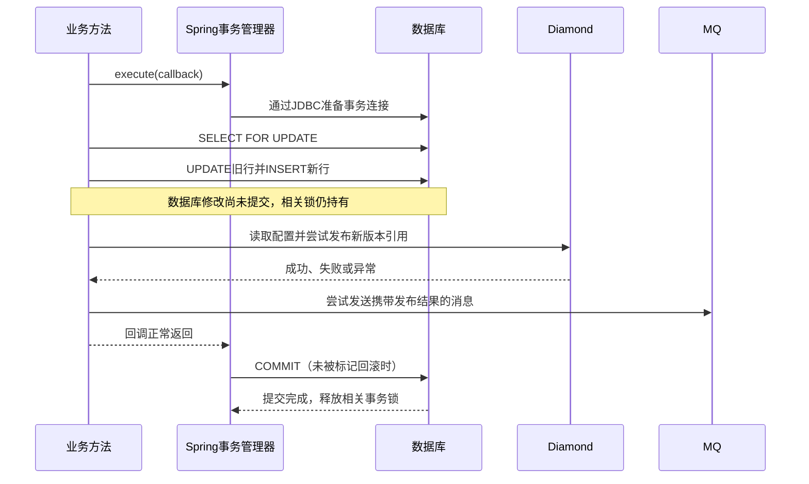
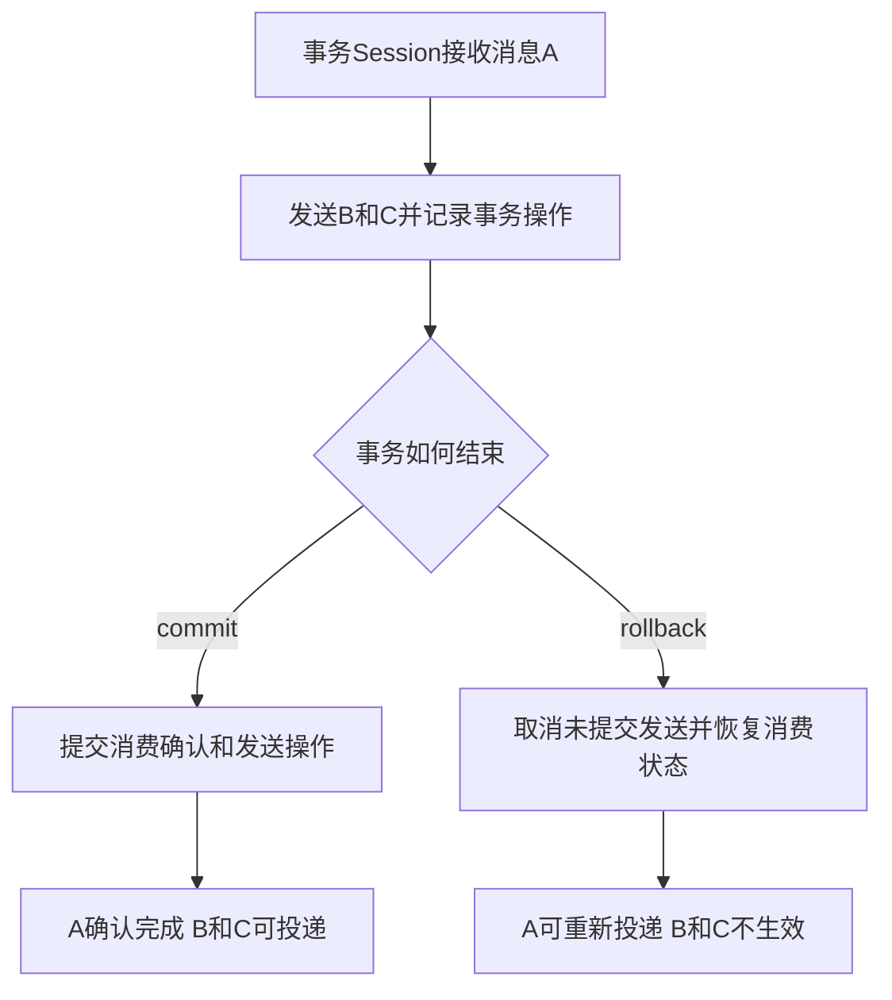
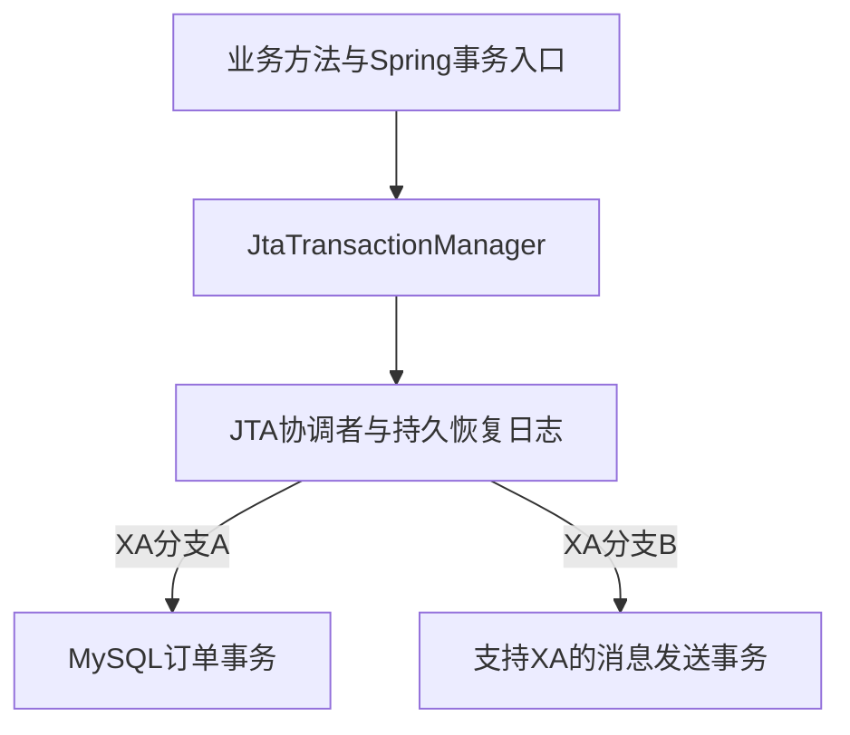

# Spring 事务与 MySQL 事务：连接管理、事务边界与 TLens 实例

Spring 事务定义并管理应用中的事务范围，通过具体事务管理器组织参与资源的操作。对 JDBC 数据库而言，Spring 负责连接复用、传播行为及提交回滚时机，MySQL/InnoDB 负责实际的数据修改、锁、恢复与持久化。

本文以普通同步 Java 调用、InnoDB 表和 TLens 的策略组修改为例。TLens 通过 TDDL 访问数据库；文中的单连接示意解释 JDBC 本地事务，不能据此推导跨物理分片的原子性。源码核对日期为 2026-11-22，未查询生产运行版本、动态开关或任务调度状态。

> [!important] 阅读时保持三个区分
> - Spring 中的一段逻辑事务范围，需要通过连接或其他资源句柄，才能对应到底层事务。
> - 数据库事务保证参与其中的数据库操作；Diamond 发布、普通消息发送和 Java 对象修改各有自己的边界。
> - CAS 防止某轮配置更新覆盖并发变化；旧消息是否仍有资格发布，需要额外的业务顺序检查。

## 1. Spring 与 MySQL 分别负责什么

| 层次 | 负责的事情 | 典型对象或操作 |
| --- | --- | --- |
| 业务层 | 定义哪些操作必须一起完成，哪些失败需要拒绝或补偿 | 修改策略组、创建订单 |
| Spring 事务层 | 管理事务范围、传播规则、事务状态与资源生命周期 | TransactionTemplate、TransactionInterceptor、PlatformTransactionManager |
| JDBC／TDDL／驱动层 | 提供连接，将事务控制和 SQL 传给数据库 | Connection、setAutoCommit、commit、rollback |
| MySQL/InnoDB | 执行数据库事务，控制可见性和锁，完成回滚、恢复和持久化 | 数据库会话、MVCC、undo、redo、事务锁 |

数据库事务提供一组数据库操作的原子提交能力；业务一致性还依赖约束和正确的业务逻辑。框架不会自动推导“版本替换只能成功一次”或“已完成的奖励不应改成失败”等规则。

Spring 提供的并非只有接口：事务管理器、模板、AOP 拦截、资源绑定、传播与清理流程都有实现。不同资源通过不同管理器接入。JDBC 事务管理器管理数据库连接；JMS 事务管理器管理消息 Session；JTA 管理器可接入跨资源协调器。即使两个系统各自支持事务，也需要正确参与协调，才能讨论跨资源原子性。[^spring-abstraction][^spring-jms][^spring-jta]

## 2. MySQL 如何开启和结束事务

普通 InnoDB 业务中，主要有三种控制方式。所有示例均假设在同一个数据库连接中执行；示例仅展示事务边界，不包含完整的转账校验逻辑。

| 方式 | 开始条件 | 结束方式 | 结束后的行为 |
| --- | --- | --- | --- |
| 单语句自动提交 | autocommit=1，且没有显式事务 | 每条语句完成自己的事务 | 下一条语句是另一个事务 |
| 显式事务 | START TRANSACTION，普通客户端 SQL 中也可用 BEGIN | COMMIT 或 ROLLBACK | 恢复先前的自动提交行为 |
| 关闭自动提交 | SET SESSION autocommit=0，随后进行数据库操作 | COMMIT 或 ROLLBACK 划分事务 | 仍保持关闭自动提交，后续操作进入下一事务 |

### 2.1 自动提交不等于没有事务

```sql
SET SESSION autocommit = 1;

UPDATE account SET balance = balance - 100 WHERE id = 1;
-- 第一条成功后已提交。

UPDATE account SET balance = balance + 100 WHERE id = 2;
-- 第二条属于另一个事务。
```

第二条失败，无法通过它自己的回滚撤销第一条已经提交的修改。多条 SQL 是否属于同一个事务，取决于会话的事务状态，而不是它们在业务代码中是否相邻。[^mysql-autocommit]

### 2.2 显式开启一段多语句事务

```sql
START TRANSACTION;

UPDATE account SET balance = balance - 100 WHERE id = 1;
UPDATE account SET balance = balance + 100 WHERE id = 2;

COMMIT;
-- 如果业务决定放弃，应在提交前执行 ROLLBACK。
```

若之前 autocommit=1，显式事务中的语句不会逐条自动提交，结束后恢复原来的自动提交行为。这个过程不要求把 @@session.autocommit 变量改成 0，因此仅看该变量，不能断定当前没有显式事务。[^mysql-start]

### 2.3 关闭自动提交后，连续划分多个事务

```sql
SET SESSION autocommit = 0;

-- 第一段事务
UPDATE account SET balance = balance - 100 WHERE id = 1;
UPDATE account SET balance = balance + 100 WHERE id = 2;
COMMIT;

-- 第二段事务，不需要再写 BEGIN
UPDATE account SET balance = balance - 50 WHERE id = 3;
UPDATE account SET balance = balance + 50 WHERE id = 4;
COMMIT;

-- 已结束上一段事务，再恢复会话的自动提交模式
SET SESSION autocommit = 1;
```

Spring 的 JDBC 本地事务通常通过 Connection.setAutoCommit(false) 控制提交模式，而不是要求业务方法手写 BEGIN。事务结束后，Spring 会按需要恢复连接设置，再归还连接池。

### 2.4 几个容易混淆的边界

- BEGIN 作用于当前连接对应的会话，不会让另一个连接的 SQL 自动加入。
- 在已有普通事务中再次 START TRANSACTION，不会创建真正的嵌套事务，而会隐式提交当前事务。
- 从 autocommit=0 改为 1，可能隐式提交尚未结束的事务；不能拿它替代 ROLLBACK。
- ALTER TABLE 等多数 DDL 会隐式提交。即使 MySQL 8.0 支持某些原子 DDL，也不能把任意 DDL 和业务 DML 当作一个可整体回滚的普通事务。[^mysql-implicit]
- 某条 SQL 报错，不代表整个事务必然回滚；应用或框架仍需按错误类型和业务要求结束事务。[^mysql-errors]

## 3. 普通 SELECT 也是事务，为什么通常不锁行

在 autocommit=1、没有显式事务时，查询 InnoDB 表的普通 SELECT 是单语句只读事务，语句完成后事务结束。连续两条 SELECT 属于两个事务；即使是 RR，中间有其他事务提交，两次结果也可能不同。

在显式事务中，RC 下每次一致性读通常使用新的 ReadView；RR 下通常复用第一次一致性读建立的快照。当前事务自身此前的修改仍然可见。普通 BEGIN 不等于立即固定一个快照；需要特别建立快照时，可研究受支持隔离级别下的 WITH CONSISTENT SNAPSHOT。[^mysql-consistent]

普通、没有副作用的 SELECT 不会为了读取而生成本次业务修改的 undo、redo 或 binlog，但可能读取已有 undo 来构造旧版本。InnoDB 对已知只读事务可以避免分配普通读写事务所需的事务 ID，并减少内部管理成本。[^mysql-readonly]

### 3.1 “不锁行”与“完全没有锁”不同

以下为普通表在常见 RC／RR 下的典型行为，具体记录范围还取决于索引和执行计划：

| 操作 | Server 层表对象 MDL | InnoDB 表级意向锁 | 记录或范围上的主要模式 |
| --- | --- | --- | --- |
| 普通 SELECT | SHARED_READ | 通常没有 | MVCC 快照读，不申请记录 S/X 锁 |
| SELECT ... FOR SHARE | 通常为 SHARED_READ | IS | S |
| SELECT ... FOR UPDATE | SHARED_WRITE | IX | X |
| UPDATE／DELETE | SHARED_WRITE | IX | X，部分检查还可能有其他锁 |

MySQL 5.7 的共享加锁查询使用 LOCK IN SHARE MODE。MDL 保护表定义；MDL_SHARED_WRITE 也不等于整表数据独占锁。[^mysql-mdl-types]

MDL 通常持有到事务结束。自动提交 SELECT 的 MDL 通常随语句结束释放；显式事务中的 SELECT 即使执行完了，只要事务不结束，仍可能阻止 DDL 获得不兼容的 MDL。Online DDL 主要构建阶段可以与业务访问并发，需要单独分析它申请独占 MDL 的阶段。[^mysql-mdl]

### 3.2 当前读的范围不能只看返回行数

RR 下，完整唯一键等值查询且记录存在时，通常主要锁找到的索引记录；非唯一查询、范围查询或查找不存在的键时，可能涉及间隙锁、Next-Key Lock。RC 下普通加锁查询和 DML 通常不锁间隙，但外键、重复键检查等有例外。[^mysql-lock-range]

S/X 是模式，记录／间隙／Next-Key 是覆盖范围。IS、IX 是表级意向锁，其中 IX 与 IX 兼容；纯间隙 S、X 锁可以共存；MDL 也有多种模式，不能把所有锁套进同一张 S/X 冲突表。[^mysql-lock-types]

## 4. Spring 如何让多个 DAO 加入同一事务

### 4.1 关联点是连接，不是发送一个 Spring 事务 ID

MySQL 不认识 Java 的 Service、Repository 或 Spring 事务对象。对于普通本地事务，它通过连接对应的会话识别当前事务中的命令。Spring 的任务是让参与操作使用正确的事务资源。

```text
当前业务线程
    │
    ├─ 事务规则：传播行为、隔离级别、超时等
    ├─ 本次调用的事务状态：是否新事务、是否 rollbackOnly 等
    │
    └─ 线程关联的资源映射
          tlensDs → ConnectionHolder → JDBC 连接 C
                                            │
                                            └─ 数据库会话 S 的当前事务
```

TransactionDefinition 描述规则；TransactionStatus 描述当前事务范围的执行状态。TransactionSynchronizationManager 通过 ThreadLocal 管理同步 JDBC 场景中的线程资源、事务属性及回调。并非所有状态都只存在一个 ThreadLocal 中，也不是将 Spring 事务 ID 写入数据页。[^spring-resources]

MyBatis-Spring 获取资源时会参与 Spring 管理的事务。事务管理器与 SqlSessionFactory 必须使用相容的同一数据源配置，DAO 不应绕过管理机制另开连接并自行提交。[^mybatis-transactions]

### 4.2 一次新建 JDBC 事务的生命周期

假设没有可加入的外层事务，且只访问同一物理数据库：

```text
TransactionTemplate.execute 或事务代理进入
    ↓
事务管理器获取连接，必要时关闭自动提交
    ↓
关联当前线程的事务资源
    ↓
DAO 1、DAO 2、DAO 3 使用事务连接执行 SQL
    ↓
事务范围结束，根据规则提交或回滚
    ↓
Connection.commit() 或 Connection.rollback()
    ↓
清理关联、恢复连接设置、归还连接
```

DataSourceTransactionManager 的 doBegin()、doCommit()、doRollback()、doCleanupAfterCompletion() 对应这些步骤。数据库驱动和 TDDL 可以延迟物理连接获取或命令下发，因此该流程不是对每次网络报文的逐条还原。[^spring-jdbc-source]

Spring 不维护一份可以撤销任意 Java 指令的日志。数据库锁和数据库修改的恢复，由 InnoDB 维护；Spring 请求提交或回滚。有关数据页、undo、redo 的具体关系，见 [[Mysql的存储结构]] 和 [[MySQL 日志：undo log、redo log、binlog 有什么用？]]。

### 4.3 为什么它不只是少写几行代码

如果订单、库存、优惠券 DAO 各自取得连接并提交，在优惠券失败时，仅回滚最后一个连接无法撤销前面已提交的操作。即使数据库支持事务，也需要应用把这些操作组织到同一事务连接上。

Spring 同时处理传播、异常规则、超时属性及资源清理。业务模块可以组合调用，而无需逐层传递 Connection 或在每一层重复编写连接管理。

## 5. Spring 事务入口、传播行为与回滚

### 5.1 事务入口与底层资源

TransactionTemplate 是显式的编程式入口；通常基于代理的 @Transactional 通过 TransactionInterceptor 在方法调用前后驱动事务管理器。最终是否具备某种事务保证，取决于选择的管理器、参与资源及执行路径。[^spring-declarative]

Spring 事务传播描述的是：进入一个声明了事务规则的方法或模板时，应该如何处理已经存在的事务。它不是把事务通过普通 RPC 自动传到另一个进程。

### 5.2 七种传播行为

下表按同线程、相容事务管理器的典型调用说明：

| 传播行为 | 已存在相容事务时 | 没有事务时 |
| --- | --- | --- |
| REQUIRED | 加入已有事务 | 创建新事务 |
| REQUIRES_NEW | 挂起外层，创建独立事务 | 创建新事务 |
| NESTED | 支持时创建保存点，形成可局部回滚的范围 | 类似 REQUIRED，创建事务 |
| SUPPORTS | 参与已有事务 | 不要求开启事务 |
| MANDATORY | 必须参与已有事务 | 报错 |
| NOT_SUPPORTED | 挂起外层，非事务执行 | 非事务执行 |
| NEVER | 报错 | 非事务执行 |

“非事务执行”指没有 Spring 管理的多语句事务。若数据库连接采用自动提交，SQL 仍有自己的数据库语句事务。SUPPORTS 还可能建立资源同步范围，不能把它与完全没有框架上下文机械等同。[^spring-propagation-api]

### 5.3 REQUIRED：内外 SQL 复用事务连接

假设以下方法属于两个 Spring Bean，调用经过事务代理，DAO 都使用受管理的同一数据源，且在同一线程执行：

```java
// OuterService
@Transactional(transactionManager = "tlensTransactionManager")
public void outer() {
    dao.updateA();       // SQL 1
    innerService.inner();
    dao.updateC();       // SQL 3
}

// InnerService
@Transactional(
    transactionManager = "tlensTransactionManager",
    propagation = Propagation.REQUIRED
)
public void inner() {
    dao.updateB();       // SQL 2
}
```

执行关系如下：

```text
outer 进入 → 创建事务，关联连接 C
    SQL 1：使用 C
    inner 进入 → 找到已有事务及连接 C，加入
        SQL 2：使用 C
    inner 返回 → 不独立提交数据库
    SQL 3：使用 C
outer 结束 → 统一提交或回滚
```

业务方法不需要显式传递 Connection。内层通过 Spring/MyBatis 的资源获取机制，找到当前线程中该数据源关联的连接。内外层有各自的逻辑事务范围，但可对应同一个数据库物理事务。

内层执行结束不代表 MySQL 已经 COMMIT。如果内层异常经过事务拦截器，并按规则将共享事务标记为 rollbackOnly，外层即使 catch 住异常，也不一定恢复提交资格；尝试提交时可能得到 UnexpectedRollbackException。若异常在内层方法内部已被吞掉，拦截器没有看到它，则不能假定已自动标记回滚。[^spring-propagation]

### 5.4 REQUIRES_NEW：独立事务与挂起

单数据源 JDBC 场景通常是：

```text
连接 C1：外层 SQL ─────────────────→ 外层 SQL → 最终提交或回滚
                       暂停调用
连接 C2：          内层 SQL → 独立提交
```

Spring 暂时解除外层资源的当前绑定，运行内层独立事务，再恢复外层资源。挂起不是让数据库提交或释放外层的锁；C1 上的事务仍在。内层如果访问外层已锁定的记录，也可能等待。

内层成功提交后，外层回滚不会撤销它。典型用途是确实需要独立保存的操作；不能仅为“避免回滚”就忽略业务原子性。REQUIRES_NEW 还会增加连接需求，实际挂起能力取决于管理器。[^spring-propagation]

### 5.5 NESTED：保存点与局部回滚

```text
同一连接 C：
    外层 SQL
    创建保存点 S
    内层 SQL
    必要时回滚到 S
    外层处理结果后继续
    最后统一提交或回滚
```

这是管理器、驱动支持时的保存点机制。内层没有独立持久提交；外层最终回滚，内层修改仍一起撤销。它也不是向 MySQL 再次发送 BEGIN。内层错误如果继续向外传播并触发外层回滚，最终仍会整体回滚；保存点本身不替业务决定是否继续。

### 5.6 Spring 回滚的完整调用链

以新建的 JDBC 本地事务为例：

```text
异常逃出事务方法／回调，或代码标记 rollbackOnly
    ↓
Spring 按入口类型和回滚规则处理
    ↓
事务管理器请求回滚
    ↓
DataSourceTransactionManager.doRollback()
    ↓
Connection.rollback()
    ↓
数据库回滚参与该事务的未提交修改
    ↓
事务完成，框架清理资源
```

InnoDB 使用 undo 等内部机制撤销记录及相关索引修改，Spring 不会逐条分析 SQL 生成“反向 SQL”。redo 负责数据库修改的崩溃恢复，不能把它理解成 Spring 的方法执行日志；对持久表的回滚操作也需要受数据库恢复机制保护。[^mysql-undo-detail][^mysql-redo-detail]

对传统默认的 @Transactional 规则，RuntimeException、Error 通常触发回滚；受检异常可通过 rollbackFor 等配置。TransactionTemplate 在回调异常逃出时会驱动回滚流程，也可显式调用 status.setRollbackOnly()。两种入口的异常处理应分别看实现，不能把注解默认规则机械套到所有编程式回调。普通 return false、返回失败 Result，或只打印失败日志，不会自动表达“回滚”。[^spring-rollback][^spring-template-source]

共享外层事务时，内层可能先标记回滚状态，由外层边界结束数据库事务；NESTED 的局部回滚则可能调用保存点回滚。因此，并非每次逻辑范围结束都立即执行整个连接的 rollback。

### 5.7 回滚资源与业务补偿

Spring 能控制的是被具体管理器接入、实际参与事务的资源。JDBC 管理器回滚数据库；JMS 管理器回滚消息 Session；支持并加入 JTA/XA 的资源由协调器按协议处理。普通外部调用不会仅因为处于同一个 Java 代码块中就自动可撤销。

| 已执行操作 | JDBC 事务回滚后的行为 | 如果需要恢复 |
| --- | --- | --- |
| 当前事务中未提交的行修改 | 数据库撤销 | 由数据库负责 |
| 另一个已提交事务的修改 | 不自动撤销 | 新事务执行经业务校验的补偿 |
| 已成功的 Diamond 发布 | 不自动恢复旧配置 | 核对当前发布代次，再发布正确配置 |
| 普通消息发送已经成功 | 不自动撤回 | 按业务设计撤销事件或补偿流程 |
| 普通文件写入 | 不自动撤销 | 暂存后发布，或保存旧内容再恢复 |
| 普通 Java 对象修改 | 不自动恢复 | 显式保存和恢复状态，或重新加载 |
| 已完成扣款 | 不会因本地回滚自动退款 | 调用明确的退款／撤销接口 |

补偿是一个新的业务操作，可能失败，也可能被其他系统观察到。不能在数据库回滚后无条件把 Diamond 改回旧值，否则可能覆盖期间已经完成的新发布。只依靠内存完成回调发起补偿，也不能覆盖进程宕机窗口；可靠补偿通常要持久化、可重试、幂等且有顺序校验。

基于代理的注解调用，还要确认是否经过事务代理；同类普通自调用可能绕过代理。同步事务关联的连接不会自动传给线程池新线程。更完整的注解使用笔记见 [[编程语言/Java/Spring事务总结]]。

## 6. 没有 SQL 的 Spring 事务会怎样

```java
transactionTemplate.execute(status -> {
    localObject.setValue(100);
    publishDiamond();
    return true;
});
```

Spring 仍可建立逻辑事务范围、维护传播与完成状态，但没有这段业务产生的数据库修改需要撤销。普通数据源可能仍取得连接、调整属性并在结束时调用提交／回滚；延迟连接代理可以直到第一次创建 Statement 才获取物理连接，没有 SQL 时不真正访问数据库提交。[^spring-lazy]

TLens 直接配置了 TDataSource；仅凭这段配置，不能确定空事务每次是否建立物理连接、是否产生 BEGIN／COMMIT 网络请求。

即使回调抛异常，普通 Java 对象不会自动恢复旧值，已完成的 Diamond 发布也不会自动撤销。ThreadLocal 保存事务上下文，本身不提供对 Java 堆内存的事务回滚能力。

## 7. TLens 实例：为什么事务和 FOR UPDATE 都需要

### 7.1 源码与配置对应关系

分析入口是 `VipOperationStrategyGroupServiceImpl.updateStrategyGroup(oriVersion, strategyGroupBO)`。它编辑的是 PRE_PUBLISH 环境的策略组版本，并在修改时推送对应环境的 Diamond。

配置核对结果：

```text
策略组 Service
    └─ 注入 tlensTransactionTemplate
          └─ tlensTransactionManager（DataSourceTransactionManager）
                └─ tlensDs

策略组 DAO
    └─ @MapperScan 指定 tlensSqlSessionFactory
          └─ SqlSessionFactoryBean 使用 tlensDs
```

事务模板和 MyBatis 使用相同数据源，模板配置 REQUIRED。TLens 同时存在管理 vipshopDs 的另一套管理器，不能认为任意一个事务管理器都能覆盖全部 DAO。

源码：[数据源、Mapper 与事务配置](/Users/qiuhb/Project/tlens/tlens-dal/src/main/java/com/taobao/tlens/dal/config/TlensDataSourceConfig.java:23)、[Service 注入](/Users/qiuhb/Project/tlens/tlens-service/src/main/java/com/taobao/tlens/vipoperation/service/VipOperationStrategyGroupServiceImpl.java:74)。

### 7.2 实际数据库流程

先设置查询参数 code、env=PRE_PUBLISH、version=oriVersion，再执行以下事务回调。下列业务片段来自源码，省略了外围日志与异常返回处理，只调整换行：

```java
tlensTransactionTemplate.execute(status -> {
    OperationStrategyGroupDO originalStrategyGroup =
        strategyGroupRepo.querySingleForUpdate(param);
    if (originalStrategyGroup == null) {
        throw new VipOperationException(
            ResultCodeEnum.BIZ_ERROR.getCode(), "no match strategyGroup");
    }

    if (ValidityEnum.INVALID.getValue()
            .equals(originalStrategyGroup.getValidity())) {
        throw new VipOperationException(
            ResultCodeEnum.BIZ_ERROR.getCode(),
            "strategyGroup has been changed, version:" + oriVersion);
    }

    OperationStrategyGroupDO invalid = new OperationStrategyGroupDO();
    invalid.setId(originalStrategyGroup.getId());
    invalid.setValidity(ValidityEnum.INVALID.getValue());
    strategyGroupRepo.updateByPrimaryKeySelective(invalid);

    OperationStrategyGroupDO newStrategyGroup =
        StrategyGroupConvertor.boToDo(strategyGroupBO);
    newStrategyGroup.setId(null);
    newStrategyGroup.setValidity(ValidityEnum.EFFECTIVE.getValue());
    newStrategyGroup.setEnv(EnvEnum.PRE_PUBLISH.getValue());
    newStrategyGroup.setVersion(originalStrategyGroup.getVersion() + 1);
    newStrategyGroup.setEditStatus(EditStatusEnum.EDITED.getValue());
    strategyGroupRepo.insertSelective(newStrategyGroup);

    OperationInfo operationInfo = OperationDiamondHandler.buildOperationInfo(
        newStrategyGroup, VipOperationType.STRATEGY_GROUP,
        newStrategyGroup.getRelatedResourceCode(), oriVersion);
    operationDiamondHandler.publishOperationInfoForUpdateOrCreate(
        EnvEnum.PRE_PUBLISH, newStrategyGroup.getRelatedResourceCode(),
        Lists.newArrayList(operationInfo));

    return true;
});
```

这里有两个独立要求：数据库事务让“旧行失效＋新行插入”一起提交或回滚；FOR UPDATE 和获得锁后的有效性检查，协调两个请求对同一个旧版本的竞争。

源码：[完整 Service 方法](/Users/qiuhb/Project/tlens/tlens-service/src/main/java/com/taobao/tlens/vipoperation/service/VipOperationStrategyGroupServiceImpl.java:109)。

### 7.3 实际锁定条件与 SQL

Repository 查询列表并返回第一条；DAO 的 Mapper 在动态 WHERE 后追加 FOR UPDATE。本次调用没有设置 validity 查询参数，而是在锁定读返回后检查旧行是否已失效。按本次参数展开后的逻辑形态是：

```sql
-- 示意展开，参数值和列清单以 Mapper 为准
SELECT <列清单>
FROM vip_operation_strategy_group
WHERE code = :code
  AND env = :pre_publish
  AND version = :ori_version
FOR UPDATE;

UPDATE vip_operation_strategy_group
SET validity = :invalid
WHERE id = :old_id;

INSERT INTO vip_operation_strategy_group (...)
VALUES (...); -- 新行，业务版本为 oriVersion + 1
```

UPDATE 本身主要按旧行 id 更新；“仍可修改”的判断在此前的加锁读之后完成。具体锁了哪些索引记录和间隙，还需实际表索引、隔离级别和执行计划，不能仅凭方法名断定只锁一行。

源码：[Repository 加锁查询](/Users/qiuhb/Project/tlens/tlens-service/src/main/java/com/taobao/tlens/vipoperation/repository/VipOperationStrategyGroupRepo.java:79)、[加锁查询 Mapper](/Users/qiuhb/Project/tlens/tlens-dal/src/main/resources/mybatis/mapper/VipOperationStrategyGroupDAO.xml:199)、[更新 Mapper](/Users/qiuhb/Project/tlens/tlens-dal/src/main/resources/mybatis/mapper/VipOperationStrategyGroupDAO.xml:135)、[插入 Mapper](/Users/qiuhb/Project/tlens/tlens-dal/src/main/resources/mybatis/mapper/VipOperationStrategyGroupDAO.xml:85)。

### 7.4 两个保存请求的时间线

假设 A、B 都基于版本 5 发起修改，记录原来有效，且相关操作访问同一数据库事务资源：

| 时刻 | 请求 A | 请求 B |
| --- | --- | --- |
| T1 | 加锁读取版本 5，发现有效 | |
| T2 | | 尝试锁定同一旧记录，等待 |
| T3 | 失效版本 5，插入版本 6 | 等待 |
| T4 | 完成回调并提交数据库 | 获得锁 |
| T5 | | 读取到版本 5 已失效，拒绝旧版本修改 |

若 A 回滚，旧行的失效修改与新行插入一起回滚，B 获得锁后再判断。用户编辑页面期间不一直持有数据库锁；锁是在保存请求处理过程中获取的。

目标是同一个有效旧版本不能被并发替换两次。B 重新获取版本 6 后再次修改，仍可成功创建版本 7。并非要求同一业务对象的所有后续修改都失败。

## 8. 数据库事务中调用 Diamond，实际覆盖到哪里

在没有需要加入的外层事务时，实际顺序如下。图中的数据库操作按同一物理数据库的本地事务示意：



发布对象是资源配置中的 OperationInfo，含 code、env、version、oriVersion 等引用信息。Diamond 成功后、数据库提交前，可能出现 Diamond 已引用新版本，但其他数据库连接尚看不到该新版本的窗口。

数据库事务未结束时，Diamond 网络调用也会占用这段事务时间。SELECT FOR UPDATE 获得的锁不会因为最后一条 SQL 已执行完，就提前自动释放。

### 8.1 Diamond 失败不一定让数据库回滚

`publishOperationInfoForUpdateOrCreate()` 是 void 方法，构造上下文后调用 `publishOperationInfo()`，没有检查其 boolean 结果。

后者会记录 publishSuccess；常规异常被 catch 后设为 false 并返回 false。因此，这类失败没有逃出回调时，Spring 仍可能提交数据库。不能看到 catch 中打印错误，就认定事务已回滚。

反过来，Diamond 已经成功，随后数据库事务回滚，也不会自动让 Diamond 恢复旧配置。普通 JDBC 管理器没有把 Diamond 客户端登记成可统一提交、回滚的资源。

源码：[外层 void 方法](/Users/qiuhb/Project/tlens/tlens-service/src/main/java/com/taobao/tlens/vipoperation/handler/OperationDiamondHandler.java:80)、[发布结果与异常处理](/Users/qiuhb/Project/tlens/tlens-service/src/main/java/com/taobao/tlens/vipoperation/handler/OperationDiamondHandler.java:131)。

## 9. MQ 什么时候发送，如何补发 Diamond

### 9.1 首次成功和首次失败都会尝试发送

消息发送位于 finally，判断的是调用来源，不是发布是否成功：

```java
// OperationDiamondHandler.publishOperationInfo() 的 finally 片段
if (publishContext.needSend()) {
    messageSender.send(
        resourceCode + "_" + EagleEye.getTraceId(),
        TOPIC, TAG, publishContext);
}

// VipOperationPublishContext
public boolean needSend() {
    return StringUtils.isBlank(source)
        || !NO_NEED_RETRY_SOURCE.equals(source);
}
// NO_NEED_RETRY_SOURCE = "msgConsumer"
```

| 场景 | 新消息 | 消费者行为 |
| --- | --- | --- |
| 首次 Diamond 成功 | 尝试发送，publishSuccess=true | 跳过 Diamond 重推，进入后置处理 |
| 首次 Diamond 失败 | 尝试发送，publishSuccess=false | 重推成功后进入后置处理 |
| 消费者内部重推 | source=msgConsumer，不再生成新消息 | 失败交给原消息重投机制 |

这条 PRE_CREATE_OR_UPDATE 消息的后置处理，在开关允许时还会查询并写入 Tair。成功消息因此也有用途，不只是失败通知。

源码：[finally 发送消息](/Users/qiuhb/Project/tlens/tlens-service/src/main/java/com/taobao/tlens/vipoperation/handler/OperationDiamondHandler.java:140)、[needSend](/Users/qiuhb/Project/tlens/tlens-service/src/main/java/com/taobao/tlens/vipoperation/VipOperationPublishContext.java:59)、[预发后置处理](/Users/qiuhb/Project/tlens/tlens-service/src/main/java/com/taobao/tlens/vipoperation/handler/PreCreateOrUpdatePostHandler.java:40)。

### 9.2 消费者补发使用消息中的版本

```java
context.setSource("msgConsumer");

if (!context.isPublishSuccess()) {
    if (!operationDiamondHandler.publishOperationInfo(context)) {
        throw new VipOperationException("push diamond error");
    }
}
```

消费者重新调用发布方法。该方法重新读取 Diamond 当前配置，再把消息携带的 OperationInfo 放进去；它不会在这一步重新查询数据库最新有效版本。

失败异常向外传递，消费者基类返回 RECONSUME_LATER。下一次投递重新解析原消息；消费进程里对 context 的修改，不等于修改了 Broker 已保存的原消息体。

重试受资源跳过名单、最大重试阈值及丢弃开关控制。源码默认阈值为 5，并在 reconsumeTimes 大于阈值时按开关决定是否直接返回；不能把它表述成线上永久重试或精确的总执行次数。

源码：[消费者处理](/Users/qiuhb/Project/tlens/tlens-service/src/main/java/com/taobao/tlens/metaq/OperationStrategyDiamondMsgConsumer.java:45)、[基类异常与重投](/Users/qiuhb/Project/tlens/tlens-integrations/src/main/java/com/taobao/tlens/metaq/consumer/base/AbstractConsumer.java:53)、[重试开关默认值](/Users/qiuhb/Project/tlens/tlens-service/src/main/java/com/taobao/tlens/vipoperation/config/StrategyOperationSwitch.java:81)。

### 9.3 消息发送也不是与数据库原子提交的

MessageSender 使用普通 producer.send，并在本地进行有限重试；常规发送异常被记录后返回失败结果。调用方没有检查该结果，消息也在数据库事务提交前发送。本次链路未见通过数据库同事务任务表或事务消息回查，把这次发送与数据库提交原子关联。

因此，“进入了 finally”只代表尝试发送，不代表消息一定到达，更不代表数据库已提交。

源码：[MessageSender](/Users/qiuhb/Project/tlens/tlens-service/src/main/java/com/taobao/tlens/metaq/producer/MessageSender.java:37)、[本地重试器](/Users/qiuhb/Project/tlens/tlens-service/src/main/java/com/taobao/tlens/util/RetryUtil.java:23)。

## 10. CAS 为什么挡不住旧版本消息

### 10.1 CAS 检查的是本轮读取后的变化

发布链读取当前配置字符串作为 expect，合并消息内容作为 update，再通常调用 publishSingleCas(dataId, group, expect, update)。失败时还会立即再尝试一次；跳过 CAS 的参数或开关可切换为普通发布。

其并发保护意图是：如果另一请求在本次读取后修改了配置，本次 CAS 应失败，避免直接覆盖那次变化。它并不自动解释业务 version 的大小关系。

源码：[发布分支与 CAS 调用](/Users/qiuhb/Project/tlens/tlens-service/src/main/java/com/taobao/tlens/vipoperation/manager/DiamondPushManager.java:126)。

### 10.2 旧消息覆盖新版本的示意时间线

假设同一环境、同一个策略组 G，版本 6 发布失败后积压，版本 7 后续发布成功。下列为根据源码推导的可能交错，不是已确认的生产事故：

| 时间 | 动作 | Diamond 中 G 的版本 |
| --- | --- | --- |
| T1 | 版本 6 发布失败，消息等待重试 | 仍为旧版本 |
| T2 | 新请求成功发布版本 7 | 7 |
| T3 | 版本 6 旧消息重试，读取当前配置 C7 | 7 |
| T4 | 将消息中的 G→6 合入 C7，生成候选配置 C6 | 7 |
| T5 | CAS(expect=C7, update=C6)，期间无人再次修改 | 可能成功变成 6 |

这条链的合并代码直接使用：

```java
operationInfoMap.put(operationInfo.getCode(), operationInfo);
```

已读取的代码没有在此比较消息版本与现有版本，也没有用 oriVersion 验证消息是否仍有资格发布。存在该字段，不代表已经执行了版本校验。

如果版本 7 在 T3 读取之后、T5 CAS 之前发布成功，CAS 可阻止这一轮覆盖；下一次旧消息重试重新读取 C7 后，仍可能发生上表的回退。启用 CAS、重新读取配置，与拒绝过时业务操作是三个不同条件。

源码：[配置读取、无条件 put 与发布](/Users/qiuhb/Project/tlens/tlens-service/src/main/java/com/taobao/tlens/vipoperation/handler/OperationDiamondHandler.java:100)。

## 11. 当前一致性保证、缺口与可选改进

### 11.1 按资源分别评价

| 范围 | 当前机制 | 能支持的结论 |
| --- | --- | --- |
| 旧行失效＋新行插入 | Spring 管理数据库事务 | 对参与同一底层事务的数据库修改统一提交／回滚 |
| 两个保存请求竞争同一旧版本 | FOR UPDATE＋锁后检查 validity | 协调旧版本替换；具体锁范围需执行计划 |
| Diamond 配置并发更新 | 可配置 CAS | 提供本轮配置冲突检测，不代替业务顺序检查 |
| Diamond 临时失败 | MQ 消息重试 | 消息成功发送、消费且未被跳过等条件下可补发 |
| 数据库与 Diamond 整体 | 本地事务＋外部调用＋补偿 | 不能推出原子一致或无条件最终一致 |

### 11.2 已能从代码推导的失败窗口

| 窗口 | 可能结果 |
| --- | --- |
| Diamond 成功，数据库尚未提交 | 配置先引用数据库中暂不可见的新版本 |
| Diamond 成功，数据库最终回滚 | 配置引用不会随数据库自动恢复 |
| Diamond 失败、消息发送也失败，数据库提交 | 缺少本次可靠补偿通知 |
| 消息先到达，数据库随后回滚 | 补偿可能执行一次未成功提交的业务变更 |
| 旧消息晚于新发布执行 | 版本引用可能回退 |
| 多个 Diamond 发布目标部分成功 | allMatch=false 不代表已成功目标被撤销 |

### 11.3 已有重新对齐工具，但运行情况需要另外核实

VipOperationPrePushDiamondTask 会按资源查询数据库中的有效配置，重新组装并推送 PRE_PUBLISH 的版本引用；VipOperationSopServiceImpl 提供了调用入口。

这提供了修复能力。任务类存在，不足以证明它已在线上按某个周期运行，也不能证明所有异常最终都会被覆盖。本文没有查询 SchedulerX 调度、线上动态开关或故障执行日志。

源码：[按资源重建并推送](/Users/qiuhb/Project/tlens/tlens-service/src/main/java/com/taobao/tlens/vipoperation/task/VipOperationPrePushDiamondTask.java:78)、[SOP 入口](/Users/qiuhb/Project/tlens/tlens-service/src/main/java/com/taobao/tlens/vipoperation/service/VipOperationSopServiceImpl.java:20)。

### 11.4 改进思路：可靠任务＋顺序控制

以下是设计建议，不代表仓库已实现：

```text
同一个数据库事务
    更新旧版本
    插入新版本
    插入待发布任务（持久化业务标识与发布代次）
    提交
        ↓
后台读取已提交的待发布任务
        ↓
核对任务是否仍然有效，组装目标配置
        ↓
发布 Diamond，处理 CAS 冲突
        ↓
成功后完成任务；失败保留任务并重试、告警
```

本地任务表需要与业务变更真正位于同一数据库事务，才能弥补“数据库已提交但通知丢失”的窗口。发布成功后进程可能在标记任务前宕机，因此还必须允许重复执行，设计幂等和并发处理。

仅在发布前查询一次数据库是否最新，仍然存在“查询后又发生新发布”的竞争。可以把发布代次与目标配置一并保存，在每轮 CAS 中根据读到的当前代次判断是否允许发布，冲突后重新读取、重新判断；也可以设计同一资源的有序发布机制。若业务支持显式回滚，应使用发布代次或操作顺序表达新旧，不能简单规定配置中的业务版本只能递增。

只把调用放进 afterCommit，能够避免提交前发布，但进程在提交后、执行发布前宕机，仍可能漏操作；不能用一个内存回调替代可靠任务。即使持久化了任务，Diamond 与数据库仍不在同一次原子提交里，设计目标是可靠补偿和可验证的收敛。

## 12. 与 vipshop 版本号更新的对照

vipshop 的奖励记录订正先普通查询得到对象，修改 status 后，把该对象交给通用更新方法。Mapper 会更新多个非空字段，并在传入 version 非空时追加旧版本条件：

```sql
-- 并发条件示意，实际保留 user_id、biz_type、activity_id 等定位条件
UPDATE vip_activity_reward_info
SET status = :status,
    version = version + 1
WHERE id = :id
  AND version = :old_version;
```

这个版本计数用于识别读取后发生的变化，避免旧对象覆盖新结果；TLens 的 version 则主要标识新插入的业务历史版本。两者都不是 InnoDB 隐藏字段 DB_TRX_ID。

| 问题 | 使用的机制 |
| --- | --- |
| 多条数据库修改要一起成功／回滚 | 同一个数据库事务，可由 Spring 管理 |
| 读、判断、写之间不允许别人修改相关记录 | 事务内 SELECT FOR UPDATE，并在锁内判断 |
| 允许先读后算，但过时结果不得写回 | 版本号或相关旧字段的条件更新 |
| 只允许特定状态迁移 | UPDATE ... WHERE status=期望状态 |
| 对当前值做累加／扣减 | 单条原子 UPDATE，可附余额等条件 |

乐观更新执行时仍然需要数据库排他锁；它省去的是读取、业务计算期间提前持有的记录锁。普通 SELECT 放进 RC／RR 事务，并不会自动阻止别人修改记录，不能把“加事务”当作替代所有并发条件的方案。

源码：[订正入口](/Users/qiuhb/Project/vipshop/member-blackvip-vipshop/src/main/java/com/alibaba/taobao/vipmember/blackvip/biz/message/listener/sop/ActivityRewardInfoReviseListener.java:71)、[更新 SQL](/Users/qiuhb/Project/vipshop/vipshop-dal/src/main/resources/sqlmap/vip_activity_reward_info.xml:172)。

## 13. JMS 事务是什么，Spring 如何控制它

### 13.1 JMS 是标准 API，事务范围主要关联 Session

JMS 是 Java Message Service，现对应 Jakarta Messaging。它定义消息操作的标准接口；具体消息系统实现这些语义。它不是某个特定 Broker，也不能与所有产品中名为“事务消息”的功能直接画等号。

经典 JMS 接口关系可以概括为：

```text
ConnectionFactory
    └─ Connection
         └─ Session（启用事务）
              ├─ MessageProducer
              └─ MessageConsumer
```

同一个事务 Session 内的一组消息发送和接收可以组成原子工作单元。事务提交确认输入消息并提交输出消息；事务回滚取消本事务的发送，并恢复输入消息的投递资格。一个 Session 的当前事务结束后，可继续下一事务。[^jms-session]

JMS 的事务单位不是“这条 TCP 连接上所有消息”。同一个 Connection 可以创建多个 Session，事务 Session 需要分别管理；Spring 的 JMS 管理器通常关联线程内的 Connection／Session 资源。

### 13.2 一个消费并转发的例子

以下仅说明事务边界，省略连接初始化和资源清理。consumer、producer 均由同一个启用事务的 Session 创建：

```java
Session session = connection.createSession(Session.SESSION_TRANSACTED);
MessageConsumer consumer = session.createConsumer(inputQueue);
MessageProducer producer = session.createProducer(outputQueue);

try {
    Message input = consumer.receive();
    producer.send(buildOutputMessageB(input));
    producer.send(buildOutputMessageC(input));
    session.commit();
} catch (Exception e) {
    session.rollback();
    throw e;
}
```

| 结束方式 | 输入消息 A | 输出消息 B、C |
| --- | --- | --- |
| commit | 确认消费 | 提交发送，之后可陆续投递 |
| rollback | 恢复投递资格，可按策略重新投递 | 取消本事务中未提交的发送 |

这不要求 B、C 在同一时刻被消费者收到，也不意味着发送方法返回时消息已提交。接收 A 后执行过的 MySQL 修改、Diamond 发布和其他外部副作用，不会仅因 JMS Session 回滚而自动恢复。

### 13.3 Spring 管理器对应的是不同资源

| 管理器 | 主要关联资源 | 最终控制的接口 |
| --- | --- | --- |
| DataSourceTransactionManager | JDBC Connection | Connection.commit／rollback |
| JmsTransactionManager | JMS Connection／Session | Session.commit／rollback |
| JtaTransactionManager | 已加入全局事务的资源分支 | 委托 JTA 协调器驱动协议 |

JmsTemplate 可以参与线程关联的 JMS 事务，使用受管理的 Session。JmsTransactionManager 本身是本地消息事务管理器，不能单独保证 MySQL 与 JMS 一起原子提交。若使用 JTA/XA，需要消息系统、数据库、连接工厂和协调器实际支持并完成资源登记；JMS 标准不要求每个实现都支持 JTA。[^spring-jms][^spring-jta]

## 14. JMS 在 Broker 底层如何 commit 和 rollback

本节选择 Apache Artemis 的文件 Journal 实现、持久化消息和持久队列作为例子。JMS 规范定义可观察的事务语义，不规定所有 Broker 必须使用相同日志文件或内存结构。Artemis 也支持 JDBC 存储和不持久化配置，不能把以下说明推广成所有消息队列的物理布局。

### 14.1 消息、队列引用、投递和事务是不同对象

可用下面的概念结构理解，字段不是源码的逐字还原：

```text
Message：messageId、消息体、属性
MessageReference：queueId、messageId、队列中的引用状态
Delivery：某次投递及其尚未最终确认的状态
Transaction T：事务 ID、状态、待完成的发送与确认操作
```

一个消息可能对应多个队列引用；某个队列的消费确认，不一定立即删除消息体。Artemis 的 TransactionImpl 实际包含 id、state、操作列表，并调用 before／afterCommit、before／afterRollback 等回调。持久化确认记录还包含 queueID 与 messageID 的关联。[^artemis-transaction][^artemis-storage]

### 14.2 操作先归属事务，不等于已经对外生效

假设事务 T 已接收 A，并发送 B、C：A 已被当前消费者取得，但消费还未最终确认；B、C 可能已经到达 Broker，消息字节甚至已经写入磁盘，但发送尚未提交。

Artemis 文件 Journal 是追加式日志，支持事务记录。下面仅示意操作关联，不是真实二进制编码：

```text
T：新增消息 B
T：新增消息 C
T：确认队列 Q 中的消息 A
T：COMMIT 或 ROLLBACK
```

消息体已落盘、发送已提交、消费者可以获取消息，是不同阶段。事务尚未完成时，Broker 不能把这些待提交发送当作已提交的正常消息随意投递。[^artemis-persistence]



### 14.3 commit 的处理

客户端请求提交，Broker 验证事务状态，完成相关存储操作并记录提交结果；按配置等待持久化完成，再完成相应队列状态及回调，返回结果。Artemis 源码可看到 TransactionImpl 调用 storageManager.commit(id)，存储层再执行 messageJournal.appendCommitRecord(...)。

PostOfficeImpl 中，发送相关的 afterCommit 回调会将待完成的消息引用加入队列。持久化消费确认则使 A 在对应队列中的消费结果生效。[^artemis-storage][^artemis-postoffice]

journal-sync-transactional 控制事务结果是否在返回客户端前可靠写入存储。异步持久化配置会改变故障下的保证；不能仅凭 commit 方法正常返回，就忽略消息持久性、队列配置和同步策略。[^artemis-guarantees]

### 14.4 rollback 的处理

Broker 取消 B、C 的待提交发送，恢复 A 的未提交消费状态，使其可以按照重投策略再次投递。Artemis 持久化层有 appendRollbackRecord(...)；事务操作回调负责相应的状态清理和恢复。

回滚不要求立刻擦除先前写入磁盘的消息字节。考虑日志交错：

```text
T1：写入 B
T2：写入 D
T2：COMMIT
T1：ROLLBACK
```

直接把文件截断到 T1 开始前，会破坏已经提交的 D。应当根据事务结果让 B 不生效、保留 D，之后再通过日志回收或压缩处理无效记录。撤销可见性和回收存储空间不是同一件事。

### 14.5 宕机恢复与不确定结果

| 恢复时的事务结果 | 逻辑处理 |
| --- | --- |
| 有完整、有效的提交记录 | 恢复已提交发送及消费确认 |
| 已明确回滚 | 不应用该事务的发送与确认 |
| 普通本地事务未完成提交 | 按未提交事务处理，不能将待提交发送当作已提交消息 |
| XA 事务已经 PREPARED | 需要按协议解决，不能一律丢弃 |

事务完成结果可能已在 Broker 持久化，但返回客户端的响应丢失；此时调用超时不等于 Broker 一定回滚。恢复和客户端重试要结合产品机制、事务状态及业务幂等，不能盲目把消息当成从未发送。[^artemis-guarantees][^artemis-resource-manager]

### 14.6 与 MySQL undo、redo 的联系和差异

| 对比项 | InnoDB | 此处的 Artemis Journal 事务 |
| --- | --- | --- |
| 操作对象 | 行、索引及数据页等 | 消息、队列引用、消费确认等 |
| 持久化恢复 | redo 等机制重放数据库修改 | 消息及事务日志重建有效队列状态 |
| 撤销 | undo 保存撤销修改和构造旧版本所需信息 | 取消未提交发送，恢复未提交确认等状态 |
| 历史版本查询 | MVCC 依赖 ReadView、undo 等机制 | 不要求实现关系数据库式的行版本链 |
| 物理回收 | 回滚与 purge 等机制各有职责 | 事务失效判断与 Journal 回收／压缩分开 |

相似处是都需要事务状态、可见性控制、持久化和故障恢复。不能把某个消息 Journal 直接等同于 MySQL redo＋undo；它不一定有独立的行旧版本 undo log，也不需要以逐行恢复旧值作为所有回滚的实现。[^mysql-undo-detail][^mysql-redo-detail]

### 14.7 什么消息可以取消

| 消息状态 | 事务 rollback 能做什么 |
| --- | --- |
| 在当前事务中发送，尚未提交 | 取消该事务的发送 |
| 已交给消费者，消费事务尚未提交 | 恢复投递资格，不撤销业务代码的外部副作用 |
| 发送事务已成功提交 | 不能通过回滚一个后续事务撤销原发送 |
| 普通非事务发送已成功 | 不能事后补一个 rollback 来撤回 |
| 下游已经扣款、发货、发布配置 | 消息事务不能自动撤销，需要业务幂等或补偿 |

某些产品提供管理删除、过期或撤销功能，但这些是额外能力，并且可能与消费者投递竞争。不能把它们视作 JMS 对“已发送消息随时召回”的通用保证。消费回滚后可能重新投递，业务处理必须考虑重复执行。

## 15. JMS 事务与 RocketMQ 事务消息的区别

JMS 本地事务由消息提供者实现，其范围主要是同一事务 Session 的消息操作。RocketMQ 中的“事务消息”则是一项具体功能，用于协调生产端本地事务结果与消息最终是否投递。

```text
生产者发送半消息 → Broker 保存，但暂不可消费
    ↓
执行业务本地事务（例如 MySQL 更新）
    ↓
通知 Broker：Commit / Rollback
    ├─ Commit：消息可以投递
    └─ Rollback：消息不投递

结果不确定：Broker 请求生产者回查，由业务查询本地事务结果
```

| 对比 | JMS 本地事务 | RocketMQ 事务消息 |
| --- | --- | --- |
| 主要范围 | 一组消息发送、接收和确认 | 生产端本地事务与消息投递 |
| 控制方式 | Session.commit／rollback | 半消息、结果确认、事务回查 |
| MySQL 是否自动加入 | 不会 | 仍由业务执行本地事务并提供结果查询 |
| 下游数据库是否自动一起提交 | 不会 | 不会 |

RocketMQ 的回查逻辑需要业务实现，Broker 不会自动理解哪条数据库记录表示成功。其目标是生产端消息与本地事务的最终一致性；下游消费的正确性、幂等及重试仍需业务保证。它不能直接等同于 JMS Session 本地事务或 JTA/XA。[^rocketmq-transaction]

## 16. vipshop 与 TLens 是否实际使用 JMS 事务

### 16.1 本地源码检查结论

截至 2026-11-22，对两个仓库的业务源码、POM、XML、properties、YAML 等配置进行了检索，未发现显式使用 JMS 事务的证据。检查项包括 javax.jms／jakarta.jms、JmsTemplate、JmsListener、JmsTransactionManager、事务 Session、sessionTransacted，以及 JTA/XA 资源配置等。

| 机制 | vipshop | TLens |
| --- | --- | --- |
| Spring JDBC 数据库事务 | 有明确配置及调用 | 有明确配置及调用 |
| JMS 事务管理器、事务 Session／监听容器 | 本次未发现 | 本次未发现 |
| JTA/XA 跨资源配置 | 本次未发现 | 本次未发现 |
| 普通 MetaQ 发送和消费失败重投 | 有 | 有 |
| RocketMQ 半消息、本地事务执行和回查 API | 本次未发现显式使用 | 本次未发现显式使用 |

这是本地源码和配置结论，不等于已经审计全部生产运行时 Bean、传递依赖 JAR、框架动态装配或 Broker 内部实现。

### 16.2 两个项目的直接证据

| 项目与环节 | 看到的实现 | 源码 |
| --- | --- | --- |
| TLens 数据库 | DataSourceTransactionManager 管理 tlensDs | [TlensDataSourceConfig](/Users/qiuhb/Project/tlens/tlens-dal/src/main/java/com/taobao/tlens/dal/config/TlensDataSourceConfig.java:43) |
| TLens 内另一个数据库配置 | JDBC 管理器管理 vipshopDs，不是 JMS 管理器 | [VipshopDataSourceConfig](/Users/qiuhb/Project/tlens/tlens-dal/src/main/java/com/taobao/tlens/dal/vipshop/config/VipshopDataSourceConfig.java:43) |
| TLens 消息发送 | MetaProducer，委托普通 producer.send | [MessageSender](/Users/qiuhb/Project/tlens/tlens-service/src/main/java/com/taobao/tlens/metaq/producer/MessageSender.java:37) |
| TLens 消费失败 | 返回 RECONSUME_LATER | [AbstractConsumer](/Users/qiuhb/Project/tlens/tlens-integrations/src/main/java/com/taobao/tlens/metaq/consumer/base/AbstractConsumer.java:80) |
| vipshop 数据库 | XML 配置 DataSourceTransactionManager | [tddl-context.xml](/Users/qiuhb/Project/vipshop/vipshop-dal/src/main/resources/bean/tddl-context.xml:8) |
| vipshop 消息发送 | MetaProducer，sendByteMsg 委托 producer.send | [MessageSender](/Users/qiuhb/Project/vipshop/member-blackvip-vipshop/src/main/java/com/alibaba/taobao/vipmember/blackvip/infra/metaq/sender/MessageSender.java:123) |
| vipshop 消费失败 | 根据处理结果返回成功或 RECONSUME_LATER | [AbstractEnhancedMessageListener](/Users/qiuhb/Project/vipshop/member-blackvip-vipshop/src/main/java/com/alibaba/taobao/vipmember/blackvip/infra/metaq/listener/AbstractEnhancedMessageListener.java:104) |

vipshop 中命名为 TransactionListener 的类，使用 Spring 的 TransactionalEventListener 处理删除本地缓存事件。这个名字不能作为 RocketMQ 事务消息回查监听器或 JMS 事务的证据。[对应类](/Users/qiuhb/Project/vipshop/member-blackvip-vipshop/src/main/java/com/alibaba/taobao/vipmember/blackvip/configuration/transaction/TransactionListener.java:22)

### 16.3 对 TLens Diamond 链路的含义

普通发送成功后，数据库回滚不会自动撤销这条消息。消费失败重投也不会自动撤销已经发布的 Diamond 配置。

因此，第 8—11 节的分析仍然成立：数据库事务、Diamond 发布和 MQ 补偿各有独立边界。不能因为项目使用 Spring、消息队列或存在一个名为 TransactionListener 的类，就推断已经具备 JMS 事务、RocketMQ 半消息回查或跨资源原子提交。

## 17. JTA/XA 如何把多个资源组成一个事务

### 17.1 JTA、XA、协调者与资源管理器

跨资源事务用于协调多个独立资源的提交结果，例如“修改 MySQL 订单＋向支持 XA 的消息服务器发送消息”，或“同时修改两个独立数据库”。每个资源仍执行自己的事务，由协调者组织它们形成同一个全局事务。

| 层次 | 职责 | 典型对象 |
| --- | --- | --- |
| JTA／Jakarta Transactions | 定义 Java 中的事务边界、资源登记、状态与协调接口 | UserTransaction、TransactionManager、Transaction |
| JTA 实现／事务协调者 TM | 组织参与者，决定提交或回滚，保存恢复信息 | Narayana 等事务管理器 |
| XA | 定义协调者与事务资源之间的接口及协议 | start、end、prepare、commit、rollback、recover |
| 资源管理器 RM | 管理自己的数据、事务分支及持久化恢复 | MySQL、支持 XA 的消息服务器 |
| Spring JtaTransactionManager | 将 Spring 事务入口接到 JTA 环境 | 委托底层 JTA 实现 |

JTA 是 Java 层面的规范，XA 是资源参与协调的接口规范；两阶段提交是协调提交时使用的协议。它们不能简单视作同一个产品。协调者可以嵌入应用进程，也可以由应用服务器提供，不一定独立部署。[^jta-spec][^spring-jta]



### 17.2 为什么依次提交两个本地事务不够

假设先执行数据库操作与消息发送，再依次提交：

```text
MySQL 更新订单，尚未提交
MQ 接收待发送消息，尚未提交
    ↓
MySQL commit 成功
    ↓
进程宕机，MQ 尚未 commit
```

MySQL 已提交的数据不能再通过原事务 rollback 撤销。反过来先提交 MQ，也会出现“消息已经可投递，但数据库没有提交”的窗口。多加一层 try/catch，无法撤销第一个系统已经完成的提交。

两阶段提交增加 PREPARED 状态：参与者先作出可恢复的准备承诺，再根据统一决定提交或回滚。执行 SQL、调用 send、进入 PREPARED、最终 commit 是不同阶段。

### 17.3 全局事务、分支与 XID 如何关联

一个全局事务可以包含多个分支。下面是概念关联，不是某个实现的内存字段布局：

```text
全局事务 G
    ├── MySQL 分支：XID = 格式标识 + 全局标识 G + 分支标识 A
    └── MQ 分支：   XID = 格式标识 + 全局标识 G + 分支标识 B

协调者的事务对象：G、状态、参与资源、完成进度
协调者的持久恢复信息：事务标识、参与者信息、完成决定或恢复所需状态
资源内部的分支状态：XID、本地修改、PREPARED／已完成状态
```

XID 中的全局事务标识与分支标识把这些工作关联起来，不是让数据库与 MQ 共用一个连接。MySQL 使用自己的连接，MQ 使用自己的连接／Session；协调者经由资源适配器取得 XAResource，并登记资源。JTA 实现还可以识别多个句柄是否属于同一个资源管理器，不能机械地把每个 Connection 都当成一个独立 RM。[^jta-spec]

常见的接口调用关系如下，省略错误处理和优化：

```text
XAResource.start(xid, flags)       关联分支与后续操作
    执行 SQL 或消息操作
XAResource.end(xid, flags)         结束这一段关联，不代表提交
XAResource.prepare(xid)            准备阶段
XAResource.commit(xid, false)      两阶段提交的最终提交
XAResource.rollback(xid)           回滚分支
XAResource.recover(flags)          故障恢复时查询待解决分支
```

### 17.4 prepare 到底保证了什么

资源返回准备成功，意味着已经稳定保存足以完成分支及恢复其状态的信息，承诺之后可以遵循协调者的决定完成事务。资源不能只在进程内存中记一个“我准备好了”，否则重启后会失去承诺。

对 MySQL/InnoDB，可以从前文的存储结构理解：业务修改仍由数据页、undo、redo 和事务状态等机制管理，XA 增加外部协调所需的分支标识与准备状态。PREPARED 不要求把所有相关脏数据页立即写回数据文件；要点是持久化恢复所需信息，确保重启后仍能识别并完成分支。回滚数据仍由数据库实现，不是由协调者保存每一行旧值并逐行还原。[^mysql-redo-detail][^mysql-undo-detail][^mysql-xa-states]

准备成功也不等于释放事务资源。InnoDB 的相关事务锁需要保留到分支最终完成，冲突的更新可能继续等待；普通 MVCC 快照读通常仍可读取符合可见性规则的旧版本。消息资源则保留事务中的消息、队列引用和确认状态等。稳定保存准备状态与保留必要资源，是 XA 的资源契约。[^xa-contract]

### 17.5 正常提交的完整时间线

以下以两个会修改数据的持久化资源为例：

| 时间 | 协调者 | MySQL 分支 A | MQ 分支 B |
| --- | --- | --- | --- |
| T0 | 创建 G，登记资源 | 建立分支 | 建立分支 |
| T1 | 执行业务方法 | 更新订单，尚未提交 | 保存待发送消息，尚不可正常消费 |
| T2 | 第一阶段：向双方发送 prepare | 保存恢复所需信息，返回准备成功 | 保存恢复所需信息，返回准备成功 |
| T3 | 汇总结果，可靠保存足以恢复全局提交决定的信息 | 保持 PREPARED，等待决定 | 保持 PREPARED，等待决定 |
| T4 | 第二阶段：向双方发送 commit | 提交订单并释放相关事务锁 | 提交发送，使消息可投递 |
| T5 | 确认完成，按实现清理恢复信息 | 完成 | 完成 |

如果某个资源不能准备成功，协调者决定回滚，并驱动其他未完成的分支回滚。若全部准备成功且提交决定已经可靠确立，就进入完成提交的过程；后续网络超时不能被当作任意改成回滚的理由。

协调者日志的具体格式由实现决定，不要求一定存在一条字面值为“COMMIT G”的记录。重要的是：在向参与者发出不可撤销的最终提交前，必须已有可靠依据让恢复过程继续完成同一个决定。只有一个实际参与资源或存在只读参与者时，可以使用相应优化，不一定每次都发生两次完整的网络往返。[^narayana-recovery][^xa-contract]

### 17.6 MySQL 暴露的 XA 状态与命令

下面仅演示 MySQL 分支；完整跨资源事务还需要协调者控制另一个资源。

```sql
XA START 'order-G', 'mysql-A', 1;

UPDATE orders SET status = 'PAID' WHERE id = 100;

XA END 'order-G', 'mysql-A', 1;
XA PREPARE 'order-G', 'mysql-A', 1;

-- 接到全局提交决定后：
XA COMMIT 'order-G', 'mysql-A', 1;

-- 如果全局决定是回滚，则改为：
-- XA ROLLBACK 'order-G', 'mysql-A', 1;
```

状态可简化为：

```text
XA START → ACTIVE
XA END   → IDLE
XA PREPARE → PREPARED
XA COMMIT / XA ROLLBACK → 完成
```

`XA RECOVER` 用于列出 PREPARED 事务，不等于自动提交或回滚。Java 事务管理器一般通过驱动和 XAResource 控制这些行为，业务代码通常不需要手工发送上述 SQL。不同 MySQL 版本对准备后是否与原连接分离等细节存在差异，不能把某个版本的连接行为套用到全部版本。[^mysql-xa-states]

## 18. 两阶段提交发生故障后如何恢复

### 18.1 MySQL 已提交、MQ 未提交时宕机

这是最需要全局决定日志的窗口：

```text
T0：MySQL、MQ 都 prepare 成功
T1：协调者可靠保存 G 的提交决定
T2：MySQL commit 成功
T3：协调者宕机，尚未通知 MQ，或未取得 MQ 完成响应
T4：协调者恢复，读取事务日志，并向资源查询待处理分支
T5：根据 G 的提交决定，继续完成 MQ 分支提交
T6：确认各分支完成后，清理相应恢复信息
```

T4、T5 不是重新执行业务方法，也不是重发 SQL 来“再做一次订单更新”。恢复过程查找事务分支，继续执行原事务尚未完成的协议步骤；如果资源的完成响应丢失，还需要结合恢复扫描和实现规则识别其实际结果。

协调者无法替 MQ 直接改磁盘。MQ 暂时不可达时，只能按恢复机制等待和重试；恢复成立的前提包括协调者日志可用、参与资源可恢复以及正确配置恢复连接。协调者对象和 XAResource 的 Java 引用在进程重启后会丢失，因此恢复设施要能重新取得资源句柄，用 `recover` 查询待解决分支。[^jta-spec][^narayana-recovery]

### 18.2 不同故障时点，处理方式不同

| 故障位置 | 应如何理解 |
| --- | --- |
| 业务阶段失败，尚未形成提交决定 | 协调者按回滚路径结束已加入的分支 |
| 一方已准备，另一方准备失败 | 形成回滚决定，驱动准备过和其他未完成分支回滚 |
| 双方已准备，最终决定暂不可获知 | 分支处于待决状态，依靠协调者日志与协议恢复，不能自行猜测 |
| 提交决定可靠保存，但只提交了一部分 | 继续完成其余分支的提交 |
| 分支已提交，但响应丢失 | 调用方结果不确定，不等于资源已回滚 |
| 资源重启，发现 PREPARED 分支 | 恢复该状态，等待或接受正确的最终处理 |

某些实现采用“推定回滚”等日志优化，可以在满足协议条件时根据协调者恢复记录判断回滚。但参与者不能仅凭“等了很久”或“连接断了”，就对已经准备成功的事务随意本地回滚：其他参与者可能已经接到提交决定。[^narayana-recovery][^xa-contract]

### 18.3 为什么 XA 故障时可能阻塞

准备阶段把“是否还能提交”的承诺固定下来，同时也使参与者不能任意退出。最终决定无法及时取得时，相关锁、事务状态和存储资源可能长期保留，形成待决事务。

例如，MySQL 分支已经修改订单 100 并进入 PREPARED，协调者暂时不可恢复。另一个事务更新同一订单，就可能一直等相关锁释放；这不是 CPU 在忙着重复计算，而是事务协议还没有允许资源完成。额外网络往返、日志持久化以及资源等待都会增加时延，应尽量保持全局事务短小。[^xa-contract][^narayana-recovery]

异常情况下，管理员或资源可能作出“启发式决定”，不等待协调者就强制提交或回滚。这可能导致部分提交、部分回滚，需要审计和业务修复。XA 提供协议与恢复机制，不意味着可以丢失协调者日志、任意强杀待决分支而仍保证结果一致。

### 18.4 原子提交不等于同一瞬间可见

两阶段提交协调的是各参与分支的最终结果。多个资源收到 commit 的时间不可能完全相同；前述 MySQL 已提交而 MQ 尚未完成的窗口，也可能被外部观察到。

因此，应区分：

- **原子提交结果**：在协议和恢复前提成立时，各分支遵循同一个全局决定。
- **资源内隔离**：数据库及消息服务器各自控制其并发访问。
- **跨资源统一快照**：XA 不会自动为任意多个查询提供这样的读取视图。
- **业务处理恰好一次**：XA 不会自动消除所有重试、重复消息或外部副作用。

发送消息的 XA 事务也不会自动把消费者后续的发货、扣款、Diamond 发布纳入原全局事务。这些操作只有实际加入相应事务或具备其他一致性机制，才能获得对应保证。

## 19. Spring 如何接入，以及 TLens 为什么不能直接套用

### 19.1 相同注解背后可以是不同事务机制

下面是使用方式示意，不是 vipshop 或 TLens 已有实现：

```java
@Transactional(transactionManager = "jtaTransactionManager")
public void createOrder() {
    orderDao.insert(order);
    jmsTemplate.convertAndSend("order.created", event);
}
```

只有数据库与消息资源实际加入同一全局事务，这段代码才有跨资源协调意义。需要配套的 XA 数据源、消息连接设施、资源登记，以及协调者的持久日志和故障恢复配置。JtaTransactionManager 将 Spring 的事务边界交给 JTA 实现；不能只创建一个同名 Bean，就使普通连接、普通消息发送自动变成 XA 操作。[^spring-jta][^spring-boot-jta]

业务方法正常结束时，由协调者决定并驱动资源完成。应用不应再自行随意调用参与连接的本地 commit，绕开协调流程。JTA 也不会自动把一个普通 HTTP／HSF 调用扩展成远端事务分支，必须有相应资源能力和上下文传播、登记机制。

### 19.2 对照 TLens 的数据库、Diamond 与 MetaQ

已检查的 TLens 策略组保存链路是：

```text
Spring JDBC 本地事务
    更新 MySQL 旧版本，插入新版本
    调用 Diamond 发布
    尝试普通 MetaQ 发送
    回调返回后提交数据库
```

第 7—11、16 节的源码证据表明，该链路没有展示出把 Diamond、MetaQ 登记为同一个 XA 全局事务分支的实现。Diamond 的普通发布接口也没有在此链路中提供可供协调者调用的 prepare、commit、rollback、recover 能力。

因此，即使将外层事务入口换成 JTA，也不会自动撤销已经发布的 Diamond 配置，更不会撤回普通发送中已提交的消息。数据库和某个 XA 消息资源能够协调，也仍然不代表第三个普通配置发布接口自动加入。

对这条链路，可考虑第 11.4 节的同库持久任务／outbox、提交后发布、幂等重试和发布顺序控制。它们是面向实际资源边界的改进方案，不能写成已经上线的事实。仅在内存中注册 afterCommit 回调，仍不能覆盖提交后、执行回调前的进程宕机窗口。

### 19.3 与 MySQL 内部两阶段提交的区分

MySQL 中协调 InnoDB 事务与 binlog 的提交机制，与这里协调“独立数据库＋消息服务器”的外部 XA，作用范围不同。两者都涉及提交顺序与故障恢复，但不意味着使用 binlog 就已经把外部 MQ、Diamond 纳入全局事务。

分析代码时应先确定参与者是谁、谁保存最终决定，以及每个参与者提供了什么恢复接口，避免因为都出现“事务”“两阶段提交”就推导出跨系统原子性。MySQL 官方也明确区分由外部协调者驱动的 external XA 与服务器内部协调的 internal XA。[^mysql-xa-restrictions]

## 20. 阅读事务代码时的检查顺序

1. 找到事务入口及使用的具体管理器，确认代理或模板实际生效。
2. 对齐管理器、MyBatis/JDBC 的数据源，以及线程、连接和物理路由边界。
3. 明确传播行为，确认谁最终负责提交，以及何种异常、回滚标记能被框架看到。
4. 列出真正参与事务的 SQL，区分普通快照读、加锁读和条件更新。
5. 将 Diamond、MQ、HTTP、缓存等外部副作用单独列出，检查发布时机、幂等、重试、顺序及持久化补偿。
6. 区分源码默认值、实际生产配置，以及根据代码推导的风险与已经证实的故障。

相关笔记：[[Mysql事务总结]]、[[编程语言/Java/Spring事务总结]]、[[MySQL 有哪些锁？]]、[[MySQL 死锁了，怎么办？]]、[[Mysql的存储结构]]、[[MySQL 日志：undo log、redo log、binlog 有什么用？]]、[[MySQL Online DDL 与 DMS 无锁结构变更：原理、复制延迟与选型]]。

## 参考资料

官方手册用于核对机制，TLens 行为以本文链接的本地源码为证据。Spring 4.3.25 源码仅用于展示长期存在的同步 JDBC 实现路径，不据此认定项目当前运行版本；较新文档中的扩展能力也不能直接套到旧版本。

[^mysql-autocommit]: [MySQL：autocommit、COMMIT 与 ROLLBACK](https://dev.mysql.com/doc/refman/8.0/en/innodb-autocommit-commit-rollback.html)。
[^mysql-start]: [MySQL：START TRANSACTION、COMMIT 与 ROLLBACK](https://dev.mysql.com/doc/refman/8.0/en/commit.html)。
[^mysql-implicit]: [MySQL：导致隐式提交的语句](https://dev.mysql.com/doc/refman/8.0/en/implicit-commit.html)。
[^mysql-errors]: [MySQL：InnoDB 错误处理](https://dev.mysql.com/doc/refman/8.0/en/innodb-error-handling.html)。
[^mysql-consistent]: [MySQL：一致性非锁定读](https://dev.mysql.com/doc/refman/8.0/en/innodb-consistent-read.html)。
[^mysql-readonly]: [MySQL：只读事务优化](https://dev.mysql.com/doc/refman/8.0/en/innodb-performance-ro-txn.html)。
[^mysql-mdl]: [MySQL：元数据锁](https://dev.mysql.com/doc/refman/8.0/en/metadata-locking.html)。
[^mysql-mdl-types]: [MySQL 8.0：mdl.h 中的 MDL 模式定义](https://github.com/mysql/mysql-server/blob/8.0/sql/mdl.h)。
[^mysql-lock-range]: [MySQL：事务隔离级别与加锁范围](https://dev.mysql.com/doc/refman/8.0/en/innodb-transaction-isolation-levels.html)。
[^mysql-lock-types]: [MySQL：InnoDB 锁类型](https://dev.mysql.com/doc/refman/8.0/en/innodb-locking.html)。
[^spring-abstraction]: [Spring：事务抽象](https://docs.spring.io/spring-framework/reference/data-access/transaction/strategies.html)。
[^spring-jms]: [Spring：JmsTransactionManager](https://docs.spring.io/spring-framework/docs/current/javadoc-api/org/springframework/jms/connection/JmsTransactionManager.html)。
[^spring-jta]: [Spring：JtaTransactionManager](https://docs.spring.io/spring-framework/docs/current/javadoc-api/org/springframework/transaction/jta/JtaTransactionManager.html)。
[^spring-resources]: [Spring 4.3.25：TransactionSynchronizationManager 源码](https://github.com/spring-projects/spring-framework/blob/v4.3.25.RELEASE/spring-tx/src/main/java/org/springframework/transaction/support/TransactionSynchronizationManager.java)。
[^spring-jdbc-source]: [Spring 4.3.25：DataSourceTransactionManager 源码](https://github.com/spring-projects/spring-framework/blob/v4.3.25.RELEASE/spring-jdbc/src/main/java/org/springframework/jdbc/datasource/DataSourceTransactionManager.java)。
[^spring-template-source]: [Spring 4.3.25：TransactionTemplate 源码](https://github.com/spring-projects/spring-framework/blob/v4.3.25.RELEASE/spring-tx/src/main/java/org/springframework/transaction/support/TransactionTemplate.java)。
[^spring-declarative]: [Spring：声明式事务实现](https://docs.spring.io/spring-framework/reference/data-access/transaction/declarative/tx-decl-explained.html)。
[^spring-propagation]: [Spring：事务传播](https://docs.spring.io/spring-framework/reference/data-access/transaction/declarative/tx-propagation.html)。
[^spring-rollback]: [Spring：声明式事务回滚规则](https://docs.spring.io/spring-framework/reference/data-access/transaction/declarative/rolling-back.html)。
[^spring-lazy]: [Spring：LazyConnectionDataSourceProxy](https://docs.spring.io/spring-framework/docs/current/javadoc-api/org/springframework/jdbc/datasource/LazyConnectionDataSourceProxy.html)。
[^mybatis-transactions]: [MyBatis-Spring：事务管理](https://mybatis.org/spring/transactions.html)。
[^spring-propagation-api]: [Spring：Propagation 枚举](https://docs.spring.io/spring-framework/docs/current/javadoc-api/org/springframework/transaction/annotation/Propagation.html)。
[^mysql-undo-detail]: [MySQL：Undo Logs](https://dev.mysql.com/doc/refman/8.0/en/innodb-undo-logs.html)。
[^mysql-redo-detail]: [MySQL：Redo Log](https://dev.mysql.com/doc/refman/8.0/en/innodb-redo-log.html)。
[^jms-session]: [Jakarta Messaging 3.1：Session 事务语义](https://jakarta.ee/specifications/messaging/3.1/apidocs/jakarta.messaging/jakarta/jms/Session.html)。
[^artemis-transaction]: [Apache Artemis：TransactionImpl](https://github.com/apache/artemis/blob/main/artemis-server/src/main/java/org/apache/activemq/artemis/core/transaction/impl/TransactionImpl.java)。
[^artemis-storage]: [Apache Artemis：AbstractJournalStorageManager](https://github.com/apache/artemis/blob/main/artemis-server/src/main/java/org/apache/activemq/artemis/core/persistence/impl/journal/AbstractJournalStorageManager.java)。
[^artemis-persistence]: [Apache Artemis：持久化与 Journal](https://artemis.apache.org/components/artemis/documentation/latest/persistence.html)。
[^artemis-postoffice]: [Apache Artemis：PostOfficeImpl 的事务提交回调](https://github.com/apache/artemis/blob/main/artemis-server/src/main/java/org/apache/activemq/artemis/core/postoffice/impl/PostOfficeImpl.java)。
[^artemis-guarantees]: [Apache Artemis：发送与事务完成保证](https://artemis.apache.org/components/artemis/documentation/latest/send-guarantees.html)。
[^artemis-resource-manager]: [Apache Artemis：事务资源管理与超时](https://artemis.apache.org/components/artemis/documentation/latest/transaction-config.html)。
[^rocketmq-transaction]: [Apache RocketMQ：事务消息](https://rocketmq.apache.org/docs/featureBehavior/04transactionmessage/)。
[^jta-spec]: [Jakarta Transactions 2.0：事务管理、资源登记、XID 与故障恢复](https://jakarta.ee/specifications/transactions/2.0/jakarta-transactions-spec-2.0.html)。
[^xa-contract]: [Jakarta Connectors 2.1：XAResource 事务契约与两阶段提交](https://jakarta.ee/specifications/connectors/2.1/jakarta-connectors-spec-2.1.html)。
[^mysql-xa-states]: [MySQL 8.0：XA 事务状态、PREPARED 与 XA RECOVER](https://dev.mysql.com/doc/refman/8.0/en/xa-states.html)。
[^narayana-recovery]: [Narayana：事务协调、日志、故障恢复与启发式结果](https://www.narayana.io/docs/project/index.html)。
[^spring-boot-jta]: [Spring Boot：使用 JTA 管理多个 XA 资源](https://docs.spring.io/spring-boot/reference/io/jta.html)。
[^mysql-xa-restrictions]: [MySQL 8.0：外部 XA 与内部 XA 的区别及限制](https://dev.mysql.com/doc/refman/8.0/en/xa-restrictions.html)。
