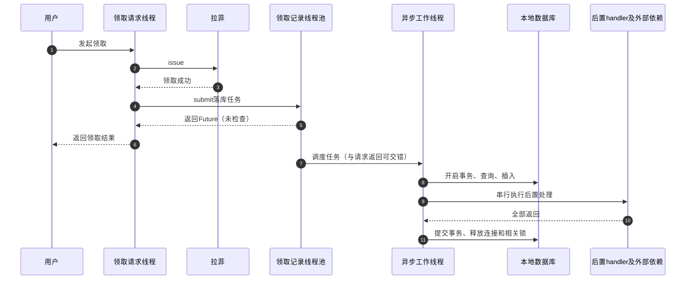
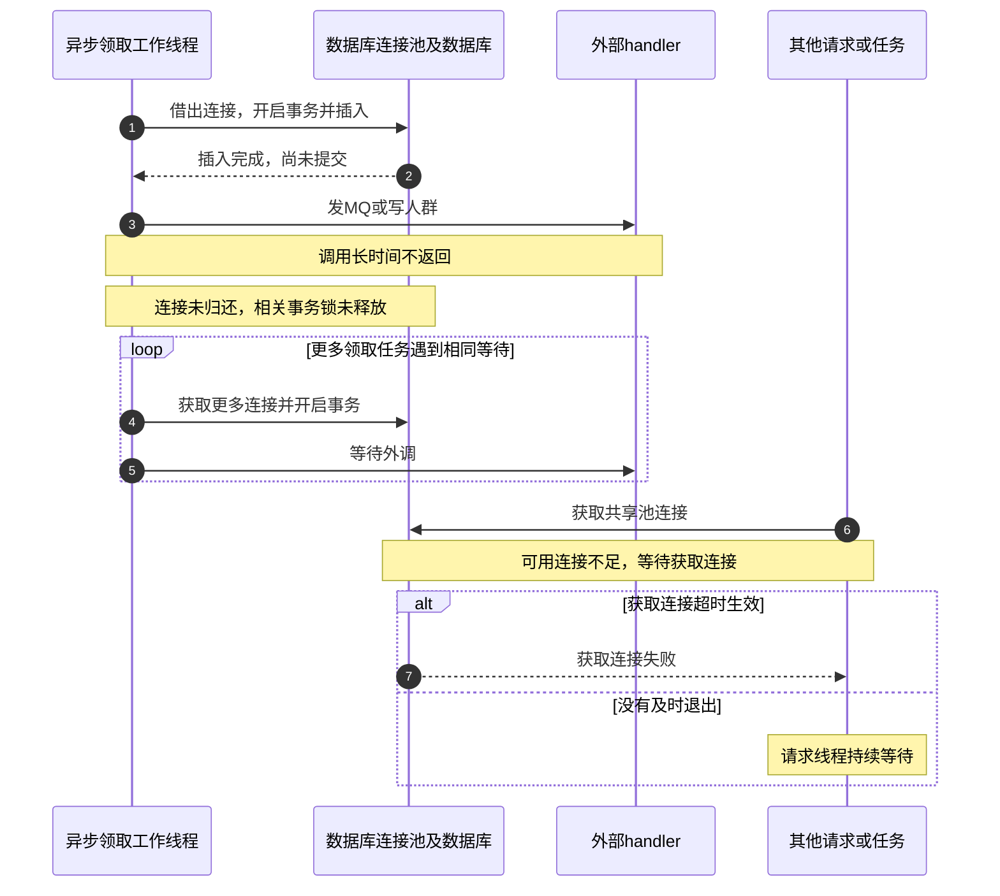
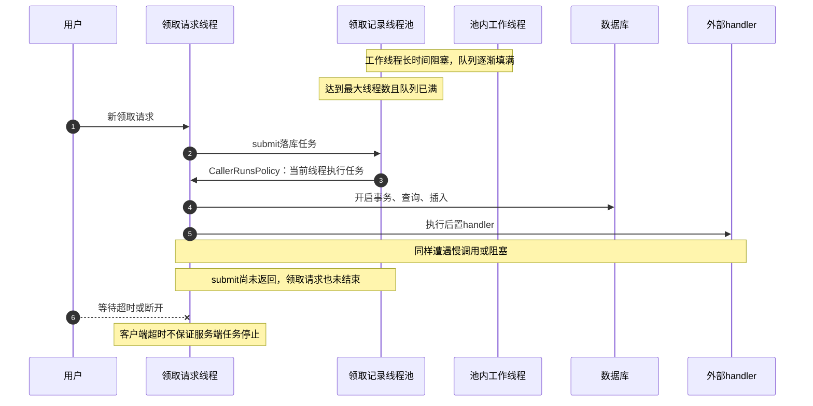
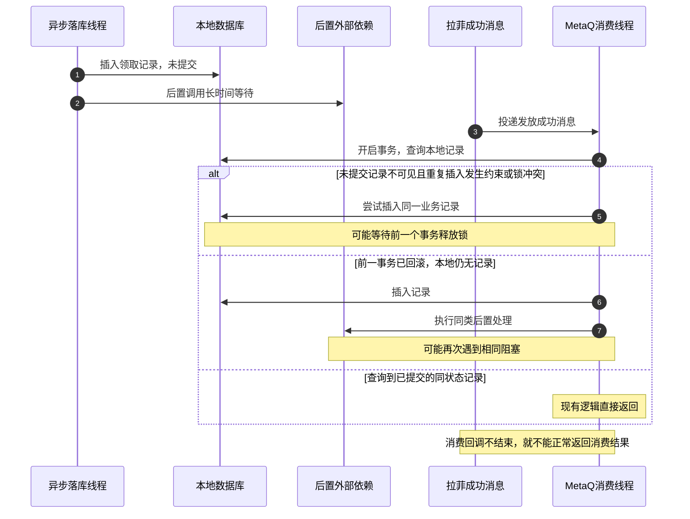
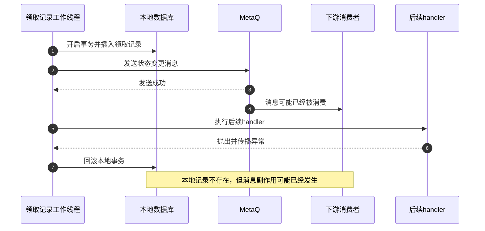

# 异步事务长时间阻塞：从后置处理到系统级故障

> 以 TLens 皮肤领取链路为例，整理异步事务、线程池、数据库连接和消息补偿之间的影响关系。源码复核日期：2026-11-06。文中的故障时序用于说明可能的演进过程，不代表线上已经发生过这些故障；运行时观测与配置推导分别标注。

领取接口把落库任务提交到线程池后就返回，并不意味着落库任务与领取请求、其他数据库操作已经完全隔离。任务仍然占用工作线程、数据库连接及事务相关锁；资源耗尽后，影响可以扩散到请求入口和消息消费。

当前链路最值得关注的是：**数据库事务包含串行的后置 handler，且异步池使用 CallerRunsPolicy。** 前者会让外部调用的等待时间进入事务持有资源的时间，后者会在池饱和时把事务转回提交任务的线程执行。

## 1. 当前代码实际上如何运行

领取成功后，`LatourIssueManager.postHandle` 在 `win=true` 且 `writeIssueRecord=true` 时调用 `asyncSaveIssueRecord`。后者通过 `executorService.submit(...)` 提交任务，没有保存或等待返回的 Future。

任务内部的顺序是：

```text
转换领取结果
  → TransactionTemplate.execute
    → 查询本地记录是否存在
    → 不存在则插入领取记录
    → 按配置顺序执行 VALID 状态的后置 handler
  → 回调返回后，事务提交或回滚
```

`BenefitEventManager` 使用普通 `forEach` 顺序调用 handler，没有在这一层并行或再次异步投递。此前提供的 ipSkin 配置顺序为 `metaq → upgradeSkinCrowd → augeCrowd → birthdaySkin`；具体处理仍取决于当次配置、handler 是否注册及其业务分支，不能把配置项数量直接当作固定外调次数。

已复核的调用包括：

- `metaq` handler 调用 `MsgProducer.sendMessage`，内部执行 `metaProducer.send(message)`，当前线程等待调用返回。包装方法捕获异常并返回 false，handler 再抛出业务异常。
- `augeCrowd` handler 调用 `AugeCrowdFacade.addUserToCrowdWithTtl`；依赖返回失败时，Facade 抛出异常。
- `upgradeSkinCrowd` 会先判断是否为高级皮肤，再按条件写人群；其写人群分支自行捕获异常，因此这部分失败不一定触发外层事务回滚。

**“后置处理在事务里”不代表每个 handler 的失败都会回滚，更不代表 MQ、人群系统加入了本地数据库事务。**

### 正常领取与异步落库



用户拿到领取成功时，本地记录可能尚未提交。拉菲发放与本地事务是两个独立的结果。

## 2. 异常回滚和 hang 是两类问题

“handler 出异常”和“handler 一直不返回”必须分开分析。

| 情况 | 控制流 | 对资源的影响 |
|---|---|---|
| handler 正常返回 | 回调继续，最终提交 | 正常释放事务资源 |
| 异常传播到异步事务回调的 catch | 标记 rollbackOnly，回调返回后回滚 | 回滚完成后释放资源；不会仅因抛异常就永久占住线程 |
| handler 自己捕获异常并返回 | 外层通常继续执行 | 可能提交 DB，但对应后置动作未成功 |
| 外调、锁等待或其他逻辑长时间不返回 | 无法走到提交、回滚与清理 | 工作线程及已获取的连接持续被占用，相关锁可能持续持有 |
| 提交或回滚阶段本身阻塞 | 回调已结束，事务边界未结束 | 仍可能占用工作线程与连接 |

这里的 hang 指任务超过合理业务时限仍未结束，可能最终被某个底层超时解除，也可能没有有效的退出条件。不能仅凭耗时长就认定“永远不返回”。

另外，事务回调内部的 catch 不能覆盖事务开始、最终提交等所有阶段的异常。由 `submit` 执行的任务若向外抛异常，通常会保存在 Future 中；当前代码没有检查 Future，所以提交线程外层的 try-catch 不能据此感知任务最终失败。

## 3. 第一条扩散路径：占住连接，拖慢其他数据库操作

后置外调发生在插入之后。正常情况下，此时已经获取数据库连接，事务尚未提交；插入和其他 SQL 产生的相关锁需要等待事务结束才能释放。

一个事务卡住不等于整套系统立刻不可用。影响范围取决于共享连接池容量、卡住任务数量、锁冲突、流量，以及获取连接和 SQL 等待是否有有效超时。

### 事务等待如何扩散到连接池



此外，即使连接池还有空闲连接，其他事务也可能因为访问同一记录或冲突索引而等待锁。读请求是否受影响，要结合隔离级别、是否锁定读以及 SQL 本身判断，不能说所有查询都会被未提交插入阻塞。

**异步化隔离了正常情况下的执行时间，没有隔离共享数据库资源。**

## 4. 第二条扩散路径：线程池饱和后，领取请求亲自执行事务

领取记录池的源码配置如下，C 表示 JVM 的 `availableProcessors()`：

| 参数 | 配置 |
|---|---|
| 核心线程数 | C + 1 |
| 最大线程数 | 2C |
| 任务队列 | `LinkedBlockingQueue(1024)` |
| 非核心线程空闲回收 | 60 秒 |
| 拒绝策略 | `CallerRunsPolicy` |

普通提交时，核心线程忙后先入队；队列满后，才继续增加非核心线程；达到最大线程数且仍无法入队时触发拒绝策略。60 秒是空闲回收时间，不是事务或任务执行超时。

假设 C=8，池内核心/最大线程数为 9/16。9 个核心线程都阻塞后，新任务可以先积压在 1024 容量的队列中，并不会立刻扩到 16 个线程。队列填满并达到最大线程数后，`CallerRunsPolicy` 会在提交者线程中执行任务。

### 后台阻塞如何传播到请求入口



这解释了为什么“请求不调用 Future.get”仍然可能被异步任务拖住：**等待发生在 submit 内部触发的调用者执行阶段。**

`2C` 也只是池内工作线程上限。多个提交线程都触发 CallerRuns 时，可以同时在池外执行事务，因此不能把它当成这段业务访问数据库的总并发上限。

请求入口若共享 HSF 业务线程池，还可能逐渐影响使用同一个池的其他接口。之前在单台线上机器观测到 HSF 默认业务池 core=50、max=720；这是当时的运行时快照，不能推广为所有机器的固定值，更不意味着 720 个慢事务是可承受的容量。

## 5. 第三条扩散路径：补偿消费者也可能被同一问题拖住

原链路有拉菲成功消息作为本地记录补偿入口，但它不是与主链路完全独立的执行路径。

`LatourBenefitIssueConsumer.doHandleMsg` 在 MetaQ 消费线程中同步开启事务，调用同一个 Repository 的 `saveIssueRecord`。需要插入记录或更新状态时，也可能执行状态变更 handler。

### 主链路和补偿链路共享故障点



具体是否出现重复键锁等待，取决于实际表索引、唯一约束、隔离级别和执行时序，不能仅凭“先查再插”断言。

消费者也可能在开启事务时就因连接池耗尽而等待。消费线程逐渐被占住后，其他消息会排队，消费延迟和积压增加。消息系统具备重试能力，并不等于能够立即释放卡住的消费线程；消费超时也不能直接理解成强制终止 Java 回调。

因此，成功消息可以补偿部分落库失败，但无法单独消除数据库资源耗尽、后置依赖阻塞等共同故障。

## 6. 第四类问题：外部副作用已成功，本地事务却回滚

将 handler 放进事务还有一致性风险，即使所有调用都能及时返回，也可能出现。

### 本地回滚无法撤回已发送的消息



本地 JDBC 事务不能回滚 MetaQ 消息或已完成的人群写入。重试整段事务时，还可能重复发送消息、重复执行后置动作，所以这些动作需要各自的幂等语义。

另一种相反的情况是 handler 吞掉异常，本地事务正常提交，但后置动作未完成。当前补偿路径查到同状态记录时会直接返回，因此“记录已存在”不能代表“所有后置动作已完成”，也不能指望重复成功消息自动补齐每个遗漏动作。

## 7. 为什么不能只看一个 timeout 就判断风险消失

超时需要按等待阶段分别看，不能用某个 SDK 参数推导出整段事务必定在固定时间内结束。

| 超时或配置 | 能约束的对象 | 不能直接保证的事情 |
|---|---|---|
| 数据库连接获取超时 | 等待借出连接 | 已借出连接的事务会按时结束 |
| SQL 执行、数据库锁等待超时 | 特定 SQL 或锁等待 | handler 的 MQ/RPC 等待会退出 |
| JDBC 网络读取超时 | 特定数据库网络读操作 | 所有客户端逻辑与清理阶段都有同一上界 |
| MQ/RPC 调用超时 | SDK 定义的调用等待范围 | 服务端停止执行、所有重试和本地排队都被覆盖 |
| Spring 事务 timeout | 由事务管理器、资源与驱动实现配合约束 | 像看门狗一样中断事务中的任意 Java 代码 |
| Future.get(timeout) | 调用者等待 Future 的时长 | 后台任务自动停止并释放连接 |
| 线程池 keepAliveTime | 空闲线程回收 | 正在执行的任务被终止 |

当前 `VipshopDataSourceConfig` 创建 `TransactionTemplate` 时没有显式设置 timeout。这只能证明该处没有主动设置，不能据此断言所有底层调用都没有超时，也不能凭经验补上线上生效值。

对于串行 handler，总耗时还包括查询、插入、每个 handler 的排队与执行、重试及提交。如果确实要给出整段事务的时间上界，需要确认每段等待都受约束、重试次数有限，并核实其生效范围。`cancel(true)` 和线程中断也依赖任务与 SDK 配合，不能当作安全回滚任意外部操作的工具。

## 8. 如何判断线上到底有没有被卡住

先区分“有潜在风险”和“当前故障正在发生”。之前鹰眼窗口中，领取记录池大量快照位于 `LinkedBlockingQueue.take → ThreadPoolExecutor.getTask`，表示线程在等任务，不能当成正在执行事务时阻塞的证据。

44,334 个快照是多次采样累计，不是队列里有 44,334 个任务。单个线程的 WAITING 状态也不足以判断故障，必须看调用栈和等待对象。

真正排查时，应把以下信号放在一起：

1. **业务池**：activeCount、poolSize、队列长度、最老任务排队时间、完成速率、CallerRuns 次数，以及多次线程栈是否停在同一业务位置。
2. **事务和连接**：活跃/空闲连接、借连接等待、事务持续时间、锁等待、阻塞者，以及提交和回滚耗时。
3. **外部依赖**：MQ 发送耗时与重试、奥格实际调用链、客户端排队、网络等待和生效超时。
4. **入口与补偿**：领取 RT、超时率、HSF 活跃线程、MetaQ 消费线程、消费延迟和重试量。
5. **完成结果**：拉菲已成功但本地记录缺失的数量、后置动作待处理与失败数量，而不仅是“任务提交成功”。

若记录池队列增长但 DB 连接很空闲，问题可能主要在其他执行阶段；若连接已满且事务栈停在外部 handler，才更符合“持有事务资源等待外调”的扩散模型。

## 9. 改造时先缩小事务边界，再设计失败恢复

### 9.1 把网络等待移出数据库事务

本地事务优先只做必要的记录写入和原子状态变更，减少持有连接及锁的时间。MQ、人群等后置动作放到事务结束后执行。

但“提交后直接发消息”仍有进程在提交后崩溃、消息未发出的窗口。若动作必须可靠完成，可以在同一个本地事务里写入领取记录和待处理事件（outbox），再由独立执行器发送、重试和记录完成状态。

Outbox 解决的是**本地记录与后置任务的持久化一致性**，不能单独覆盖“拉菲发放成功，但本地领取记录和 outbox 都还没写入”的窗口。这个窗口仍需要拉菲成功消息、可恢复的领取任务或对账机制来覆盖，具体方案取决于依赖承诺和允许的恢复时限。

### 9.2 必须完成的任务不能依赖内存队列存活

提交到内存线程池不等于持久化成功，进程退出会丢失未完成任务。对于领取记录，应保留可重放的持久化事实来源，并明确积压、失败、重试耗尽后的处理方式。

异步执行器应记录最终成功、失败和耗时。不能只监控 submit 是否抛异常，也不能仅依赖未检查的 Future。

### 9.3 显式选择过载行为

CallerRuns 能形成反压，但会把后台慢操作带回请求线程。是否保留，需要根据入口允许的耗时和资源预算决定，不能把它当作无成本兜底。

若改为拒绝，也必须让拒绝结果可观测，并能通过持久化任务或消息重新处理；对必须完成的 Future 任务，静默丢弃尤其危险，可能让等待者永远等不到完成。

增加线程数和队列长度只能改变故障出现的时点，还可能增加数据库与下游压力。应同时限制数据库事务总并发，纳入 CallerRuns 带来的池外并发。

### 9.4 每个后置动作有独立的完成与幂等语义

应区分“领取记录已持久化”和“后置动作全部完成”。必达动作需要可恢复状态，允许降级的动作应有清晰的失败观测。

消息按至少一次执行设计；幂等键可包含业务领取记录标识、目标状态/版本和动作类型，并配合持久化去重或条件更新。涉及 TTL 人群写入时，还要确认重复调用是否会延长有效期，不能只看最终人群成员相同就判定完全幂等。

## 10. 代码依据与观测边界

本文重新核对了以下本地源码；仓库版本与部署版本可能存在差异。之前的鹰眼和 QoS 结果仅作为当时的单机或时间窗口证据，本文没有重新连接机器或修改任何业务代码、配置。

- [领取后置入口 LatourIssueManager](/Users/qiuhb/Project/tlens/tlens-service/src/main/java/com/taobao/tlens/benefit/receive/manager/LatourIssueManager.java)
- [异步池、事务和记录补偿 BenefitIssueRecordRepository](/Users/qiuhb/Project/tlens/tlens-service/src/main/java/com/taobao/tlens/benefit/receive/repository/BenefitIssueRecordRepository.java)
- [串行 handler 调度 BenefitEventManager](/Users/qiuhb/Project/tlens/tlens-service/src/main/java/com/taobao/tlens/benefit/receive/manager/BenefitEventManager.java)
- [MQ handler](/Users/qiuhb/Project/tlens/tlens-service/src/main/java/com/taobao/tlens/benefit/receive/handler/BenefitEventMessageHandler.java)
- [MQ 发送包装](/Users/qiuhb/Project/tlens/tlens-facility/src/main/java/com/taobao/tlens/metaq/producer/MsgProducer.java)
- [奥格 handler](/Users/qiuhb/Project/tlens/tlens-service/src/main/java/com/taobao/tlens/benefit/receive/handler/BenefitEventAugeCrowdHandler.java)
- [高级皮肤 handler](/Users/qiuhb/Project/tlens/tlens-service/src/main/java/com/taobao/tlens/benefit/receive/handler/UpgradeSkinCrowdEventHandler.java)
- [事务 Bean 配置](/Users/qiuhb/Project/tlens/tlens-dal/src/main/java/com/taobao/tlens/dal/vipshop/config/VipshopDataSourceConfig.java)
- [拉菲成功消息消费者](/Users/qiuhb/Project/tlens/tlens-service/src/main/java/com/taobao/tlens/metaq/LatourBenefitIssueConsumer.java)
- [鹰眼线程诊断](https://eagleeye.alibaba-inc.com/trace?pid=tlens:tlenshost&regionId=cn-hangzhou#/jstackPlus)
